# NOVA

**Nozzle Optimization for Variable Applications**

A repository for the development of the NOVA nozzle design suite.

---

## What NOVA Is

NOVA is a computational toolset for generating and analyzing rocket nozzle geometry programmatically. Rather than drawing contours by hand in CAD, the geometry is defined through mathematical functions and design parameters, giving precise control, reproducibility, and the freedom to explore the design space across a wide range of applications.

## Design Ethos

- Nozzle contours, cooling geometry, and secondary structural features are generated fully programmatically from first-principles physics and a handful of design parameters.
- The suite is built to be adaptable to mission needs rather than to a single fixed design.
- A consistent coordinate convention is enforced across every geometry generator so output aligns cleanly with traditional CAD expectations.
- All internal quantities are in mass-base SI units for consistency and to avoid unit-conversion error. A unit conversion module is shipped with the repo to allow for inputs and outputs to be specified to the user's preference.
- Generated geometry is structured and exported to import directly into standard CAD tools without rework.

---

## Contents

- [NOVA](#nova)
  - [What NOVA Is](#what-nova-is)
  - [Design Ethos](#design-ethos)
  - [Contents](#contents)
  - [Download: the desktop app](#download-the-desktop-app)
  - [Installation](#installation)
  - [Quickstart: API](#quickstart-api)
  - [Quickstart: GUI](#quickstart-gui)
    - [Design](#design)
    - [Generate](#generate)
    - [View](#view)
    - [Analyze](#analyze)
    - [Export](#export)
    - [Light mode](#light-mode)
  - [Configuration reference](#configuration-reference)
    - [Contour definition](#contour-definition)
    - [Combustion](#combustion)
    - [Regenerative cooling jacket](#regenerative-cooling-jacket)
    - [Film cooling](#film-cooling)
    - [Radiative extension](#radiative-extension)
    - [Volutes](#volutes)
    - [Program options](#program-options)
  - [Outputs](#outputs)
  - [Worked example: LOX/LH2 upper-stage nozzle](#worked-example-loxlh2-upper-stage-nozzle)
    - [Inputs](#inputs)
    - [Combustion results](#combustion-results)
    - [Sizing results](#sizing-results)
    - [Generated geometry](#generated-geometry)
    - [Contour families and verification](#contour-families-and-verification)
    - [Plume](#plume)
    - [Materials](#materials)
  - [Module layout](#module-layout)
  - [Testing](#testing)
  - [Theory](#theory)

---

## Download: the desktop app

Windows users who want the GUI alone can run it without Python. Each [release](https://github.com/sean-bowman/NOVA/releases) carries `NOVA-<version>-win64.zip`: unzip it and run `NOVA\NOVA.exe`. Releases are not code-signed, so the first launch may show "Windows protected your PC"; **More info**, then **Run anyway**, starts it. The [GUI quickstart](#quickstart-gui) describes the window, and `README.txt` in the folder says where the app keeps its runs, exports and log. [docs/releasing.md](docs/releasing.md) covers how a release is built.

## Installation

NOVA targets **Python 3.10 or later** on Windows. `pyproject.toml` pins the floor at 3.10 for its `match` statements and `X | Y` union syntax.

Run from the repository root, where `pyproject.toml` lives:

```bash
pip install -e .
```

That installs the dependencies and puts `NOVA` on the import path, so `from NOVA import Nozzle` resolves from any working directory. The package itself lives in `src/NOVA/`.

Combustion thermochemistry comes from NASA CEA through [`rocketcea`](https://rocketcea.readthedocs.io/), which ships a prebuilt `cp<pyversion>-win_amd64` wheel. **No Fortran compiler is required.**

Fluid properties dispatch to REFPROP first and fall back to CoolProp if the user does not have REFPROP. CoolProp alone is sufficient and is packaged as a repo dependency so NOVA will run fully after the above pip install command.

## Quickstart: API

An API interface for NOVA is exposed for users familiar with programming. The repo ships with an example result that can be generated by calling the main pipeline wrapper with no arguments, or a user can create their own config and pass that instead:

```python
from NOVA import Nozzle

myNozzle = Nozzle()
myNozzle.generateNozzle()                       # uses assets/NOVANozzle.json
myNozzle.generateNozzle(configPath = 'myCase.json')   # or point at your own
```

To run the worked example below from a shell:

```bash
python -c "from NOVA import Nozzle; Nozzle().generateNozzle()"
```

The physics solvers used in the NOVA backend are importable on their own without needing to instantiate a `Nozzle` object:

```python
from NOVA import machFromAreaRatio, wallMaterialCurves
from NOVA import gasDynamics, materials, fluidProps
```

`generateNozzle()` runs the full pipeline: diverging contour, converging section, regen truncation, cooling channels and volutes when enabled, heat transfer, then plotting and export. Output is written to `runs/<filename>Outputs/` at the repository root, where `<filename>` can be specified in the config.

`assets/NOVANozzle.json` is the example configuration the repository ships. It is runnable as it stands, and it is what `generateNozzle()` reads when no path is given. Users can copy it as a starting point for a case of their own. `assets/examples/` holds five more complete configurations, one engine for each cooling architecture and the extension films: the same engine on a single pass with a radiation-cooled extension, a methalox first stage, and engines in the arrangement of the F-1, the Vulcain 2 and the SSME. [Regen Cooling Architectures](docs/regenCoolingArchitectures.md) lists what each one shows, and [featureShowcase/buildCoolingShowcase.py](featureShowcase/buildCoolingShowcase.py) solves and draws them all.

## Quickstart: GUI

[novaGui/](novaGui/) is the front end: a React app served by a FastAPI layer over the same pipeline, in a desktop window. It builds a configuration in the `NOVANozzle.json` schema, runs `generateNozzle()` in a worker process that Cancel can stop, and shows the result beside the form. It needs the `web` extra; the built app ships with the repository, so running it takes no Node:

```bash
pip install -e .[web]
nova-gui                        # desktop window, no console
python -m novaGui               # the same window, from a console
python -m novaGui --browser     # the system browser instead
```

The install writes the `nova-gui` launcher (`nova-gui.exe` on Windows) into the environment's `Scripts` or `bin` folder. It starts from any folder, and with no console it writes startup output to `%TEMP%\NOVA\novaGui.log`. The log's first line, and the About dialog, name what runs: NOVA's version, the checkout's revision and whether it has uncommitted changes, and the Python and system under it. The install has to be editable: the GUI reads the checkout's `docs/` and `src/NOVA/assets/` and exports to its `runs/` folder.

### Design

The window holds the Design form on the left and the result pane on the right, with a splitter between them that sets the form's width. The form opens on the shipped nozzle, the [worked example](#worked-example-loxlh2-upper-stage-nozzle) below. Each section leads with the fields a design is made from and folds the rest into **Advanced settings**, which hold the shipped nozzle's values until changed; each volute has a fold of its own. Alternative inputs share a selector row: L* or chamber barrel length, thrust or engine mass flow, expansion ratio or exit pressure, and where the regen jacket is truncated. Dependent fields stay hidden until they apply, every dimensioned field carries a unit dropdown that converts in place, and the selected wall alloy's sampled properties show beneath it. A search box finds a field by its label, key, help or options, and **Changed only** shows the fields that differ from the shipped nozzle. An outline of the sections runs above the form, or down its side when the form is dragged wide: each entry counts its section's changed fields and problems, marks the section in view, and jumps to it. Problems across fields list above the form and are written under the rows they name. **Load config** in the header opens a JSON file, **Save config** writes one, **Reset to example** returns to the shipped nozzle, and **Load example** offers the engines in `assets/examples/`.

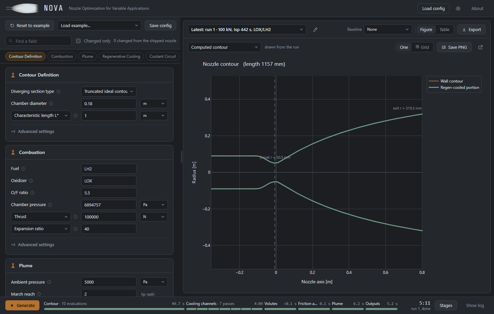

The Coolant Circuit section picks the architecture, and a note beneath the choice says what that circuit does, where it is viable and which engines flew it; the extension circuit's outlet carries the same.

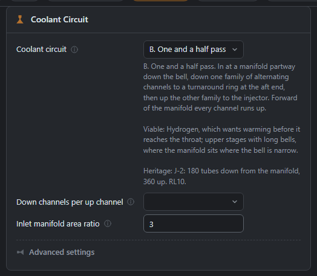

Every field carries an (i) marker. Hovering it gives the field's meaning.

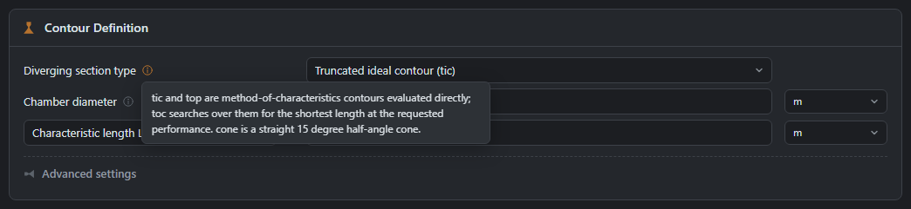

### Generate

**Generate** in the run bar, or Ctrl+R, runs the form through `generateNozzle()`, and **Cancel** stops it. During a run Generate becomes **Queue**: the form joins the queue and runs when the runs before it end, so several designs can be lined up and left to run. The run bar steps through the run's stages from its progress events: one segment per stage, as wide as the time that stage took on the last run, each naming what its stage is doing, the contour solve's evaluation or the coolant circuit's pass. **Stages** lists every stage and the stages inside it with their times, and the coolant circuit's passes with each leg's outlet temperature and the up leg's change, so the circuit can be watched settling. While a multi-pass circuit iterates, the **Circuit iterations** view draws each pass as it ends: both legs' hot wall and coolant along the wall, the latest solid and the earlier ones fading, so where along the wall the circuit is still moving reads off the axis. The finished run keeps every pass, so the view stays after it. **Show log** opens the run's full output above the bar. The shipped nozzle builds a one-and-a-half-pass jacket to the exit, its outlet volute and the marched plume, and takes a little over a minute.

When the contour stage ends, about 45 s in, the result pane draws the new run's contour, near-wall state and flow fields while cooling and the plume still run; the rest of its views, its table and its outputs follow when it finishes. The warnings a run raises are counted in the run bar, which opens the log on a click, and listed under the pane's header for whichever run it shows. A strip under the pane's header says which run the pane shows, and once the form is edited, it names each field that differs from the config that run ran, with its value then and now.

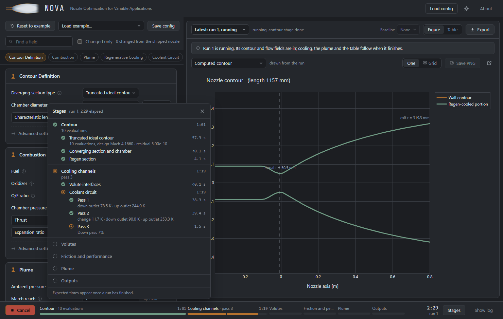

### View

The result pane draws a figure picked from a menu of contour, flow, plume, cooling and 3D views, in plotly, to zoom, rotate and read values off. **Save PNG** saves the view's Matplotlib drawing, the picture NOVA's saved figures use, at the pane's size.

The flow fields run from the injector face to the exit plane: the one-dimensional answer upstream of the throat, where no characteristic is solved, and the characteristic mesh from the throat to the exit of the wall that is built, with the seam between them marked. The field is shaded on a grid interpolated from the solved nodes; **Solution nodes** in the legend shows the nodes themselves, and hovering one reads the value the solve produced there.

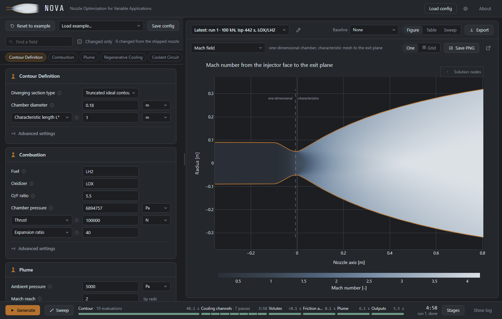

The plume view draws the nozzle and its plume as one Mach field: the chamber, the characteristic mesh and the station march past the lip, inside the wall and the solved plume boundary. It opens on the nozzle and the marched plume; zooming out shows the correlated shock cells past the march.

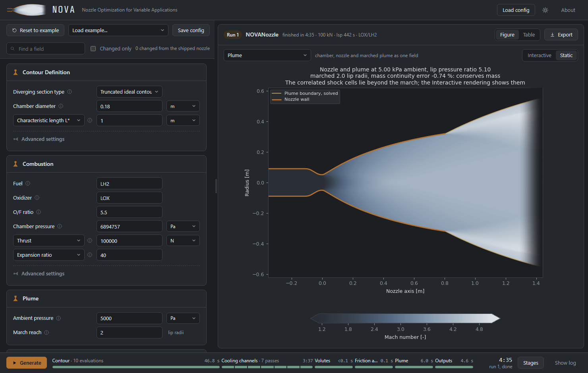

The cooling views draw everything the jacket solve computes along the channel: the jacket on the wall with the hot wall and the coolant colored by temperature, the wall against its limit and the gas driving it, the coolant's pressure, velocity and Mach number, its density, viscosity and specific heat, and the heat flux with both film coefficients and the Reynolds and Nusselt numbers.

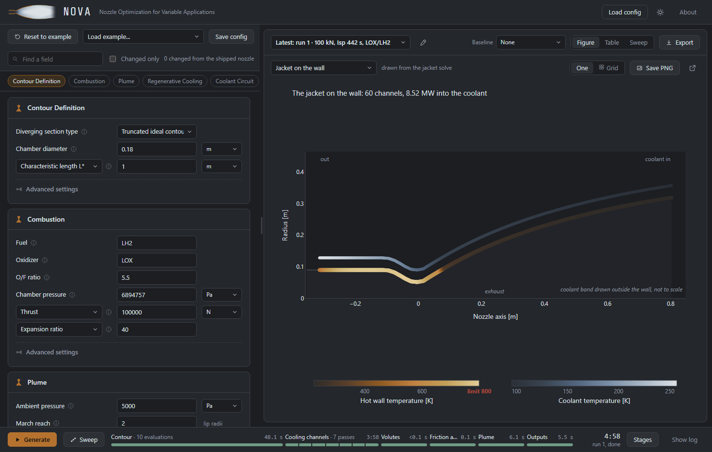

With film cooling on, the film view maps the film along the wall; with a radiative extension, the extension view draws the whole wall on one temperature scale against the shell's limit.

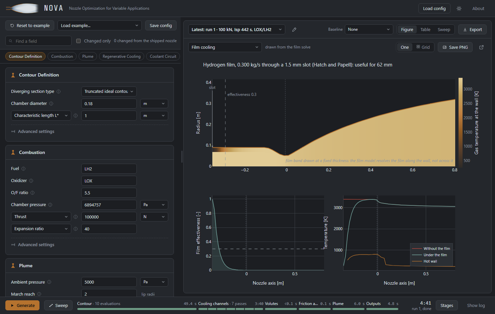

The circuit view draws the coolant's paths on the half section, and with two passes or an extension circuit, the passes view draws each one's coolant and hot wall.

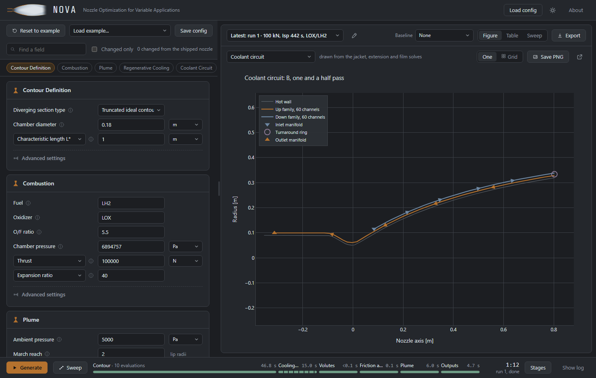

Circuit iterations draws every pass of a multi-pass circuit's outer iteration. On the shipped nozzle the jacket settles in seven passes: the up leg's coolant rises toward its final profile, its largest change falling from 12 K at the second pass by about a factor of three a pass.

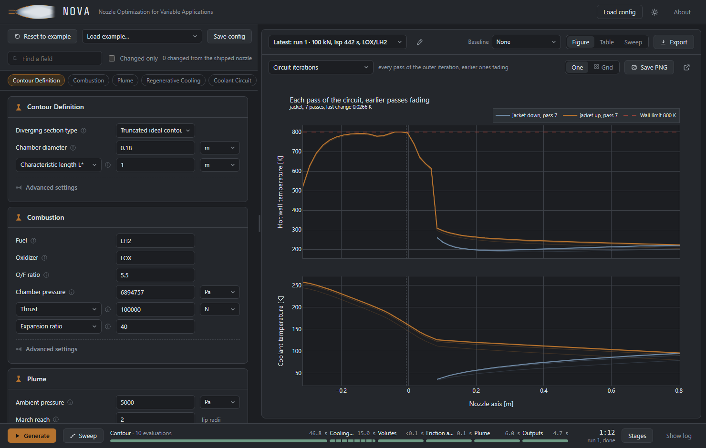

The channel mesh, the revolved contour and the volutes are 3D views at full resolution.

| Channel mesh | Revolved contour |
| --- | --- |
| 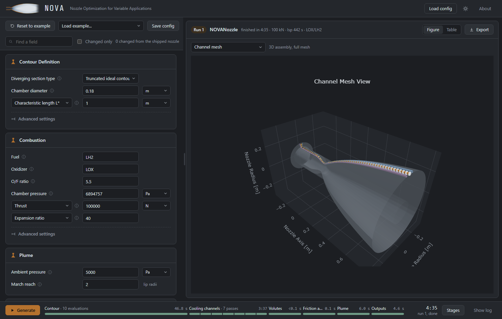 | 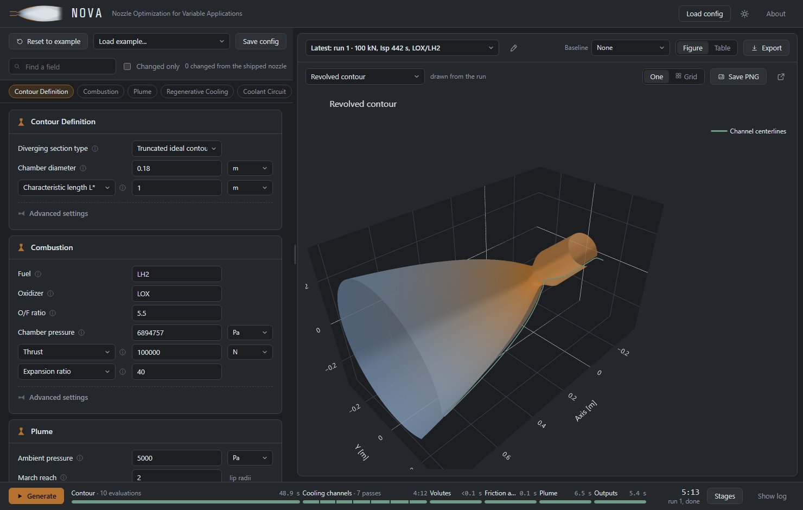 |

**Grid** draws four views at once, and the views drawn along the nozzle axis share one cursor and one zoom: the mouse over any of them marks the same station on all, the contour, near-wall and cooling plots read their values there, and a zoom along the axis on one zooms the rest. The wall temperature, the heat flux and the coolant state at the throat read off in one look. The pop-out button opens the figure or the grid in a window of its own, for a second monitor, which follows the latest run.

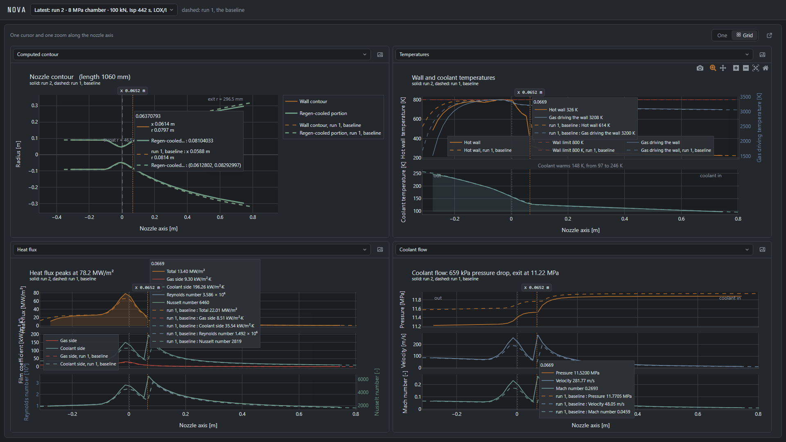

### Runs and the baseline

Finished runs are saved, so they are still there the next time the GUI opens, and each keeps its number. The run menu at the left of the pane's header shows any of them, by number, name, thrust, Isp and run time; it follows the latest run until another is picked, and Generate sets it back to following. **Baseline** picks the run the shown one is compared against. The line plots draw the baseline dashed under the shown run, in the same colors, and a second strip names the fields that differ between the two configs.

The pencil beside the run menu opens the shown run's details: a name, which the run menu shows in place of the config's filename, a free-text note, the baseline, **Edit from this run**, and **Delete run**. Edit from this run puts the config that run ran back into the Design form, so iterating from an earlier design takes one click; when the form differs from the run shown, the strip under the header that names the changed fields offers the same button. Named runs, a sweep's runs and the baseline are kept however many runs follow; unnamed runs go oldest first past 24 of them or 2 GB in all. The runs are saved under `%LOCALAPPDATA%\NOVA\runs` (`~/.local/share/NOVA/runs` elsewhere), or the folder `NOVA_RUN_STORE` names.

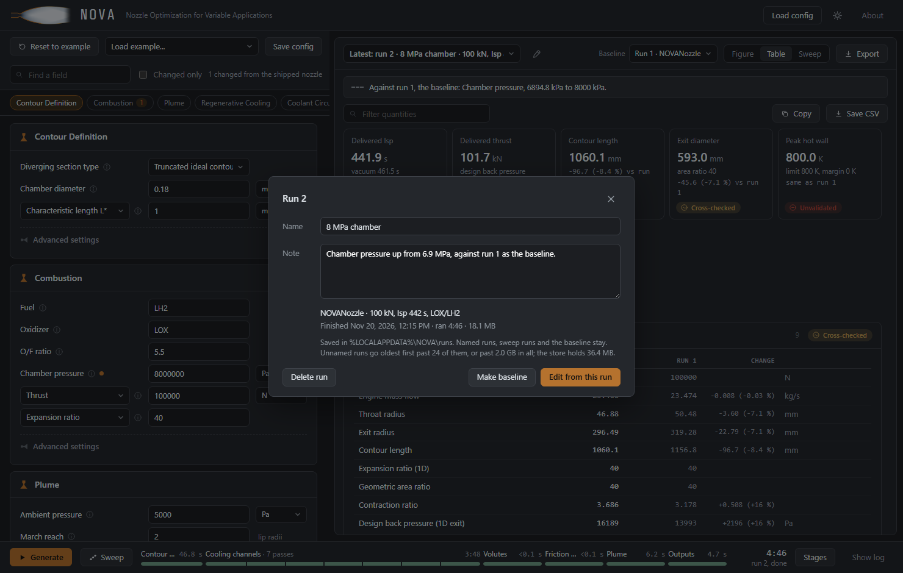

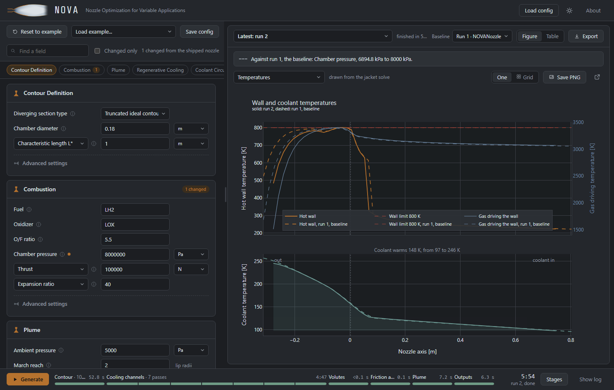

### Table

**Table** in the result pane's header swaps the figure for the numbers behind it, in one table: sizing, the combustion chamber, delivered performance beside the 1D estimates, CEA thermochemistry at the chamber and throat, the cooling summary and each coolant pass, and the plume's lip pressure ratio, march reach and mass continuity error. The numbers a design is judged by first head it: delivered Isp and thrust, contour length, exit diameter, the peak hot wall against its limit, and each pass's pressure drop. A row or a headline number that a figure shows opens that figure. The table filters by name, copies as tab-separated text and saves as CSV.

Each headline number and section carries a badge saying how far it can be trusted: Validated, Calibrated, Compared, Cross-checked or Unvalidated, or By construction for geometry and accounting. A number reads as the weakest status among the models behind it, as the run used them: the gas-side model it selected, the multi-pass circuit and the chamber film only where it has them. A click on the badge lists those models, each with the reference it was put against and the result in numbers, and shows the passage of the validation record its status stands on. The statuses are summarized in [docs/validationStatus.md](docs/validationStatus.md).

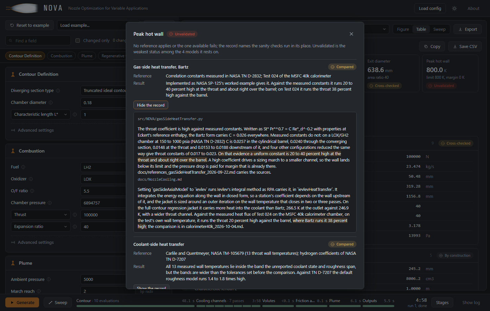

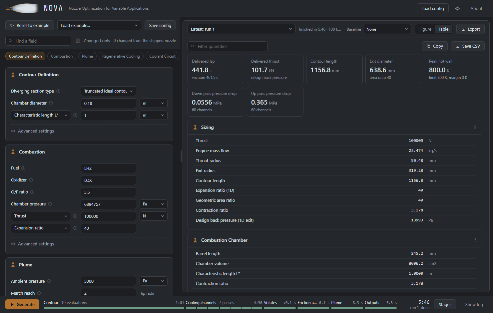

Beside a baseline, each value carries the baseline's value and the change from it, the shown run minus the baseline, with the percent change; a value that did not move reads blank.

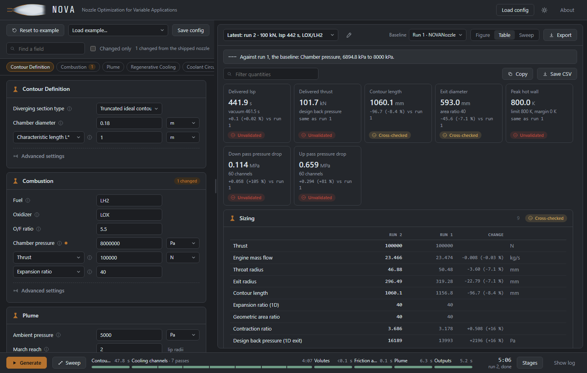

### Trade sweeps

**Sweep** in the run bar queues one run per value of a field: chamber pressure from 6 to 8 MPa in three values, or a list, in the unit picked beside it, or the options of a choice or a switch. A second field makes a grid, every value of the first against each of the second. The dialog counts the runs and estimates their time and size from the latest run's. The runs go one at a time; the run bar counts the ones queued, the queue takes any of them out before it starts, and Cancel stops the run alone or the queue with it. A point whose run fails keeps its reason and the sweep goes on.

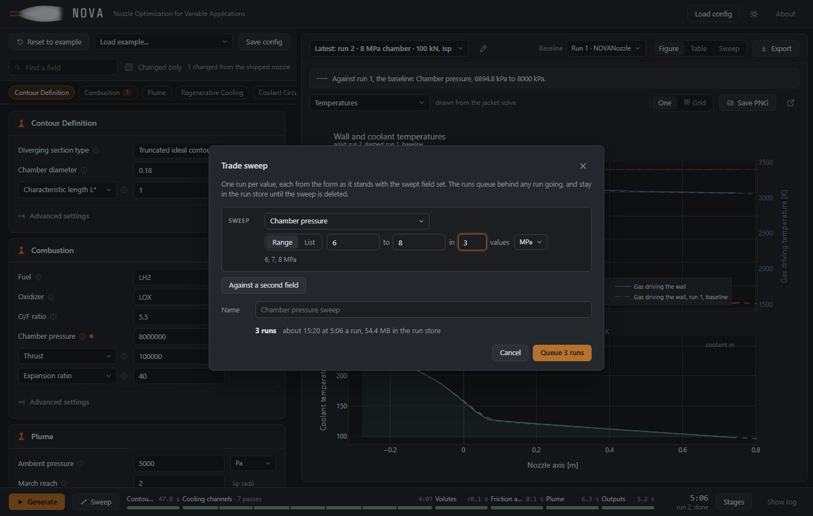

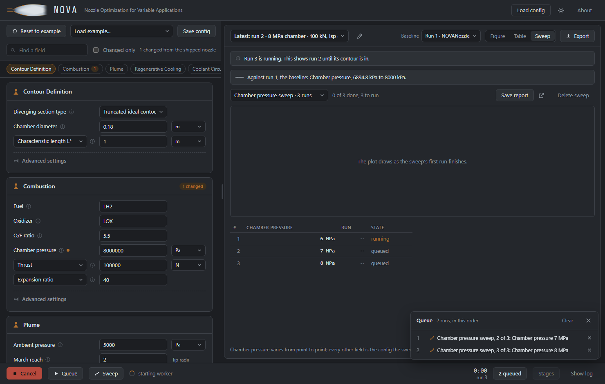

The result pane's **Sweep** view plots any headline number against the swept field, one line per value of a second field, and tabulates the points: the swept values, the run, its state and the run's headline numbers, each column with its validation status. A click on a row or a point shows that run. A sweep's runs are grouped under its name in the run menu and kept until the sweep is deleted, and a sweep whose window closed before it finished can run the rest.

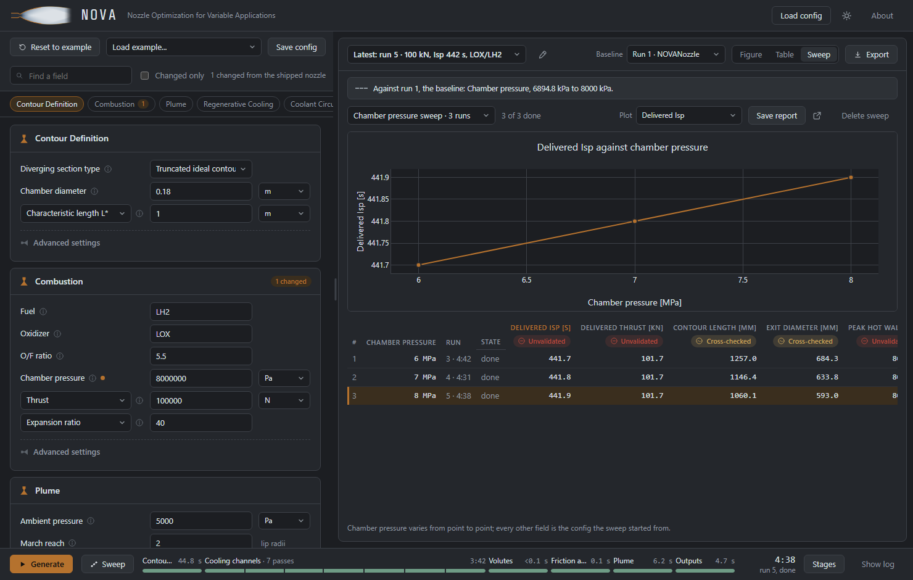

### Export

A run writes its outputs into its own folder in the run store, not to the output folder. **Export** in the result pane's header opens a dialog that lists the shown run's outputs by category, each with a check: figures, interactive HTML, contour coordinates, STL geometry, the channel size profile, the pickled `Nozzle` and the run configuration. The figures carry thumbnails, and the eye on a row previews the file beside the list: an image as itself, an STL surface in the 3D viewer, a text or JSON file as its first lines. **Export** copies the checked files to `<output folder>/<output name>Outputs/`.

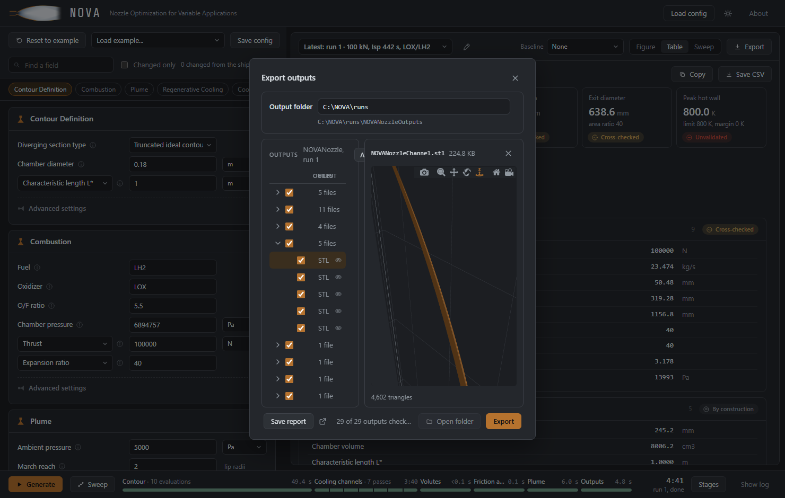

### Reports

**Save report** in the Export dialog writes the shown run's report as one HTML file, against the baseline when one is chosen, and **Save report** in the Sweep view writes the sweep's; the button beside each opens it in a window. A run's report carries the headline numbers with their validation status, the inputs that differ from the shipped nozzle, the whole result table, the contour, near-wall, jacket temperature and plume figures, the run's warnings, a validation section for every model behind its numbers, and the config to rerun it. A sweep's report carries the swept fields, each headline number plotted against them and its range, and the table of points. The file opens offline, names no folder on the machine that wrote it, and prints as a light page.

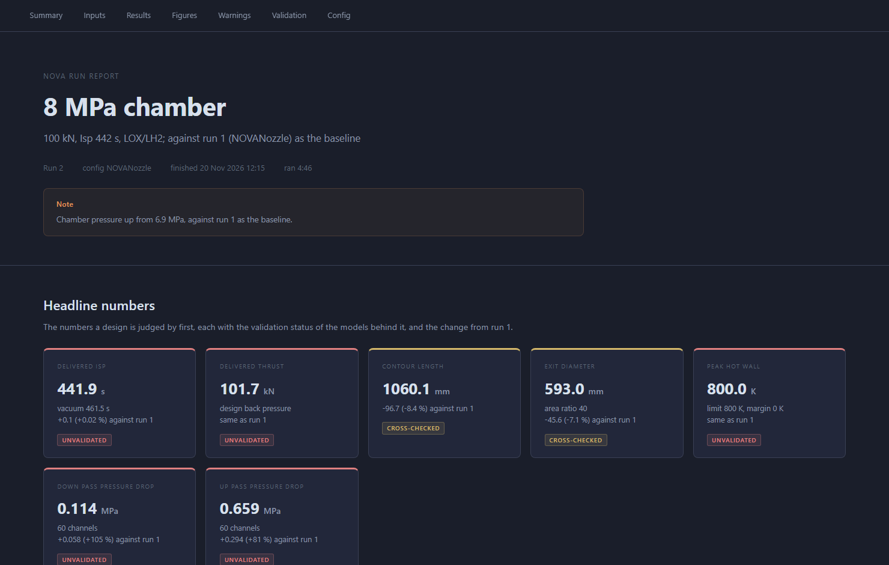

### Light mode

The sun and moon button in the header switches between the dark and light modes of the Engineering Flat Metal palette, and the choice persists between sessions with the form's width.

| Design | Plume |
| --- | --- |
| 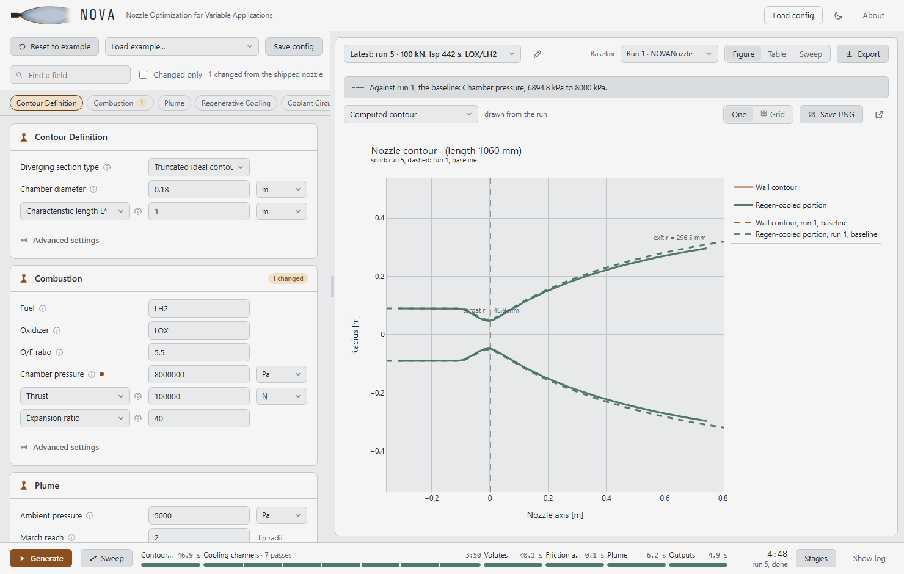 | 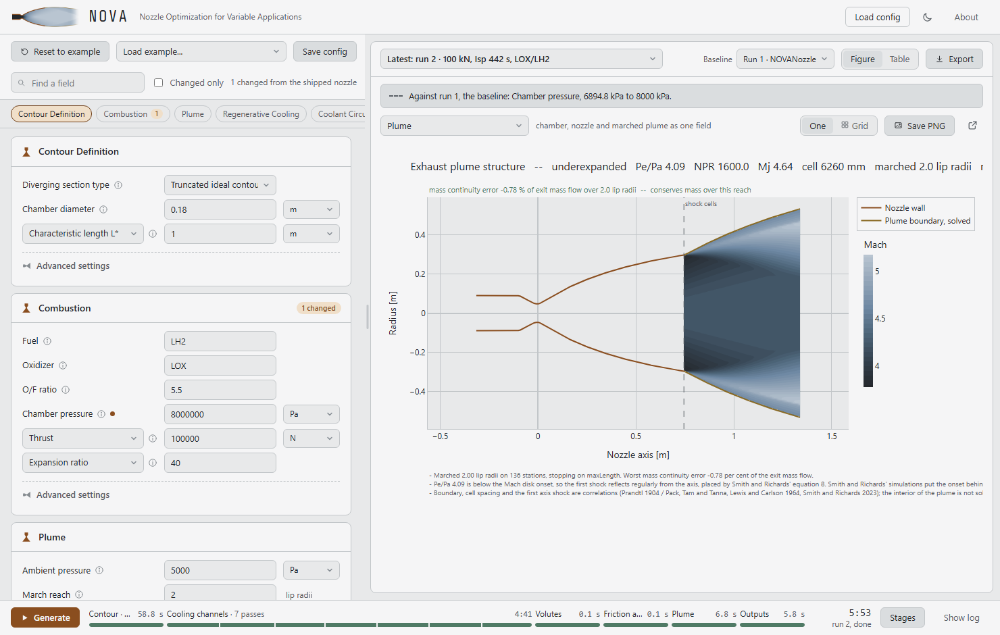 |

[novaGui/README.md](novaGui/README.md) covers the architecture, the run pipeline, the progress model, the views and the modules the package holds, and [docs/guiRoadmap.md](docs/guiRoadmap.md) lists the GUI work still open.

## Configuration reference

Grouped by section, matching the order in the config file.

### Contour definition

| Field                                    | Unit  | Meaning                                                                                                                                                        |
| ----------------------------------------- | ----- | --------------------------------------------------------------------------------------------------------------------------------------------------------------- |
| `numContourPoints`                      | --    | Points in the resampled contour                                                                                                                                |
| `chamberDiameter`                       | m     | Chamber diameter at the converging inlet. Sets the contraction ratio                                                                                     |
| `convergingSectionAngle`                | deg   | Converging wall angle at the throat                                                                                                                            |
| `Lstar`                                  | m     | Characteristic length Vc/At. Sizes the cylindrical chamber barrel after the converging-section volume is subtracted. Mutually exclusive with`chamberLength`  |
| `chamberLength`                         | m     | Cylindrical chamber barrel length, given directly instead of through`Lstar`. Leave both `null` for no chamber                                              |
| `divergingSectionType`                  | --    | `tic` (truncated ideal contour), `top` (thrust-optimized parabola), `toc` (thrust-optimized contour, searched) or `cone` (15 degree half angle) |
| `lengthFraction`                        | --    | Truncated ideal contour length as a fraction of the equivalent 15 degree cone. NASA SP-8120's percent bell                                                     |
| `expansionRatio`                        | --    | Geometric area ratio the wall is cut at. Mutually exclusive with`targetExitPressure`                                                                          |
| `targetExitPressure`                    | Pa    | Design exit static pressure. Mutually exclusive with`expansionRatio`: resolved to an equivalent area ratio through CEA before the wall is cut, and delivered the same way                        |
| `regenTruncationType`                   | --    | `none`, `temp` or `er`: where the regen-cooled section ends, by near-wall gas temperature or by area ratio                                              |
| `regenTruncationValue`                  | K or -- | Ignored when`regenTruncationType` is `none`. A near-wall recovery temperature [K] for `temp`, a local area ratio [-] for `er`                                |
| `numCharacteristics`                    | --    | Characteristics launched from the throat arc, setting the mesh resolution of the whole solve                                                                  |
| `transonicModel`                        | --    | `sauer` (default), `secondOrder` or `smallRadius`: which starting line the characteristics net is launched from                                          |
| `nearWallStateModel`                    | --    | `oneDimensional` (default) or `transonic`: where the converging near-wall state comes from. `transonic` carries the starting line's transonic solution over the entrant arc, so the wall goes sonic ahead of the throat |
| `throatInletCurvature`                  | --    | Throat inlet arc radius, as a multiple of the throat radius. SP-8120 requires above 0.6                                                                        |
| `throatOutletCurvature`                 | --    | Throat outlet arc radius, as a multiple of the throat radius. 0.382 is Rao's own value                                                                         |
| `divergingSectionDesignVariables`       | deg, deg, --, -- | Pins a`toc` wall instead of searching for one: inflection angle, exit angle, inflection tension, exit tension. `null` searches                     |
| `gammaModel`                            | --    | `chamber` (default) or `effective`: which ratio of specific heats the constant-gamma contour solve runs in                                             |

`L*` is measured over the whole chamber volume, so the converging cone counts toward it and the barrel takes up the remainder. Chamber length, volume, delivered L* and contraction ratio are reported in the GUI's results table.

### Combustion

| Field                                                      | Unit | Meaning                                                                                                                            |
| ---------------------------------------------------------- | ---- | ---------------------------------------------------------------------------------------------------------------------------------- |
| `Fuel`, `Oxidizer`                                     | --   | Propellant names; see the[CEA interface docs](docs/ceaInterface.md#propellant-names)                                                |
| `OFRatio`                                                | --   | Mixture ratio, or`"maxisp"` to optimize                                                                                          |
| `chamberPressure`                                        | Pa   |                                                                                                                                    |
| `fuelInitialTemperature`, `oxidizerInitialTemperature` | K    |                                                                                                                                    |
| `thrust`                                                 | N    | Mutually exclusive with`engineMassFlow`                                                                                          |
| `engineMassFlow`                                         | kg/s | Mutually exclusive with`thrust`                                                                                                  |
| `expansionRatio`                                         | --   | Mutually exclusive with`targetExitPressure`                                                                                      |
| `targetExitPressure`                                     | Pa   | Mutually exclusive with`expansionRatio`                                                                                          |
| `plumeAmbientPressure`                                   | Pa   | Ambient the exhaust plume is drawn against. Sets the jet regime, shock cell spacing and Mach disk. Leave`null` to skip the plume |
| `plumeFieldReach`                                        | --   | Lip radii past the exit plane the station march carries the plume boundary and interior. Mass continuity holds within 1 % to about 2 lip radii; `null` skips the march and keeps the correlations |

### Regenerative cooling jacket

Coolant enters through the inlet volute at the aft end of the regen nozzle, runs forward against the exhaust, and leaves through the outlet volute at the injector face; at each end a flare turns the channels off the wall into the volute to allow for variable radial volute placement for wall thickness tailoring. The scroll area is linear in wrap angle. A `cutwater` scroll runs from the tongue at one end of the wrap to the throat at the other and stops short of a full turn by the angle its tongue wall occupies. A `ring` wraps the full turn, is fed from both directions at once, and puts the tongue half a turn from the throat, so each half serves half the ports and the two ends of the sweep match.

Gas-side heat transfer is Bartz by default with a single correlation constant along the whole wall. Measured constants vary with station: on a LOX/GH2 chamber at 150 to 1000 psia they run 0.0257 in the barrel against 0.0148 at the throat (NASA TN D-2832), so that default is about right over the barrel and 20 to 40 percent high at the throat, which buys wall margin and charges pressure drop for it. Setting `gasSideAxialModel` to `measured` takes the axial shape from those constants instead, normalized on the barrel so Bartz keeps the absolute level: unity over the barrel and 0.59 at the throat. The correlation and both options live in [src/NOVA/gasSideHeatTransfer.py](src/NOVA/gasSideHeatTransfer.py), which the ablative liner and the radiative extension read as well, and the sources are in [docs/references_gasSideHeatTransfer_2026-09-22.md](docs/references_gasSideHeatTransfer_2026-09-22.md). Setting it to `ievlev` runs Ievlev's integral method as RPA carries it ([src/NOVA/ievlevHeatTransfer.py](src/NOVA/ievlevHeatTransfer.py)); it depends on the wall upstream of each station, so the jacket is sized around an outer iteration on the wall temperature, two or three passes. How each gas side compares against the measured heat flux of the MSFC 40k calorimeter chamber is in [docs/reports/calorimeter40k_2026-10-04.md](docs/reports/calorimeter40k_2026-10-04.md).

Three channel families are built, one per run:

| `channelType` | Section | Held | Sized | Derived |
|---|---|---|---|---|
| `circle` | Circle | Rib | Radius | Wrap angle |
| `rectangular` | Rounded rectangle, depth along the wall normal | Rib, and the channels run straight | Depth | Width, which fills the pitch at the cold wall less the rib, and aspect ratio |
| `helical` | Rounded rectangle on a helix of `nChannel` starts | Helix angle and aspect ratio | Width | Rib, which varies along the nozzle |

`channelRadius` references both a circle's radius and half a rectangle's depth for consistency in the backend variables. At each station it is converged to be the largest channel that holds the wall at `maxWallTemperature`, within the limits of each family. Spirally fluted channels are kept in [experimental/flutedChannels.py](experimental/flutedChannels.py).

A channel may not exceed the largest that fits between its neighbors, may not reach past `maxChannelDepth` out from the wall, and may not fall below `minChannelRadius`. Coolant outlet properties are checked against `minCoolantExitPressure` and `minCoolantExitTemperature`, and the coolant along the whole jacket against `maxCoolantTemperature` and `maxColdWallTemperature`.

The size is arrived at one of two ways, set by `channelSizingMode`. `thermal`: each station converges its own size, at about seven passes of the thermal model per station. `manual` reads the size off `manualChannelProfile` and marches each station once, so the wall temperature, the pressure drop and the coolant exit state come out as results rather than targets.

A profile is a half-extent in meters for a constant channel, or a list of `[key, half-extent]` control points, linear in the key between them and flat outside them. `manualChannelProfileKey` names the key: `areaRatio` is the local area ratio signed negative upstream of the throat, so a 3.2 contraction ratio chamber reads -3.2, the throat is -1 on the converging side and +1 on the diverging side, and no station sits between the two. `jacketFraction` is the meridional distance along the jacket from the injector face, 0 to 1, which is the key a recorded profile is written in because the area ratio holds one value along a constant radius barrel. A station whose requested size will not fit between its neighbors, or falls below the process minimum, stops the run and names the station and the bound; a channel count too high for its throat stops it too, where the search reduces the count instead.

Every run prints the profile it built and writes it to `<name>ChannelProfile.json` beside the exported geometry. A configuration may name that file as its `manualChannelProfile` instead of listing points.

What a rough wall may do to the coolant-side heat transfer is set by `coolantRoughnessModel`: Carlile's wall temperatures want more coolant-side heat transfer than a smooth-wall correlation gives, and the hydrogen coefficients of NASA TN D-7207 want less. The default is the bounded middle, Dipprey and Sabersky's measured rough-wall heat transfer.

**No wall-to-bulk property ratio correction is applied, and that is a measured choice.** Taylor's correction (NASA TN D-4332) is implemented behind `coolantPropertyCorrection` and defaults to off. Switching it on puts 0 of Carlile and Quentmeyer's 13 measured throat wall temperatures inside the predicted band where leaving it off puts 13 of 13, and moves the mean signed error from +18.8 K to +479.5 K. Taylor is fitted on symmetrically heated tubes, where the surface sits at one temperature all the way around; a cooling channel heated hard on one face and cool on the other three is not that geometry, and handing the correlation the hot-face temperature over-applies it. The option is kept so the comparison can be re-run.

A thermal barrier coating is a second shell inside the metal one, set by `thermalBarrierThickness` and `thermalBarrierConductivity`. It raises its own gas-side surface temperature and lowers the metal behind it, which is the point of fitting one, so `maxWallTemperature` applies to the metal rather than to the ceramic.

Every run marches a turbulent boundary layer along the finished wall and prices the drag it costs, reporting `frictionLossCoefficient` and a corrected thrust coefficient. The march starts at the injector face, so the layer arriving at the throat carries the chamber's history, but only the diverging section's drag is charged against exit thrust: friction on the subsonic wall is a chamber momentum loss and is reported separately as `chamberDragForce`. On the reference nozzle the debit is 1.72 percent of the thrust at the design back pressure, from 1730 N over the bell against 211 N over the chamber; the bell's wall temperature is the jacket's over the cooled section and the extension's solved shell temperature beyond it. The displacement thickness is reported and **not** applied to the wall: offsetting the contour by it is SP-8120's reference practice and would move every contour the tool produces.

| Field                                       | Unit | Meaning                                                                                            |
| --------------------------------------------- | ---- | ----------------------------------------------------------------------------------------------------- |
| `makeCoolingChannels`                       | --   | Build the jacket and run the heat transfer model                                                   |
| `material`                                  | --   | Wall alloy; see the material table below                                                            |
| `channelType`                               | --   | `circle`, `rectangular` or `helical`                                                               |
| `channelSizingMode`                         | --   | `thermal` converges each station's channel size against `maxWallTemperature`; `manual` reads it off `manualChannelProfile` and marches once |
| `manualChannelProfile`                      | m    | `manual` only: a half-extent for a constant channel, a list of `[key, half-extent]` control points, or a path to a profile a run recorded |
| `manualChannelProfileKey`                   | --   | `manual` only: `areaRatio`, signed negative upstream of the throat, or `jacketFraction` from the injector face. Default `areaRatio` |
| `coolantRoughnessModel`                     | --   | What a rough wall may do to the coolant-side heat transfer: `frictionOnly`, `dippreySabersky` or `fullCredit`. Roughness raises the friction factor and the pressure drop under all three |
| `coolantPropertyCorrection`                 | --   | `none` or `taylor`. Whether the coolant-side correlation is corrected for the property variation between the bulk and the hot wall. Leave it at `none`: see below |
| `thermalBarrierThickness`                   | m    | Ceramic barrier coating over the hot wall. `null` for none. A wall temperature limit then applies to the metal behind it rather than to the coating surface |
| `thermalBarrierConductivity`                | W/m K | Conductivity of that coating. Yttria-stabilized zirconia is about 1.5 |
| `channelSurfaceRoughness`                   | m    | Absolute roughness the coolant-side friction factor is built on, default 35 um for a printed channel |
| `coolantGeometryCorrections`                | --   | Enhances the coolant-side coefficient in the developing length after the inlet and through bends, by the entrance and Ito curvature factors of NASA TN D-7207 |
| `gasSideAxialModel`                         | --   | `uniform` holds one gas-side correlation constant along the wall, as Bartz does. `measured` scales it by the constants measured along a LOX/GH2 chamber: the barrel is unchanged and the throat drops about 40 percent. `ievlev` runs Ievlev's integral method, as RPA does, around an outer iteration on the wall temperature |
| `hotWallThickness`, `shellThickness`      | m    | Combustion-side wall and outer structural shell thickness                                          |
| `infillThickness`                          | m    | Rib between channels, at least 0.5 mm. Exact at the wall for `rectangular`; the floor for `helical` |
| `nChannel`                                  | --   | Channel count, or helical starts. Reduced at run time if the throat cannot hold the minimum channel |
| `minChannelWidth`                           | m    | Narrowest `rectangular` or `helical` channel the process can build, default 1 mm                  |
| `channelCornerRadius`                       | m    | Corner radius of a `rectangular` or `helical` section. Unset is a sharp corner                     |
| `maxChannelAspectRatio`                     | --   | Depth a `rectangular` channel may reach as a multiple of its width, default 8                      |
| `maxChannelDepth`                           | m    | How far any channel may reach out from the wall, a circle's diameter included. Unset leaves a circle bounded only by the room between its neighbors |
| `channelHelixAngle`                         | deg  | `helical` only: angle to the meridian, 0 to 85                                                     |
| `channelAspectRatio`                        | --   | `helical` only: depth as a multiple of width, default 1                                            |
| `numCrossSections`, `numCSPointsChannel` | --   | Cross sections swept along each channel, and points per cross section                              |
| `maxWallTemperature`                        | K    | Hot wall temperature the jacket is held to, one value for the whole jacket. Required whenever the jacket is built |
| `maxWallTempUpperBound`, `maxWallTempLowerBound` | K | Bounds for a wall temperature search. Read by no solver: no such search is implemented |
| `nChannelUpperBound`, `nChannelLowerBound` | --   | Bounds for a channel-count search. Read by no solver: no such search is implemented |
| `coolantClass`                              | --   | `fuel` or `oxidizer`: which propellant stream feeds the jacket                                  |
| `coolant`                                   | --   | REFPROP / CoolProp fluid name                                                                       |
| `coolantInitialTemperature`                | K    | Coolant temperature entering the jacket                                                             |
| `coolantInitialPressure`                    | Pa   | Coolant pressure entering the jacket                                                                 |
| `coolantMassFlow`                           | kg/s | Coolant mass flow through the jacket. Unset draws the chamber's whole flow of the coolant's propellant, less any bypass; more than that flow is refused |
| `coolantBypassFraction`                     | --   | Share of the coolant's propellant sent around the jacket to the injector, read only when `coolantMassFlow` is unset; naming both is refused |
| `jacketFlowDirection`                       | --   | `counterflow` (inlet at the aft end, the default) or `coflow` (inlet at the injector face); the volutes swap ends with it |
| `minCoolantExitPressure`                    | Pa   | Lower limit on coolant pressure at the jacket exit. Checked once the jacket is solved; unset is no limit |
| `minCoolantExitTemperature`                 | K    | Lower limit on coolant temperature at the jacket exit. Checked once the jacket is solved; unset is no limit |
| `maxCoolantTemperature`                     | K    | Ceiling on the bulk coolant temperature anywhere in the jacket. Checked once the jacket is solved; unset is no limit |
| `maxColdWallTemperature`                    | K    | Ceiling on the coolant-side wall, the coking limit of a hydrocarbon. The thermal sizing holds it; a manual profile is refused past it; unset is no limit |
| `coolantCircuit`                            | --   | `singlePass` (A, the default), `oneAndHalfPass` (B: in partway down the bell, down one family to a turnaround at the aft end, up the other) or `twoPass` (C: in at the injector end, down and back). Circular channels, counterflow, no inlet scroll; `nChannel` is the up channels |
| `passChannelRatio`                          | --   | Down channels per up channel in a multi-pass jacket: 1 (F-1) or 0.5 (J-2's 180 down to 360 up), default 1 |
| `coolantInletAreaRatio`                     | --   | Where a `oneAndHalfPass` jacket's inlet manifold sits on the diverging wall |
| `turnaroundVelocityRatio`                   | --   | Turning velocity in the turnaround ring over the down channel's, default 0.5. The ring loses one velocity head of the down channel and half of the up |
| `channelSplitAreaRatio`                     | --   | Circular channels only: where on the diverging wall each channel forks into two. Unset is no split |
| `channelSplitLength`                        | --   | Length of the fork's transition in parent pitches at its start, default 4. The daughters part on a cosine blend and the section through it is the two circles' union |

The `material` field is a wall alloy name resolved by `src/NOVA/materials.py`: `GRCop-42`, `CuCrZr`, `OFHC Copper`, `NARloy-Z`, `AlSi10Mg`, `Al 6061-T6`, `Inconel 718`, `Inconel 625`, `316L`, `Ti-6Al-4V`, or a recognized free-text alias. The heat transfer model samples that module's temperature-dependent thermal conductivity curve for whichever alloy is named; an unrecognized name falls back to GRCop-42 with a warning. Conductivity curves are validated against their cited sources in `tests/testMaterials.py`.

### Film cooling

Optional throughout: a configuration that names none of these describes an engine with no film. Works alongside a jacket rather than instead of one; see [NozzleCooling.md](docs/NozzleCooling.md) for the two closures.

| Field                              | Unit | Meaning                                                                                          |
| ---------------------------------- | ---- | ------------------------------------------------------------------------------------------------ |
| `filmCooling`                      | --   | Inject a sheet of coolant along the wall                                                         |
| `filmCoolingModel`                 | --   | `hatchPapell` (flat-plate correlation) or `sp8124Entrainment` (accounts for acceleration and turning) |
| `filmCoolant`                      | --   | REFPROP / CoolProp fluid name; must be a gas at its slot conditions                              |
| `filmMassFlow`                     | kg/s | Coolant through the film ring, bypassing the injector                                            |
| `filmInletTemperature`             | K    | Coolant temperature leaving the slot                                                             |
| `filmInjectionAxialPosition`       | m    | Axial position of the slot. One ring only                                                        |
| `filmSlotHeight`                   | m    | Radial height of the annular slot                                                                |
| `filmCoolantMixtureRatio`          | --   | Oxidizer to fuel ratio of the coolant itself. Zero is a pure fuel film                           |
| `filmEntrainmentMultiplier`        | --   | psi_m at the slot, for the entrainment closure. SP-8124 recommends 3 to 4                        |

### Gas generator and extension film

Optional. A gas generator exists when its mixture ratio is given, and is specified rather than solved: no power balance with the pumps is carried. Its turbine exhaust, and any named coolant, can be injected through slots on the extension. Every film over the extension, the chamber film carried past the joint included, is stacked by Sellers superposition into the temperature that drives the extension wall; see [turbineExhaust.py](src/NOVA/turbineExhaust.py) and [extensionFilm.py](src/NOVA/extensionFilm.py).

| Field                              | Unit | Meaning                                                                                          |
| ---------------------------------- | ---- | ------------------------------------------------------------------------------------------------ |
| `gasGeneratorMixtureRatio`         | --   | Gas generator oxidizer to fuel ratio. Unset is no gas generator                                  |
| `gasGeneratorPressure`             | Pa   | Gas generator chamber pressure, the turbine inlet                                                |
| `turbinePressureRatio`             | --   | Turbine inlet over exhaust static pressure, at least the gas's sonic ratio                       |
| `turbineEfficiency`                | --   | Actual over isentropic enthalpy drop, in (0, 1]                                                  |
| `turbineExhaustMassFlow`           | kg/s | Turbine flow. Exhaust not slotted onto the extension is counted as dumped with no thrust         |
| `extensionFilmSlots`               | --   | List of slots, each `{areaRatio, slotHeight, source}` with `source` one of `turbineExhaust` (optional `massFlow`, default the whole exhaust) or `species` (`species`, `massFlow`, `temperature`, optional `mixtureRatio`) |
| `extensionFilmModel`               | --   | Closure that drives the extension, `hatchPapell` or `sp8124Entrainment`; defaults to `filmCoolingModel`. The other closure is reported beside it |
| `extensionCircuit`                 | --   | Cool the extension with a circuit of its own (architecture D), from the joint to `extensionCircuitEndAreaRatio`, with the shell radiation cooled beyond |
| `extensionCoolant`, `extensionCoolantMassFlow` | --, kg/s | The circuit's coolant and flow |
| `extensionCoolantInitialTemperature`, `extensionCoolantInitialPressure` | K, Pa | The circuit's inlet state |
| `extensionChannelCount`            | --   | Circular channels of the circuit, sized against `maxWallTemperature` as the chamber jacket is |
| `extensionCircuitPasses`           | --   | 1 (default) or 2, down to the far end and back to the joint |
| `extensionCircuitDirection`        | --   | One pass: `coflow` from the joint (default) or `counterflow` from the far end |
| `extensionCircuitOutlet`           | --   | `return` to the feed (held with the chamber jacket to the chamber flow of their propellant), `film` (slot it with a `source: extensionCircuitOutlet` entry in `extensionFilmSlots`), or `overboard` (counted as flow with no thrust) |

Slot films are drawn beside the chamber flow, so the performance summary reports the engine's total flow, the thrust the films add expanded apart from the core and fully mixed into it, and the engine specific impulse on the total flow. A fuel-rich hydrocarbon gas generator forms graphite at CEA's equilibrium and runs hot: 1252 K against the F-1's published 1063 K at a mixture ratio of 0.416.

### Radiative extension

Solves the wall temperature of an uncooled extension beyond the jacket. Needs a non-`none` `regenTruncationType`, since with none the jacket runs the whole contour and there is no extension to solve.

| Field                                      | Unit    | Meaning                                                                                     |
| --------------------------------------------- | ------- | ------------------------------------------------------------------------------------------- |
| `makeRadiativeExtension`                   | --      | Solve the extension                                                                          |
| `extensionMaterial`                        | --      | Named only to look up a temperature limit for the margin report. Leave empty to skip it     |
| `extensionAtmosphere`                      | --      | `inert`, `oxidising` or `oxidisingCoated`: which of the material's limits applies    |
| `extensionThickness`                       | m       | Shell thickness, setting conduction along the shell                                          |
| `extensionThermalConductivity`             | W/m-K   | Supplied rather than looked up, since the materials store carries curves only for the jacket alloys |
| `extensionInnerEmissivity`                 | --      | Gas-side surface emissivity                                                                  |
| `extensionOuterEmissivity`                 | --      | Outer surface emissivity. Wall temperature goes as its inverse fourth root                   |
| `extensionOuterViewFactor`                 | --      | Fraction of outward emission reaching the sink. One for open space                           |
| `extensionSinkTemperature`                 | K       | What the outer surface radiates to                                                           |
| `extensionGasEmissivity`                   | --      | Total emissivity of the exhaust over the mean beam length. Zero makes the gas transparent    |
| `extensionJointTemperature`                | K       | Wall temperature where the shell meets whatever is upstream. Empty makes the joint adiabatic |

### Volutes

| Field                                                | Unit | Meaning                                                                             |
| ------------------------------------------------------ | ---- | ------------------------------------------------------------------------------------ |
| `makeInletVolute`, `makeOutletVolute`             | --   | Build the inlet manifold and the outlet manifold onto the cooling channels; with `makeCoolingChannels` off, neither is built |
| `numCSVolute`, `numCSPointsVolute`               | --   | Cross sections swept around each volute, and points per cross section              |
| `voluteRelativeRoll`                               | deg  | Roll offset between the inlet and outlet volutes                                    |
| `voluteScrollType`                                 | --   | `ring` or `cutwater`                                                                 |
| `maxVoluteBore`                                    | m    | Largest scroll throat the build accepts before refusing                             |
| `inletVoluteCrossSection`, `outletVoluteCrossSection` | -- | `circle` or `squarc`. An egg section is kept in [experimental/eggVolute.py](experimental/eggVolute.py) |
| `inletVoluteAlignment`, `outletVoluteAlignment`   | --   | `c`, `n`, `s`, `i`, `o`, `ni`, `si`, `no` or `so`: which edge of a section holds still as the scroll grows, and so whether it grows toward the nozzle or away from it |
| `inletVolutePrintability`, `outletVolutePrintability` | -- | Apply overhang-safe shaping                                                        |
| `inletVoluteTilt`, `outletVoluteTilt`             | deg  | Tilt of the cross section, read by a squircle section                                |
| `inletGraylocDiameter`, `outletGraylocDiameter`   | in   | Inner diameter of the Grayloc seal ring the scroll transitions into                  |
| `inletVoluteAxialOffset`, `outletVoluteAxialOffset` | m  | Where each flare leaves the wall: upstream of the aft end for the inlet, downstream of the injector face for the outlet |
| `inletVoluteFlareRoverD`, `outletVoluteFlareRoverD` | -- | Fillet radius of the turn into each flare, over the jacket depth                  |
| `inletVoluteFlareLength`, `outletVoluteFlareLength`  | m    | Flare length                                                                          |

The chamber keep-out envelope is kept in [experimental/keepOut.py](experimental/keepOut.py) beside the sunken throat that wraps it.

### Program options

| Field           | Unit | Meaning                                                                                       |
| ----------------- | ---- | ----------------------------------------------------------------------------------------------- |
| `plotsEnabled`  | --   | Write every figure the run generates: contour, Mach, pressure, temperature and near-wall views, the interactive channel-mesh and jacket HTML views, and the volute assembly |
| `export`        | --   | Write contour text files, STL geometry and the pickled `Nozzle`                              |
| `filename`      | --   | Base name for the output folder: `<name>Outputs/`                                          |

## Outputs

A run writes to `{filename}Outputs/` beside the repository root.

| Output                                                                                                 | Written when                                               |
| ------------------------------------------------------------------------------------------------------ | ---------------------------------------------------------- |
| `contourSegmentsVisualization.png`                                                                   | `plotsEnabled`                                            |
| `machContours.png`, `pressureContours.png`, `temperatureContours.png`                            | `plotsEnabled`                                            |
| `nearWallProperties.png`                                                                             | `plotsEnabled`                                            |
| `heatTransferModelOutput.html`                                                                       | `export` with cooling channels                             |
| `threeChannelMeshViewInterfaced.html`                                                                | `plotsEnabled` with cooling channels                      |
| `contourInteractive.html`, `nearWallInteractive.html`, `revolvedContourView.html`                | `export`                                                     |
| `machFieldInteractive.html`, `pressureFieldInteractive.html`, `temperatureFieldInteractive.html` | `export`                                                     |
| `plumeStructureInteractive.html`                                                                     | `export`, `plumeAmbientPressure` set                     |
| `*HotWallRegenContour.txt`, `*HotWallUntruncatedContour.txt`                                       | `export`                                                 |
| `*ShellRegenContour.txt`, `*ChannelCenterline3D.txt`                                               | `export` with cooling channels                           |
| `*.stl` geometry set                                                                                 | `export` with cooling channels                           |
| `*.pkl` pickled `Nozzle` object                                                                    | `export`                                                 |

Every figure is written twice: a Matplotlib PNG and an interactive plotly HTML companion. Matplotlib draws the PNGs and the GUI's Save PNG drawings; plotly draws every view the GUI shows. Both are drawn from one description in `src/NOVA/figures.py`, which also holds the styled renderer for each backend, so the two renderings cannot drift. [featureShowcase/](featureShowcase/) calls the same Matplotlib renderer for its documentation figures, so a run's own output looks exactly like the worked example below.

A run's own `export` writes **STL only**. A STEP writer exists in [experimental/stepExport.py](experimental/stepExport.py): it writes each component as the exact surface it is, a surface of revolution for the walls and a B-spline surface for the swept channels and volutes, rather than as triangles. It is not yet wired into `export`, and it does not perform booleans, so a run does not produce an assembled STEP body; see [docs/reports/stepExport_2026-09-20.md](docs/reports/stepExport_2026-09-20.md) for what it covers and what remains. A `rectangular` or `helical` channel needs `channelCornerRadius` above zero for it: the B-spline fit through a sharp corner rings.

Generated `*Outputs/` directories are gitignored. The curated figures above are kept in [featureShowcase/](featureShowcase/), which is also where the documentation draws its figures from.

## Worked example: LOX/LH2 upper-stage nozzle

`src/NOVA/assets/NOVANozzle.json` defines a 100 kN hydrolox upper stage which is the case every table and figure below is drawn from. It is the same operating point used as the CEA validation case in `tests/testCeaInterface.py`, so the thermochemistry can be checked directly against the [NASA CEARun web tool](https://cearun.grc.nasa.gov/). The build scripts behind the figures live in [featureShowcase/](featureShowcase/), and [featureShowcase/README.md](featureShowcase/README.md) catalogues the figures with a line on how to read each one.

### Inputs

| Parameter                         | Value                                | Notes                         |
| --------------------------------- | ------------------------------------ | ----------------------------- |
| Propellants                       | LOX / LH2                            |                               |
| Chamber pressure                  | 6.8948 MPa                           | 1000 psia                     |
| Mixture ratio                     | 5.5                                  | hydrogen-rich, near peak Isp  |
| Expansion ratio                   | 40                                   | where the contour is cut      |
| Thrust                            | 100 kN                               | mass flow is derived from it  |
| Oxidizer / fuel inlet temperature | 90.17 K / 20.27 K                    | normal boiling points         |
| Contour                           | truncated ideal, length fraction 0.8 | method of characteristics     |
| Chamber diameter                  | 180 mm                               | contraction ratio ~3.2        |
| Cooling circuit                   | one and a half pass (B), to the exit | inlet manifold at area ratio 3 |
| Jacket                            | 60 down and 60 up GRCop-42 channels  | circular, 800 K wall limit    |
| Coolant                           | hydrogen, 3.4 kg/s, 12 MPa, 30 K     | 0.3 kg/s film at the chamber  |

In the config, a field left `null` means *not specified*. A literal `0.0` means *specified as zero*, which is not the same thing: `thrust` and `engineMassFlow` are mutually exclusive, so one of them must be `null`.

### Combustion results

CEA output at the chamber, compared against CEARun for the same case:

| Quantity                 | NOVA         | CEARun      |
| ------------------------ | ------------ | ----------- |
| Chamber temperature      | 3398.4 K     | ~3400 K     |
| Chamber molecular weight | 12.662 g/mol | ~12.7 g/mol |
| Chamber gamma            | 1.1475       | ~1.14       |
| Characteristic velocity  | 2339.9 m/s   | ~2330 m/s   |
| Vacuum Isp               | 453.77 s     | ~450 s      |
| Chamber Prandtl number   | 0.5190       | ~0.5        |

### Sizing results

| Quantity                  | Value       |
| ------------------------- | ----------- |
| Throat radius             | 50.5 mm     |
| Exit radius               | 319.2 mm    |
| Diverging section length  | 802.4 mm    |
| Delivered area ratio      | 40.000      |
| Delivered length fraction | 0.8000      |
| Mass flow                 | 23.466 kg/s |

### Performance: estimated and delivered

The engine is sized before any contour exists, from a one-dimensional estimate: the requested thrust becomes a mass flow through CEA's matched-expansion specific impulse at the area ratio. After the solve, the same quantities are integrated over the solved exit plane. Every run prints this table and writes it to `*Performance.json`; the GUI's results table shows it too. The one-dimensional estimate appears in two gases: CEA's equilibrium gas, and the frozen chamber gas the method of characteristics is solved in, which is the like-for-like reference for what the contour delivers. Delivered exit-state values are mass averages over the plane. Each thrust coefficient and specific impulse is given at a named back pressure, because a thrust coefficient means nothing without one. The design back pressure is the one-dimensional equilibrium exit pressure, 13.99 kPa: the requested thrust is defined there.

| Quantity                                    | 1D equilibrium | 1D chamber gas | Delivered | Delivered, after friction |
| ------------------------------------------- | -------------- | -------------- | --------- | ------------------------- |
| Exit Mach number                            | 4.223          | 3.954          | 3.945     |                           |
| Exit pressure [kPa]                         | 13.99          | 17.70          | 18.61     |                           |
| Exit temperature [K]                        | 1275           | 1578           | 1583      |                           |
| Exit velocity [m/s]                         | 4260           | 4312           | 4282      |                           |
| Thrust coefficient, vacuum                  | 1.902          | 1.945          | 1.907     | 1.868                     |
| Thrust coefficient, design back pressure    | 1.821          | 1.863          | 1.826     | 1.787                     |
| Thrust coefficient, sea level               | 1.314          | 1.357          | 1.319     | 1.281                     |
| Specific impulse, vacuum [s]                | 453.8          | 464.2          | 461.5     | 452.1                     |
| Specific impulse, design back pressure [s]  | 434.4          | 444.8          | 441.8     | 432.4                     |
| Thrust, design back pressure [kN]           | 100.0          |                | 101.7     | 99.5                      |

The delivered vacuum coefficient is 0.981 of the chamber-gas estimate: that is the contour's own divergence and exit non-uniformity, with the gas held the same. The delivered plane's exit pressure runs from 25.5 kPa at the wall to 10.7 kPa on the axis, with an area average of 17.6 kPa.

The chamber-gas column delivers more than the equilibrium column because the frozen gas, with the chamber's ratio of specific heats, expands to a lower Mach number and a higher temperature at the same area ratio. Wall friction costs 0.039 of thrust coefficient: the jacket holds the bell's wall at 200 to 300 K, and a cold wall carries more skin friction than the 2780 K radiation-cooled shell of the single-pass reference, which costs 0.031.

### Generated geometry

The contour: converging section from the generated chamber, sonic throat, and a truncated ideal diverging section from the method of characteristics.

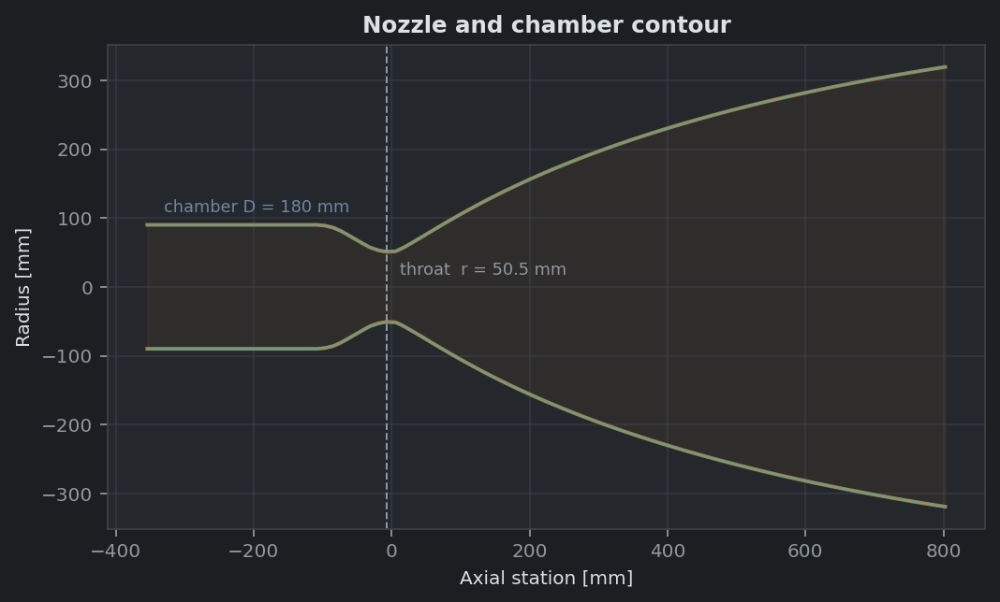

Near-wall exhaust state along the axis: velocity, static temperature, static pressure and Mach number.

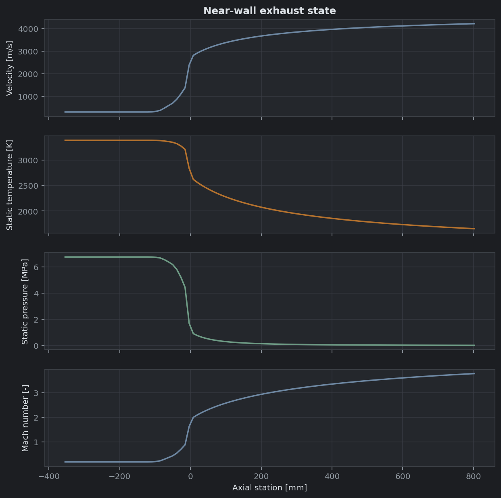

Chamber, converging section and diverging section in one frame, with the seam between the one-dimensional chamber solve and the characteristics mesh marked. `stitchedFieldPressure.png` and `stitchedFieldTemperature.png` in [featureShowcase/](featureShowcase/) show the same frame shaded by the other two quantities.

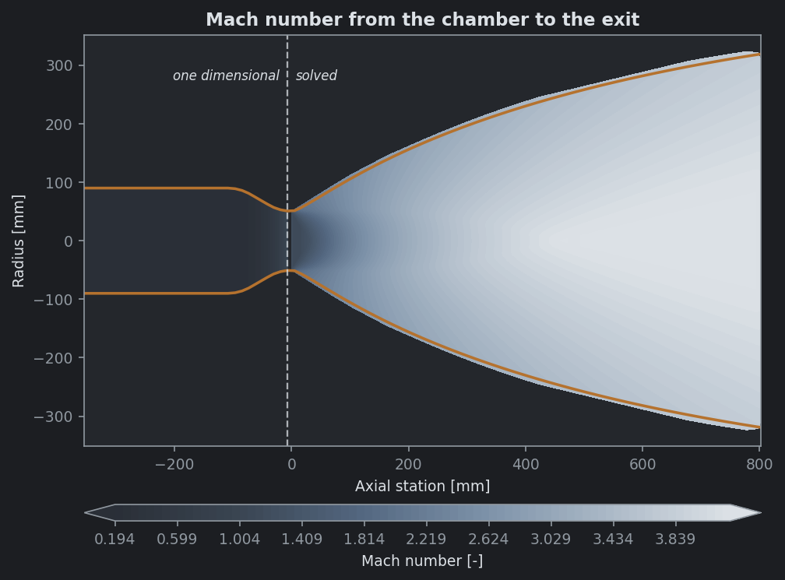

### Contour families and verification

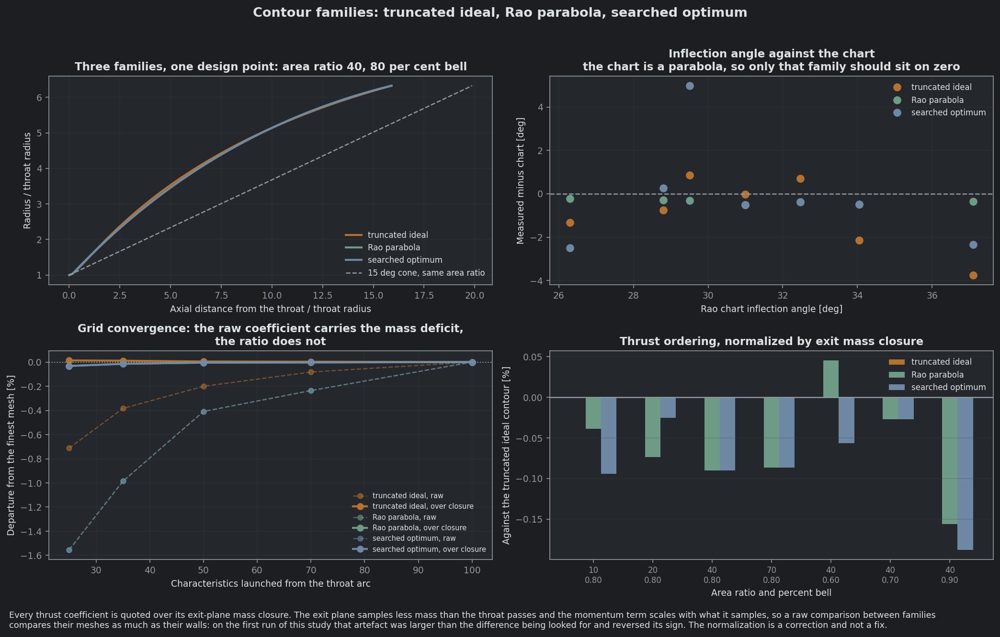

The three diverging families compared on one engine: truncated ideal, thrust-optimized parabola and searched thrust-optimized contour.

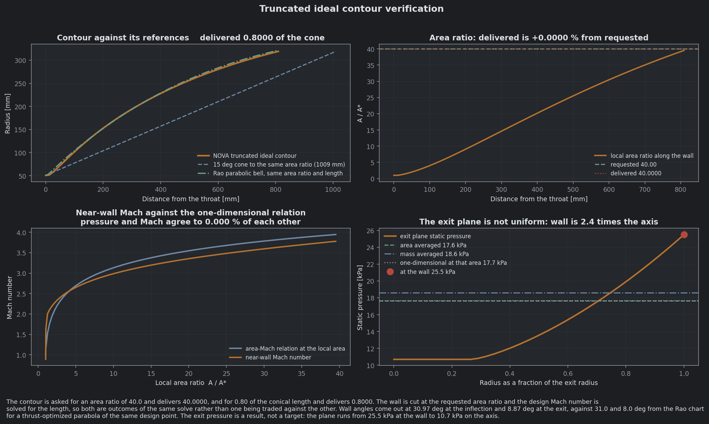

The worked case against its independent references: length, area ratio, near-wall consistency and the exit plane mass balance.

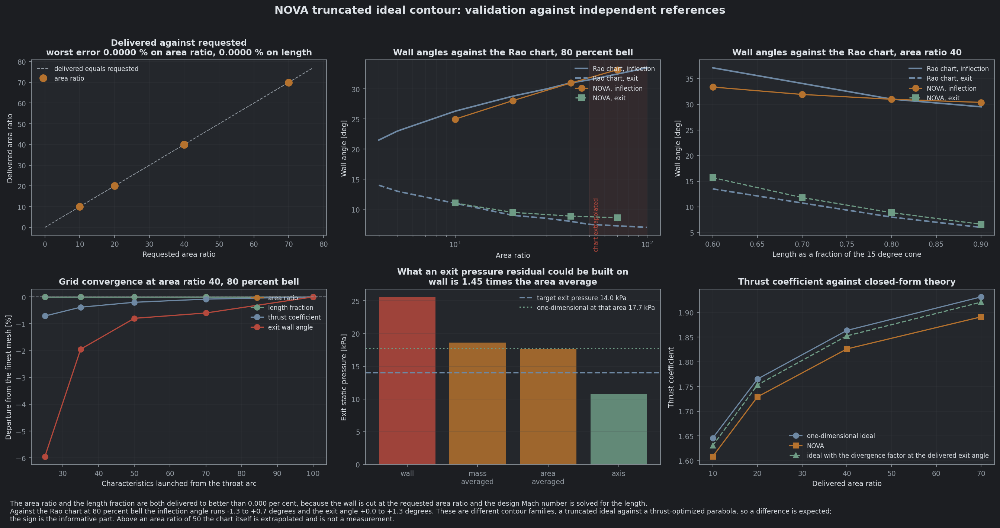

Sweeps over area ratio, percent bell and mesh resolution, drawn against the Rao chart.

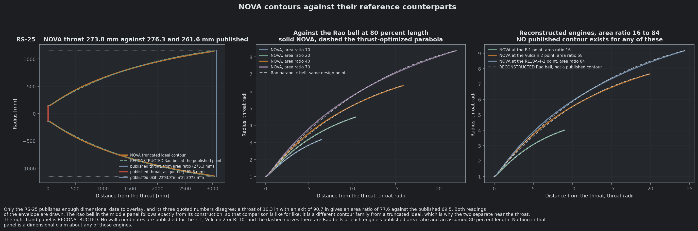

NOVA contours drawn on the RS-25 envelope, on Rao bells, and on reconstructed engines.

### Plume

The nozzle solution carried past the lip by the station marcher, swept across the back pressures the march covers: lip pressure ratios of 0.75 to 1.8, shaded by Mach number. Below 0.75 the march refuses; above about 1.8 the free boundary starts collapsing onto the axis. Each frame is drawn to six lip radii and labelled with what that reach costs in mass continuity, a few tenths of a percent at two radii and tens of a percent at six.

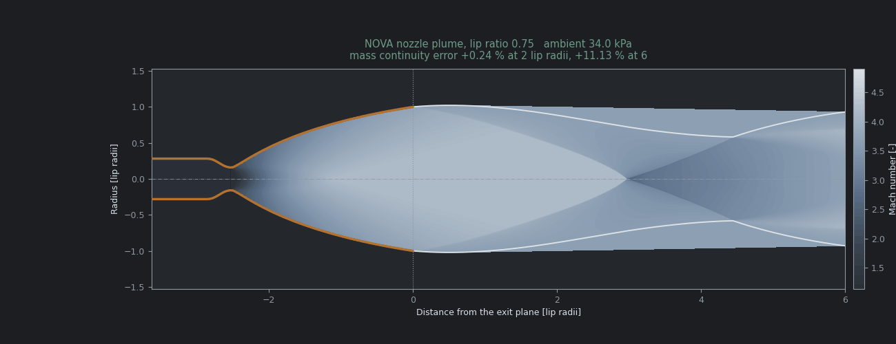

The same nozzle at a fixed altitude, with the engine as the variable instead. Power level walks down from rated in 5 percent steps against an ambient of 8.85 kPa, the pressure at which rated power sits at the top of the march's envelope, and the sweep stops at 25 percent: one step short of where the nozzle separates, the compressed lip needs a shock stronger than the march stands in for. Thrust and one-dimensional ideal specific impulse run alongside.

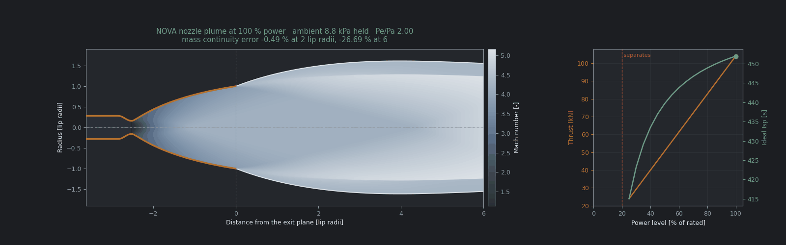

At this altitude the engine throttles 5:1 before its own nozzle separates at 20 percent power, so the nozzle binds rather than the combustion side: CECE demonstrated 17.6:1 on an RL10 derivative of the same propellants and cycle. [Throttled Plume Model](docs/plumeThrottleModel.md) covers what the model does and does not represent, including why a throttle sweep is a sequence of steady solutions.

The shock cell train against Prandtl, the operating range and the four regime figures are in [featureShowcase/](featureShowcase/).

### Materials

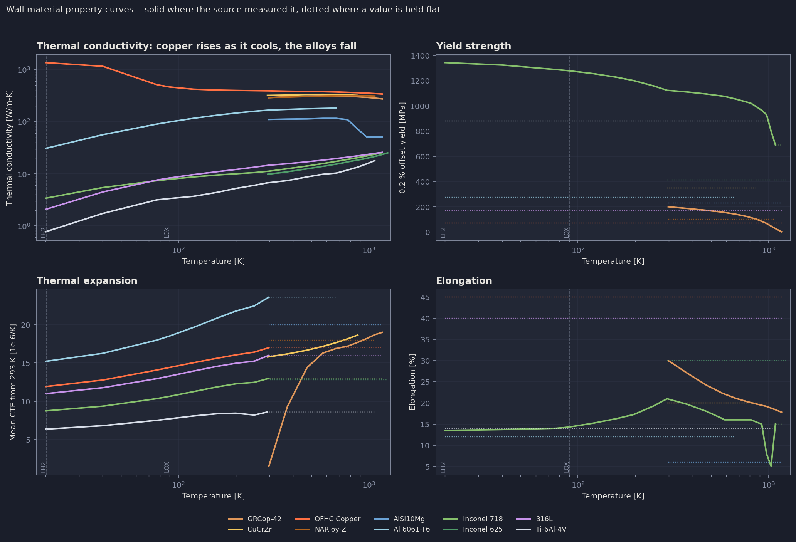

The property curves behind the material selector, drawn solid where a source measured the value and dotted where it is held flat.

Three of the studies behind these figures are slow: the Rao sweeps take about sixteen minutes, the family comparison about forty, and the subfamily search about two hours. The interactive plotly companions are regenerated rather than committed, so they are not linked here.

## Module layout

`Nozzle.py` holds the `Nozzle` class, and the class is a facade: it declares the object's state, assembles the inputs each module needs, calls that module, and copies the result back. It computes nothing. Everything that does sits in a module beside it, each of which takes its inputs explicitly and reads nothing off a `Nozzle`, so each can be driven and tested on its own.

That is checked rather than asserted. `tests/testFacade.py` holds it structurally: no module imports `Nozzle` or reaches `self` outside its own classes, no facade method contains a loop or an arithmetic operator, and every state object is complete in both directions.

`Nozzle.py` re-exports the plume and gas dynamics names, so `from Nozzle import PlumeFlow` and the like keep working.

The nozzle interior point and the plume interior point are the same relations, and the fact that they now live in separate modules is what makes it checkable: `tests/testCharacteristics.py` compares them directly and states how far apart they end up.

Program option flags (`plotsEnabled`, `export`, `makeCoolingChannels`, `makeInletVolute`, `makeOutletVolute`, `filmCooling`, `makeRadiativeExtension`, `inletVolutePrintability`, `outletVolutePrintability`) accept JSON booleans or the strings `"on"` / `"off"`.

| Module                                                      | Holds                                                                                                                                                                                                                                                          |
| ----------------------------------------------------------- | -------------------------------------------------------------------------------------------------------------------------------------------------------------------------------------------------------------------------------------------------------------- |
| `gasDynamics.py`                                          | Isentropic ratios, the Prandtl-Meyer function and its inverse, the area-Mach relation and both its branches, the conical length reference                                                                                                                      |
| `characteristics.py`                                      | The method-of-characteristics unit processes: the interior point and the wall point, taking a`CharacteristicGas`                                                                                                                                             |
| `contourKernel.py`                                        | The Rao throat arcs, the selectable transonic starting line, and the intersections that seed the net                                                                                                                                                           |
| `wallGeometry.py`                                         | Analytic wall primitives and the prescribed walls built from them: arcs, lines, quadratic and cubic Beziers, each with a closed-form tangent and ray intersection. Pure geometry, with no gas and no NOVA imports                                              |
| `directCharacteristics.py`                                | The forward march over a wall that is handed to the solver rather than solved for, and the internal shock it detects and captures                                                                                                                              |
| `contour.py`                                              | The three contoured family solves, the throat scaling into real units, and the conical reference contour                                                                                                                                                       |
| `contourOptimization.py`                                  | The direct search that produces a thrust-optimized contour: the design vector, its bounds and validity test, and the restarts and optimality evidence around the optimizer                                                                                     |
| `boundaryLayer.py`                                        | The compressible integral turbulent boundary layer on a finished wall: reference-temperature properties, the momentum and energy integral marches, the displacement-thickness wall offset, the friction drag debit and a marched gas-side heat transfer coefficient |
| `plume.py`                                                | Plume correlations, the TN D-2327 free-jet lattice, and the characteristics march past the lip                                                                                                                                                                 |
| `ceaInterface.py`                                         | Thermochemistry through rocketcea                                                                                                                                                                                                                              |
| `fluidProperties.py`                                      | One equation-of-state accessor over two backends: REFPROP when installed, CoolProp as the automatic fallback                                                                                                                                                    |
| `figures.py`                                              | One figure description per view and the styled renderer for each backend: the interactive plotly HTML, the Matplotlib PNGs a run writes and the feature showcase draws for documentation, and the 3D assembly views that have no static twin                  |
| `regenThermal.py`                                          | The regenerative jacket thermal model: Bartz on the gas side, Gnielinski on the hydraulic diameter on the coolant side, the wall as the sector each channel owns and the rib as a fin |
| `ablative.py`                                             | The charring ablator response: CMA in-depth conduction with a receding surface, Arrhenius pyrolysis, surface thermochemistry, and the station march that applies them along a contour                                                                          |
| `filmCooling.py`                                          | Two film closures and the marches that lower the driving temperature along a contour: the Hatch and Papell correlation with its property correction to the film mean temperature, and the SP-8124 entrainment model that accounts for acceleration and turning |
| `radiativeCooling.py`                                     | Gas-to-wall radiation as an exact coefficient on its own potential, and the damped Newton solve for the wall temperature of an uncooled extension                                                                                                              |
| `channelSections.py`                                       | What the thermal model reads about each channel family: flow area, perimeters, hydraulic diameter, the rib as a fin, the rectangular width and the helical spacing and loxodrome |
| `channelGeometry.py`                                       | Cooling channel cross sections: the circular profile on a transport frame, and the rounded rectangle on frames built from the wall normal |
| `channelSizing.py`                                         | The channel size solve: converging each station so the hot wall runs at the temperature it is allowed to, or building it at the size a manual profile fixes |
| `channelProfile.py`                                        | A manually fixed channel size distribution: the area ratio and jacket fraction keys, the reader, the interpolation and the profile a run records |
| `regenChannels.py`                                         | The jacket build: the fillet and flare to each volute, the channel centerline and its wrap, the swept channels and the wall meshes |
| `nozzleVolutes.py`                                        | The inlet and outlet scrolls, their walls sized against the coolant state, and their print supports                                                                                                                                                            |
| `chamber.py`                                              | The combustion chamber and the converging section                                                                                                                                                                                                              |
| `regenStations.py`                                        | Where the jacket ends, and the exhaust state at every station of both sections                                                                                                                                                                                 |
| `config.py`                                               | Reading a configuration from JSON or a dictionary                                                                                                                                                                                                              |
| `exports.py`                                              | Contours, STL geometry, exhaust properties and the pickled run                                                                                                                                                                                                 |
| `validation.py`                                           | Input validation as rule tables rather than branches, with one checker behind them                                                                                                                                                                             |
| `errors.py`                                               | The exception hierarchy every deliberate NOVA failure raises, and the context dictionary a raise site attaches to it                                                                                                                                            |
| `progress.py`                                             | The progress events a run sends to a front end that listens: the stage plan, the stages as they open and close, the steps of long loops and the iterations of iterative solves. With no listener, loops draw tqdm bars on the terminal |
| `materials.py`, `units.py`, `geometryTools.py`, `Volute.py` | Wall alloys, unit conversion, geometry helpers, volute construction                                                                                                                                                                                          |
| `novaGui/`                                                | The front end: a React app served by a FastAPI layer over the pipeline, and every non-visual piece of a front end (config schema, form checks, runner, progress model, view list, drawers, result table, palette) |
| `featureShowcase/`                                        | Build scripts for the figures above, and the curated gallery                                                                                                                                                                                                   |
| `examples/`                                               | `novaNozzle.py` runs the reference nozzle through every solver; the others drive one feature each                                                                                                                                                            |

## Testing

```bash
python -m pytest tests/ -v
```

The Tests workflow ([.github/workflows/tests.yml](.github/workflows/tests.yml)) runs the suite on a Windows runner for every pull request and every push to main, with NOVA's dependencies pinned by `packaging/constraints.txt` and the test tools by `tests/requirements.txt`. The runner has no REFPROP, so fluid properties come from CoolProp there and the tests that need REFPROP skip; the tests that read the local showcase runs skip as well. A version tag is pushed only once the merge commit has passed it ([docs/releasing.md](docs/releasing.md)).

The suite never opens a window. `tests/conftest.py` sets `NOVA_HEADLESS` before anything is imported, which selects a non-interactive matplotlib backend and stops plotly launching a browser tab per figure, and it closes any figures a test leaves behind. Nothing is suppressed except the display: every figure is still built and every file still written.

The same switch is available to any run, which is what to reach for when iterating on a feature rather than clicking through a dozen windows each time:

```bash
NOVA_HEADLESS=1 python examples/novaNozzle.py    # write the figures, open nothing
NOVA_HEADLESS=0 python -m pytest tests/testRegenChannels.py   # put the windows back
```

It is an environment variable rather than a configuration field because it describes where NOVA is running, not the engine being designed. The regression harness and the GUI both set it for themselves.

`tests/regressionHarness.py` is not part of the suite. It runs a configuration end to end, walks every public attribute of the resulting `Nozzle`, and compares against a recorded baseline at exact equality, which is what holds a refactor to moving code rather than changing answers. Record a baseline before making changes:

```bash
python tests/regressionHarness.py --record --verify   # record, and prove determinism
python tests/regressionHarness.py --compare           # after a change
```

Baselines are written to `tests/baselines/` and are carried in the repository, so a change that moves a number shows up in the diff rather than only on the machine that ran it.

`tests/testCeaInterface.py` covers the CEA interface in 50 tests that run in about two seconds: unit conversion constants, the LOX/LH2 reference case against CEARun, pressure conventions, endpoint guards over the area ratios the contour sweeps actually generate, propellant name resolution, and the lazy result mapping.

`tests/testMaterials.py` validates the wall alloy thermal conductivity curves in `materials.py` against their cited sources (Touloukian, ASM, Special Metals, ITER MPH, NASA).

`tests/testPlume.py` validates the plume correlations in `Nozzle.py`: the Prandtl-Meyer function against compressible flow tables, the Tam and Tanna equivalent diameter against an independent mass-conservation derivation, the Ashkenas and Sherman Mach disk location in both its diameter and radius forms, the supersonic-exit Mach disk onset through each of its sources, Lewis and Carlson's disk location against its radius form, the regular reflection's limit at the lip Mach line, the exit state taken in the contour's own gas, and the oblique shock deflection against the theta-beta-M relation solved the other way round.

## Theory

- [Nozzle Design Overview](docs/NozzleDesignOverview.md) -- consolidated contour and cooling reference, end to end ([PDF](docs/NozzleDesignOverview.pdf)).
- [Nozzle Contour](docs/NozzleContour.md) -- MOC contour generation: nomenclature, Sauer transonic analysis, characteristics, process flow.
- [Nozzle Contour Methods](docs/NozzleContourMethods.md) -- the contour families, what each optimizes, how other axisymmetric MOC implementations differ, and where this one sits.
- [Nozzle Contour Validation](docs/NozzleContourValidation.md) -- what the contour generator is checked against, the defects that check found, and an explicit statement of what is and is not validated.
- [Validation Status](docs/validationStatus.md) -- one table of every model behind NOVA's reported results: its status, the reference, the result in numbers, and the records it stands on.
- [Contour Families Report](docs/reports/contourFamilies_2026-09-15.html) -- the three families, the throat and transonic models, the boundary layer and the internal shock, with the plots behind each number.
- [arcSpline Overshoot at a Corner](docs/reports/arcSplineOvershoot_2026-09-08.md) -- why the arc-length resampler used to invent geometry outside its own input, what replaced it, and how far the contour moved.
- [Contour Verification and Assessment](docs/reports/nozzleContourEffort_2026-09-06.md) -- the narrative of that effort end to end, phase by phase, with the figures. Rendered as a standalone [HTML report](docs/reports/nozzleContourEffort_2026-09-06.html).
- [Nozzle Cooling](docs/NozzleCooling.md) -- regenerative cooling architecture and a worked example.
- [Regen Cooling Architectures](docs/regenCoolingArchitectures.md) -- cooling circuit topology: architectures A to D, flow direction and accounting, the channel split, the extension circuit and films, what reference practice does, how NOVA solves each, and the example engines.
- [Regen Cooling Topology References](docs/references_regenCoolingTopologies_2026-10-02.md) -- annotated sources behind that document, from SP-8087 to current channel wall nozzle manufacturing.
- [CEA Interface](docs/ceaInterface.md) -- combustion thermochemistry, result keys and units, propellant naming, thread safety.
- [Plume Development State](experimental/plumeDevelopmentState.md) -- where the plume solver stands: what is validated, what is open, and the findings behind both.
- [Internal Shock State](experimental/internalShockState.md) -- how the shock inside an optimized contour is detected and captured, where the weak-shock treatment stops being defensible, and what a rotational characteristics solve would cost.
- [Plume Structure References](docs/references_plumeStructure_2026-09-04.md) -- annotated sources behind the plume correlations in `Nozzle.py`, and an explicit statement of what the correlations do and do not support.
- [Throttled Plume Model](docs/plumeThrottleModel.md) -- a plume driven by engine power level at fixed ambient: what is new physics in that change, the throttle range the reference engine has before its nozzle separates, and the staged path to building it.
- [Throttling and Separation References](docs/references_nozzleThrottling_2026-10-03.md) -- annotated sources on how far engines throttle, what limits them, and where an overexpanded nozzle separates.
- [Nozzle Contour References](docs/references_nozzleContour_2026-09-06.md) -- annotated sources behind the contour generator, and what they do and do not establish about it.
- [Thrust-Optimized Contour References](docs/references_thrustOptimizedContours_2026-09-13.md) -- annotated sources behind the optimized families: the direct-optimization method, the perfect-bell data set it is checked against, and what neither of them publishes.

---

## License

MIT. See [LICENSE](LICENSE).

---

Sean Bowman
