# NOVA Cooling Circuits: Architectures, Extension Films and Example Engines

An account of the effort that gave NOVA's regenerative jacket the cooling circuits production engines use: what started it, what each phase built, what was found wrong along the way, what the new example engines show, where the numbers stand, and what is still open.

The design reference this draws on is organized by topic and stays where the code links to it: [regenCoolingArchitectures.md](../regenCoolingArchitectures.md) for the circuits, their viability and heritage, and the example engines; [NozzleCooling.md](../NozzleCooling.md) for the channel geometry and the station thermal model; [references_regenCoolingTopologies_2026-10-02.md](../references_regenCoolingTopologies_2026-10-02.md) and [references_extensionCooling_2026-11-03.md](../references_extensionCooling_2026-11-03.md) for the sources.

---

## Request and outcome

An investigation into cooling the nozzle extension came first, and it found that NOVA could not do it on a high-pressure engine. A radiation-cooled C103 extension on the shipped 6.9 MPa LOX/LH2 nozzle ran at 2780 K against its 1673 K limit, and on a 10 MPa methalox first stage at 2976 K. The only alternative NOVA offered, a single pass fed from the exit, was refused by the volute sizing and cost 2.5 MPa on methane, because the coolant reached the throat already warm.

The ask that followed had six parts: fix every defect found along the way; model turbine exhaust so that a turbine exhaust film and a dumped-coolant film are both viable; implement cooling architectures A to D, with the GUI saying where each is viable and which engine flew it; build a methalox first stage example; move the shipped hydrogen engine onto the new features; and build several example nozzles, each showing a subset of the design options, with figures at every step to show the intended behavior.

The short answer on each.

**Both extension films are viable.** Under 5 kg/s of turbine exhaust, 3.3 percent of the chamber flow, the methalox first stage's extension drops from 2975 K to 1898 K under the entrainment closure, and it reaches the C103 limit at about 4.3 percent. With an extension circuit of its own as well, the shell peaks at 1340 K, 333 K inside its limit. A Vulcain 2-like engine that dumps its extension hydrogen as a film above a turbine exhaust film holds its shell to 865 K.

**All four architectures are solved.** A single pass in either direction (A), one and a half passes (B), two passes in alternating channels (C) and a separate extension circuit (D), with a channel split, a jacket bypass, a coking ceiling on the coolant-side wall and flow accounting against the chamber's propellant flows. Each has a GUI account of where it is viable and its heritage engine.

**The shipped engine runs architecture B to the exit.** Its hydrogen enters a ring manifold at an area ratio of three, runs down 60 channels to a turnaround ring at the exit and returns up 60, for 0.42 MPa over the circuit, with the hydrogen out at 257 K and the wall at its 800 K limit. The engine it replaces is kept as a sixth example.

**Five example engines ship with NOVA**, each a complete configuration loadable from the GUI: the single-pass reference, a methalox first stage, and engines in the arrangement of the F-1, the Vulcain 2 and the SSME.

**About two dozen defects were fixed.** The two that mattered most were a step of up to 230 percent in the coolant-side roughness correlation at the onset of roughness, and a wall-limit margin read off a barrier coating's surface rather than the metal behind it.

**None of the circuits is validated against hardware.** Each is verified against the identities it must satisfy, and the rib conductance between two passes against an independent two-dimensional conduction solve. The [Validation](#validation) section gives the status of each piece.

The work ran in eight phases over 3 to 5 November 2026, each committed with its tests passing and its figures reviewed.

| Phase | Commit | What it added |
|---|---|---|
| 0 | `4888010` | Defects, and estimated against delivered performance |
| 1 | `6091953` | March order, coflow, flow accounting, coolant ceilings |
| 2 | `3b3e06f` | Turbine exhaust, stacked extension films, film thrust |
| 3 | `9668f21` | Channel split, thermal and three-dimensional |
| 4 | `2742cda` | Two-pass and one-and-a-half-pass circuits, turnaround ring |
| 5 | `200f5db` | Extension circuit, supersonic slot refusal |
| 6 | `02c2fa1` | GUI: circuit groups, schematic, per-pass view, Load example |
| 7 | `8bba93b` | Shipped engine on B, example engines, cooling showcase, docs |

---

## The architectures

| Key | Name | Circuit | Viable where | Heritage |
|---|---|---|---|---|
| `singlePass` | A. Single pass | In at the jacket's aft end, up every channel to the injector | Small chambers; wherever the aft manifold is acceptable | SSME nozzle tubes, NERVA |
| `oneAndHalfPass` | B. One and a half pass | In at a ring manifold partway down the bell, down one family of alternating channels to a turnaround ring, up the other | Hydrogen, which must be warmed before the throat; upper stages | J-2 (180 tubes down, 360 up), RL10 |
| `twoPass` | C. Two pass | In at the injector end, down one family, up the other | Large tube-wall boosters, which keep both manifolds forward of the gimbal | F-1 (alternating tubes, 70 percent of the fuel) |
| `extensionCircuit` | D. Extension circuit | A second circuit from the joint to a far end on the extension; returned, dumped as a film, or dumped overboard | First stages and long bells where the throat must see cold coolant | Vulcain 2, SSME nozzle circuit |

D combines with any of A to C. The films over the extension are independent of the circuit: a slot carries turbine exhaust, the extension circuit's outlet, or a named species, and every film stacks with the chamber film carried past the joint.

---

## Phase 0: defects found in the investigation

The investigation turned up fifteen defects, each fixed with a test.

| Defect | Effect | Fix |
|---|---|---|
| SP-8124's adiabatic wall temperature charged a film the core's kinetic energy at the slot | A slow methane film read 164 K below zero | The recovery deficit is the film layer's, at its own velocity; the velocity ratio is reported against SP-8124's 0.9 to 1.15 band |
| The throat was taken as the smallest station of a resampled wall, in the jacket's Bartz coefficient, the film's area ratio and the extension's Bartz | That station sat 1.9 percent above the sized throat and the gas-side coefficient read 3.5 percent high; full-jacket coolant pickup falls 3 percent | The sized throat, through `sizedThroatRadius` |
| Friction stretched jacket wall temperatures over the whole wall by index, before the extension was solved | Shipped drag 2001 N | Placed by axial position after the extension: 1730 N |
| A barrier coating held its surface, not the metal, to the wall limit | Coated jackets sized to the wrong temperature | The search reads `metalWallTemperature` |
| The coolant entrance length was measured from the wrong end of the march | Entrance enhancement applied at the wrong stations | Measured in march order |
| Every error printed REGENERATIVE GEOMETRY ERROR; a null value read as NaN past its default; a cone with no truncation, and a radiative extension with no extension, raised; extension properties were not checked for NaN | Wrong or opaque failures | Each class names its kind; defaults route through the null-aware readers; the missing branches and guards added |
| The outlet-only export read the inlet volute; volute walls were sized on GRCop-42 whatever the alloy; a dashboard path joined with a backslash; files listed that nothing writes; Analyze showed the limit as the peak | Wrong outputs and labels | Each corrected |
| The extension solver accepted a non-physical drive and capped its starting guess silently | A silent wrong answer was possible | Guarded and reported |
| CEA solves were serialized within a process only | Concurrent runs shared RocketCEA's scratch files | A lock file serializes them across processes |

Phase 0 also made the performance report explicit about back pressure. The thrust coefficient the solve delivers is the exit plane against a design back pressure, which with only an area ratio given is the one-dimensional equilibrium exit pressure, neither vacuum nor an ambient. Every run now reports the delivered coefficient, specific impulse and thrust at named back pressures, with and without friction, beside the one-dimensional estimate in CEA's equilibrium gas and in the frozen chamber gas the characteristics are solved in.

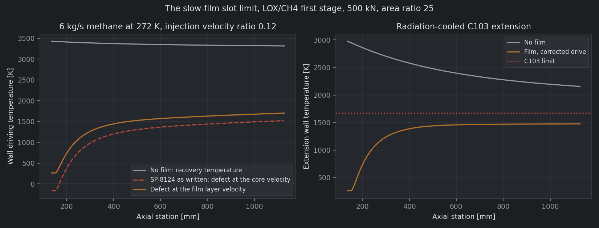

*A cold methane film at a twentieth of the core velocity at the jacket joint of a LOX/CH4 first stage: charged the core's kinetic energy, the entrainment closure drives the wall below absolute zero at the slot; at the film layer's own velocity it starts at the coolant's temperature.*

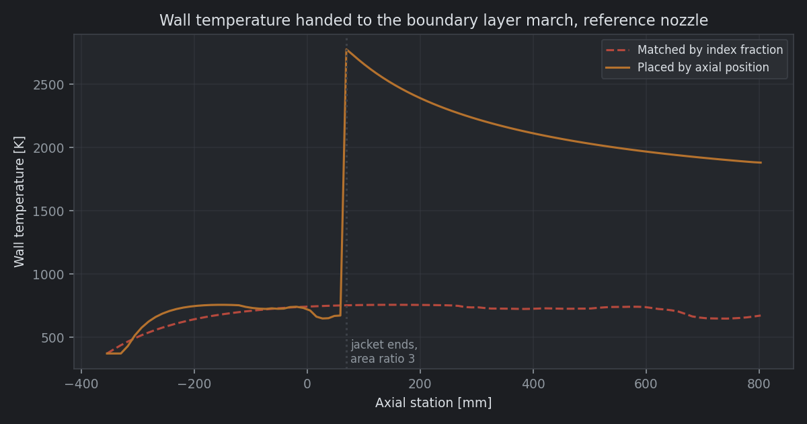

*The wall temperature the boundary layer march is handed: stretched by index, a jacket ending at an area ratio of 3 covers the whole bell; placed by axial position, the jacket covers its section and the extension carries its solved shell temperature.*

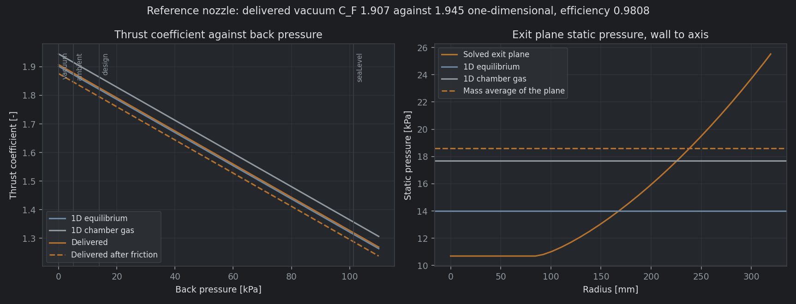

*Thrust coefficient against back pressure for the one-dimensional equilibrium and chamber-gas estimates and as the solved exit plane delivers it, with the named back pressures marked.*

---

## Phase 1: march order, coflow, flow accounting and ceilings

The sizing march visits the jacket's stations through an explicit order, `coolantMarchOrder`, rather than hard-coded flips, and offsets the channel centerline to the outer side of the wall whichever way it walks. That made coflow a choice of which end carries the inlet state: `jacketFlowDirection` `coflow` runs the coolant from the injector face, with the inlet and outlet volutes built on swapped ends. On a uniform barrel under a uniform gas state, the coflow solution matches the counterflow one reflected about the midpoint to a relative 6.6e-15.

`flowAccounting.py` splits the chamber flow by the mixture ratio and refuses a jacket returned to the injector, or a chamber film drawn from it, that asks for more of a propellant than the chamber burns. `coolantBypassFraction` derives the jacket flow as what the bypass leaves. `maxCoolantTemperature` caps the bulk coolant, and `maxColdWallTemperature` caps the coolant-side wall, the coking limit of a hydrocarbon: the thermal sizing holds that ceiling by shrinking the channel until the coolant-side wall sits at it.

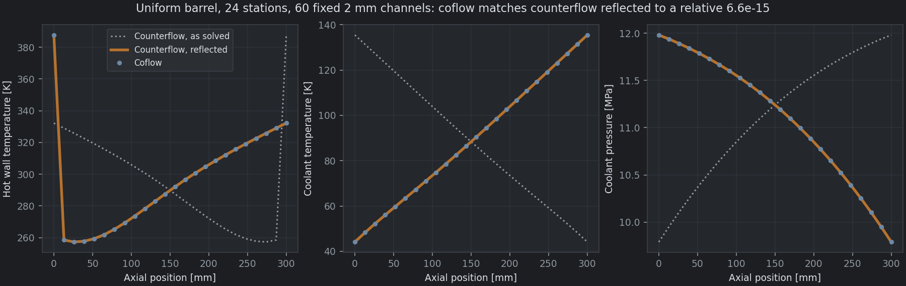

*The closed-form check on the march order: the coflow solution on a uniform barrel drawn over the counterflow one reflected. They agree to round-off.*

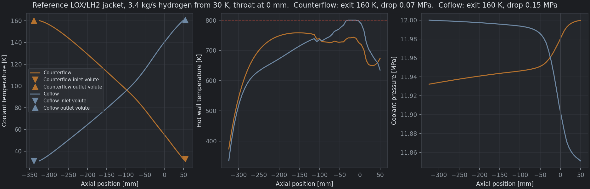

*The single-pass reference jacket sized counterflow and coflow: coolant temperature, hot wall and pressure along the wall, with each direction's volutes marked.*

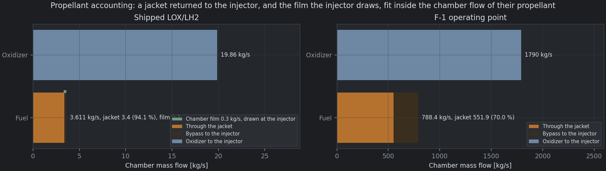

*The chamber flow of each propellant for the reference engine and for the F-1 operating point, split into the jacket's share and the bypass, with the chamber film drawn against the fuel it comes out of.*

---

## Phase 2: turbine exhaust and the extension films

**The gas generator and turbine are specified, not solved.** `turbineExhaust.py` takes a gas generator's mixture ratio, pressure and flow and a turbine's pressure ratio and efficiency, with no power balance against the pumps. The generator is burned in CEA at equilibrium and expanded frozen through the turbine,

$$
h_{te} = h_{gg} - \eta_t \left( h_{gg} - h_{is} \right)
$$

where $h_{gg}$ is the generator's enthalpy, $h_{is}$ the frozen isentropic exhaust enthalpy at the turbine's pressure ratio and $\eta_t$ the turbine efficiency. A perfect turbine reproduces CEA's frozen expansion exactly. Condensed carbon is reported: a fuel-rich hydrocarbon generator runs hot at equilibrium, 1252 K at the F-1's mixture ratio of 0.416 against its published 1063 K. CEA's frozen expansion silently returns the throat state for LOX/CH4 at a mixture ratio of 0.25 and below, and those cases are refused.

**Every film over the extension is marched over one wall and stacked.** `extensionFilm.py` joins the jacket and extension stations, carries the chamber film past the joint, and adds slots of turbine exhaust, the extension circuit's outlet or a named coolant. The films stack by Sellers superposition, each seeing the wall the films upstream have made,

$$
T_{aw,n} = T_{aw,n-1} - \eta_n \left( T_{aw,n-1} - T_{c,n} \right)
$$

where $T_{aw,n}$ is the adiabatic wall temperature after the $n$th film, $\eta_n$ its effectiveness and $T_{c,n}$ its coolant temperature. The stacked temperature drives the radiative extension; the other closure is solved beside the configured one. A film's thrust is its unmixed expansion from the slot to the exit pressure, reported beside the fully mixed bound, and the engine's specific impulse is taken on its total flow,

$$
I_{sp,engine} = \frac{F_{chamber} + F_{film}}{\dot{m}_{total}\, g_0}
$$

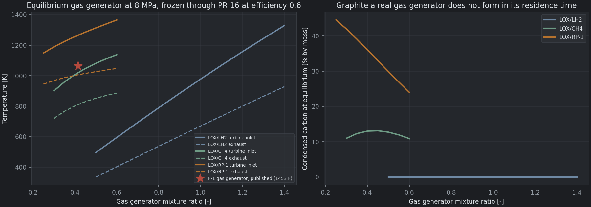

*Turbine inlet and exhaust temperatures against mixture ratio for LOX/LH2, LOX/CH4 and LOX/RP-1 at 8 MPa through a turbine of pressure ratio 16 and efficiency 0.6, with the condensed carbon CEA's equilibrium forms and the F-1's published point marked.*

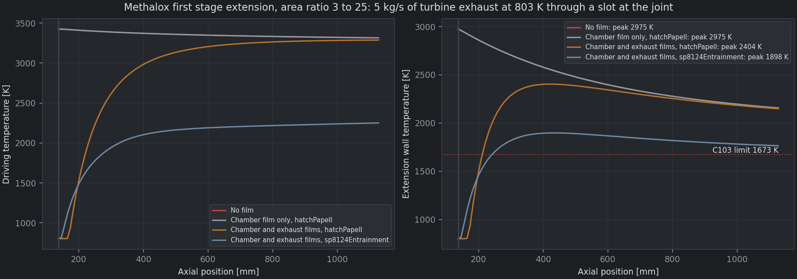

*The methalox first stage's extension from an area ratio of 3 to 25, with and without 5 kg/s of turbine exhaust through a slot at the joint. The peak falls from 2975 K to 2404 K under Hatch-Papell and to 1898 K under the entrainment closure.*

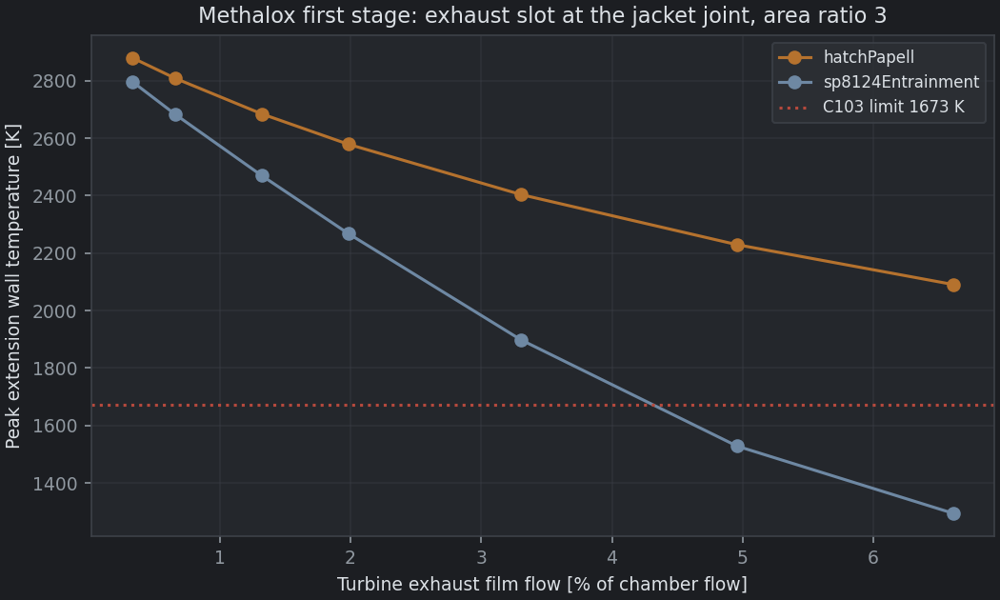

*Peak extension temperature against turbine exhaust flow. The entrainment closure reaches the C103 limit at about 4.3 percent of the chamber flow; Hatch-Papell does not reach it within 6.6 percent.*

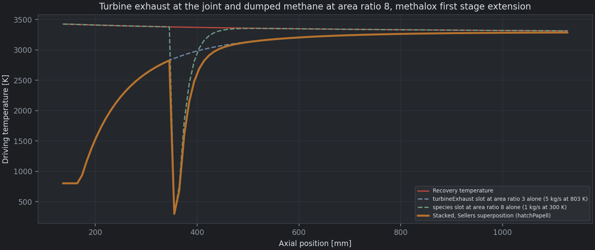

*Sellers stacking of the turbine exhaust film and a dumped methane film downstream of it.*

---

## Phase 3: the channel split

A bell's circumference grows several times between the throat and the exit, so a channel count chosen for the throat leaves a wide pitch downstream. `channelSplitAreaRatio` forks each circular channel into two where the diverging wall reaches that area ratio, over `channelSplitLength` parent diameters. Through the transition the daughters' centers part on a cosine blend $\beta$ to a separation

$$
d = \beta \frac{\pi R}{N}
$$

and the section is the union of two circles, closed form in area and perimeter,

$$
A = 2\pi r^2 - \left(2r^2\cos^{-1}{d \over 2r} - {d \over 2}\sqrt{4r^2 - d^2}\right), \qquad P = 4r\left(\pi - \cos^{-1}{d \over 2r}\right)
$$

held against the outline polygon to 1e-6. At full separation the pair carries one parent's flow at the two daughters' mass flux and hydraulic diameter, so the sizing march stays one parent channel wide straight through the split. Mid-split the waisted section's hydraulic diameter swells and its mass flux falls, the dip in heat transfer Wadel's bifurcations show, and the march answers it by shrinking the channel there. In three dimensions each daughter is the parent's centerline turned about the axis by $\pm\beta\pi/(2N)$ and is exported as its own body.

On the reference jacket carried to the exit, splitting 60 channels to 120 at an area ratio of 3 holds the exit channel to 8.1 mm half-extent against 17.2 mm, for 33 kPa more pressure drop.

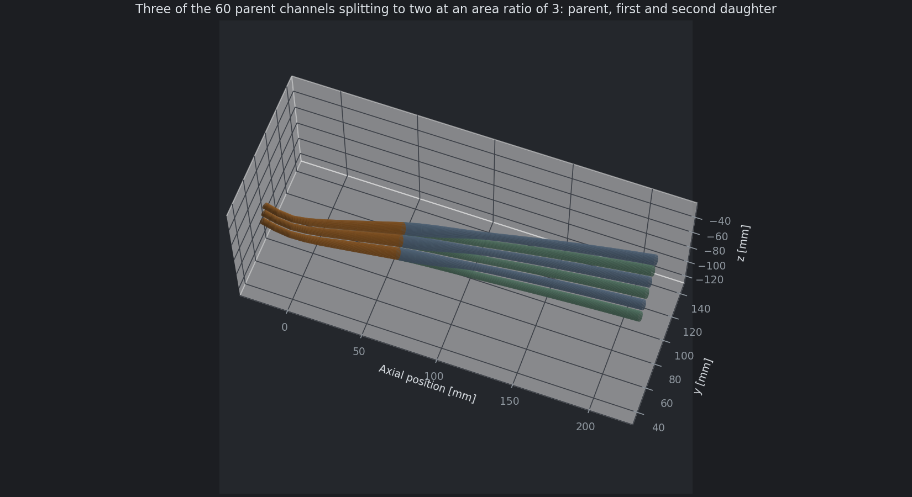

*The parent channel and its two daughters through the transition, with the neighboring forks either side.*

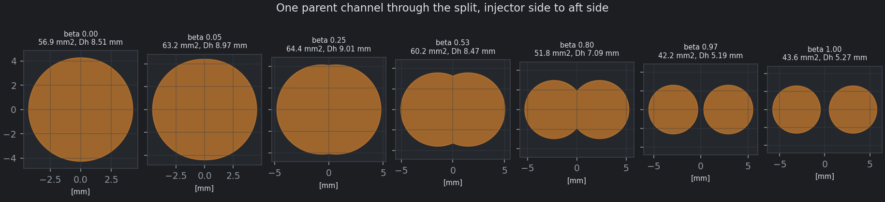

*The union outline at stations through the transition, from one circle to two.*

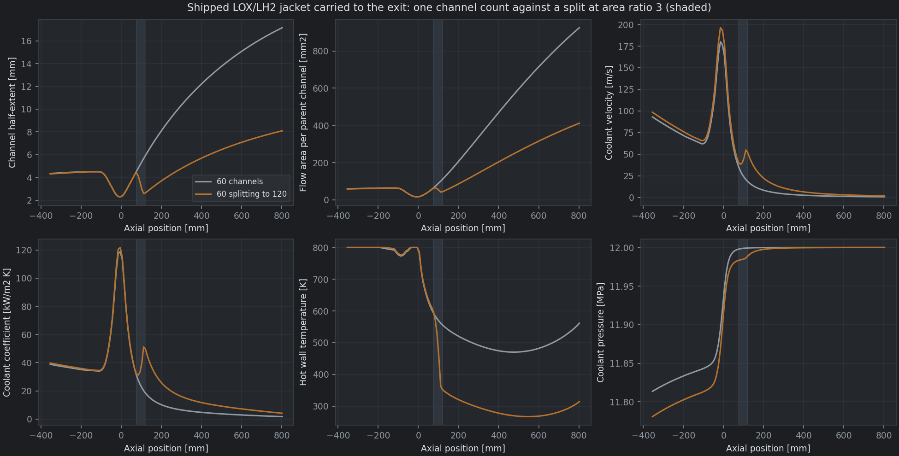

*The reference jacket carried to the exit, one channel count against a split at an area ratio of 3: half-extent, flow area, velocity, coolant coefficient, hot wall and pressure.*

---

## Phase 4: two passes and the turnaround ring

`coolantCircuit` `twoPass` (C) and `oneAndHalfPass` (B) build two families of circular channels alternating around the circumference. Each pass is the single-pass sizing march on its own stations, with its own flow per channel and the share of the pitch where both families run, $2\pi R/(N_{down} + N_{up})$. At the aft end the coolant turns in a constant-section torus sized for half the down channel's velocity, losing one velocity head of the down channel and half of the up, and keeping its enthalpy.

Neighbors of the two families carry coolant at different temperatures, so heat crosses the rib between them through the conductance

$$
G = \frac{1}{\dfrac{1}{h_1 a_1} + \dfrac{t}{k \bar{a}} + \dfrac{1}{h_2 a_2}}
$$

with each channel's face its half perimeter toward that neighbor and $t$ the thinnest web. The two passes are marched in turn on each other's profiles until the up coolant moves less than 0.05 K. The rib heat balances between the passes to 0.05 percent, and the heat the two coolants take on matches the wall's to 0.2 percent.

On the reference jacket to an area ratio of 10 with 30 down and 30 up channels, the two-pass circuit costs 1.53 MPa against the single pass's 0.08 MPa, because the throat holds the same 60 channels on both circuits and C carries the whole flow through half of them twice.

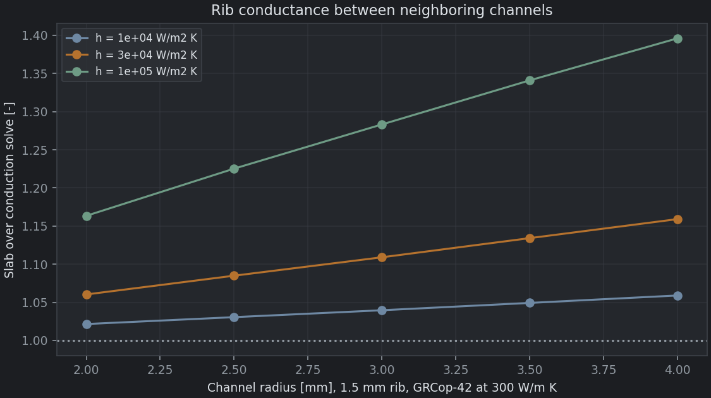

*The rib conductance against a two-dimensional finite-difference conduction solve of the web between two circular channels, over channel radii of 2 to 4 mm and coolant coefficients of 1e4 to 1e5 W/m^2 K. The slab form runs 2 to 40 percent high, the most for large channels at high coefficients.*

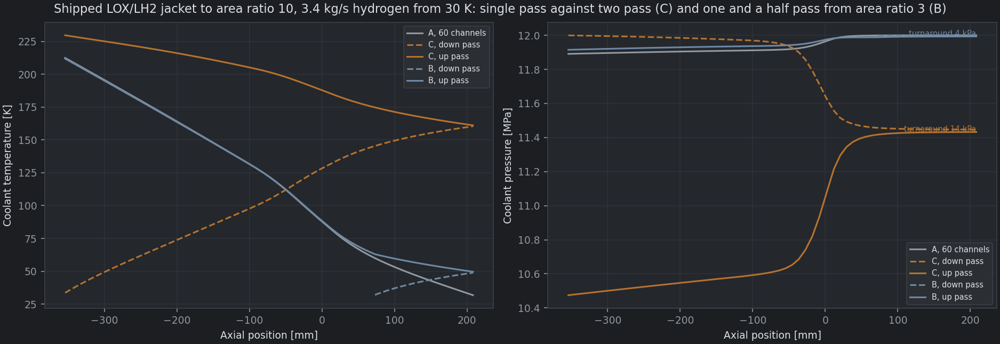

*Coolant temperature and pressure of each pass for a single pass, a two-pass and a one-and-a-half-pass jacket on the reference engine, with the turnaround marked.*

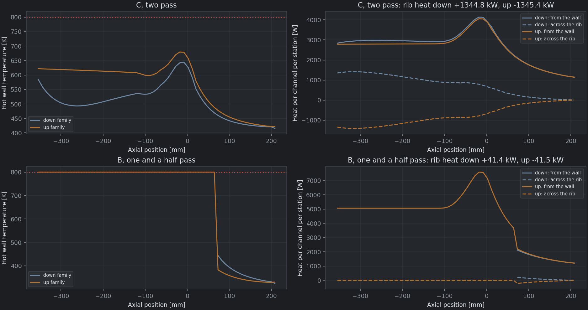

*The hot wall each family holds, and the rib heat each pass gains against the heat the wall gives it.*

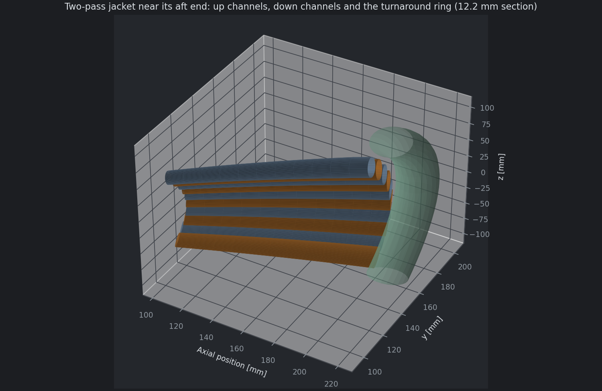

*Up and down channels near the aft end and the turnaround ring they meet in.*

---

## Phase 5: the extension circuit

`extensionCircuit` (D) runs a second jacket from the joint to `extensionCircuitEndAreaRatio` with its own coolant, flow, inlet state, channel count, passes and direction. It is the chamber jacket's sizing march on the extension's stations, bit-identical to that march run alone. Its outlet is returned to the feed and held with the chamber jacket to the chamber's flow of that propellant; laid as a film from a slot at the circuit's outlet, starting at the circuit's outlet state; or dumped overboard as flow with no thrust. The radiation-cooled shell starts where the circuit ends, and the friction march sees the circuit's wall over its span.

On the reference nozzle with its jacket cut at an area ratio of 3, a hydrogen circuit to 12 dumped as a film holds the C103 shell to 1594 K, 79 K inside its limit, against 2777 K with no circuit and 2294 K with the circuit's coolant returned. The dumped 0.5 kg/s costs 6 s of engine specific impulse.

The film closures take a slot's static state at the wall pressure, and a slot too small for its flow there would have to run supersonic, which no closure describes. Such a slot is refused with the height it needs.

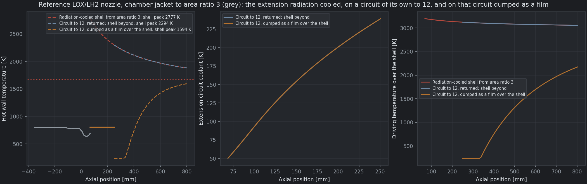

*The hot wall along the whole nozzle with the extension cooled three ways: radiation only, a circuit to an area ratio of 12 returned, and the same circuit dumped as a film over the shell; the circuit's coolant; and the drive the dumped film leaves.*

---

## Phase 6: the GUI

The Design tab gains four groups: Coolant Circuit, Extension Circuit, Gas Generator and Turbine, and Extension Film. A choice field can carry an account of each option, and the circuit choice shows the selected circuit's: what the coolant does, where the option is the usual choice and which engine flew it, for A to C and for the extension circuit's outlets. A Load example menu lists the engines in `assets/examples/`. The channel split field is offered on a single pass only.

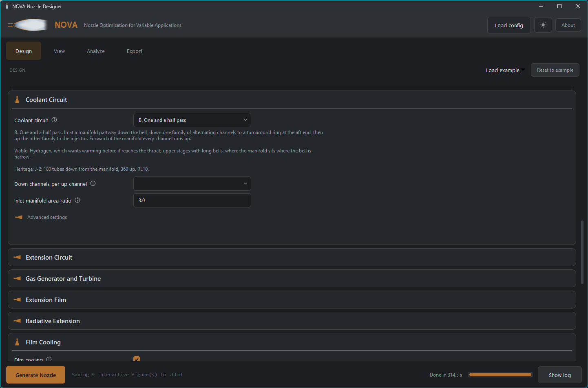

*The Coolant Circuit section with the shipped engine's one-and-a-half pass selected and its account beneath it.*

The View tab gains a coolant circuit schematic, the half section with each family's path and direction, its manifolds, turnaround and split, the extension circuit and its outlet, the film slots and the radiation-cooled shell; and a per-pass view of each pass's coolant and hot wall. The Analyze tab reports each pass, the turnaround, the rib exchange, the extension circuit, the gas generator, the films over the extension and the engine's flows and impulse.

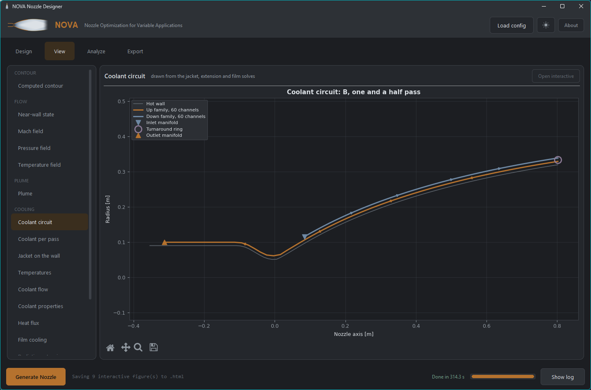

*The circuit view of the shipped engine: the down family from the inlet manifold at an area ratio of three to the turnaround ring at the exit, the up family back to the outlet volute.*

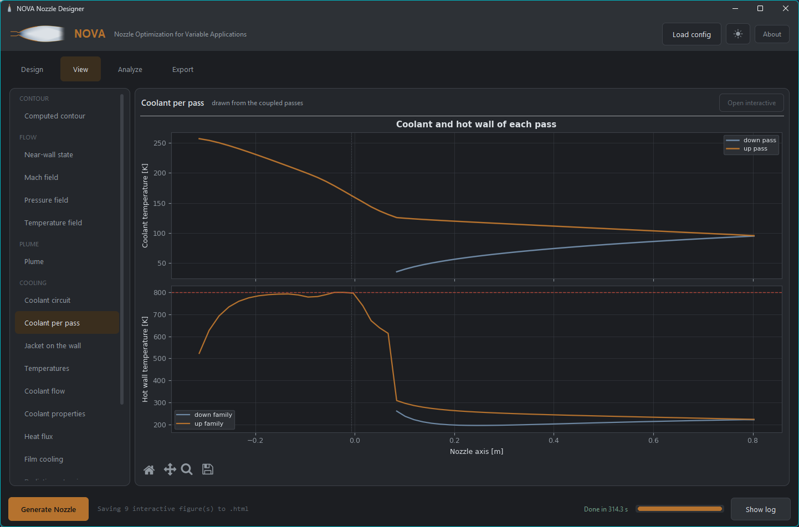

*The per-pass view: coolant temperature and hot wall of each family.*

---

## Phase 7: the shipped engine and the example engines

### The shipped engine

`NOVANozzle.json` runs B to the exit: 60 down and 60 up GRCop-42 channels, the inlet ring manifold at an area ratio of three, the turnaround ring at the exit, the outlet volute at the injector, the chamber film kept, and no inlet scroll or radiative extension. The hydrogen is warmed in the bell before it reaches the throat, which is what B is for.

| Quantity | Value |
|---|---|
| Down pass | 60 channels at 56.7 g/s, 30.0 to 94.9 K, 0.056 MPa |
| Turnaround | 12.0 mm section radius, 2.1 kPa |
| Up pass | 60 channels at 56.7 g/s, 94.9 to 257.0 K, 0.365 MPa |
| Rib exchange | 808 kW, balanced to 0.07 percent |
| Peak hot wall | 800 K, at its limit through the throat region |
| Friction | 0.039 of thrust coefficient, against 0.031 on the single-pass reference |

Friction rises because the jacket holds the bell at 200 to 300 K, and a cold wall carries more skin friction than the 2780 K radiation-cooled shell it replaces. Delivered thrust after friction at the design back pressure is 99.5 kN; vacuum specific impulse after friction 452.1 s.

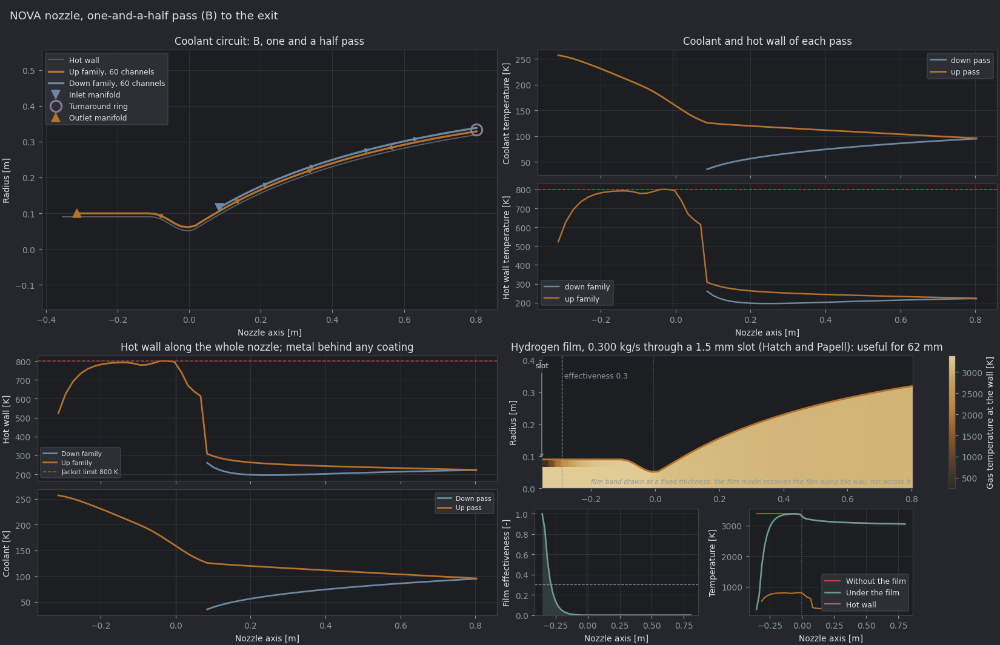

*The shipped engine: circuit schematic, coolant and hot wall per pass, the hot wall along the whole nozzle, and the chamber film. The up family holds 800 K from the barrel through the throat and drops to about 300 K aft of the inlet manifold, where the cold down family runs beside it.*

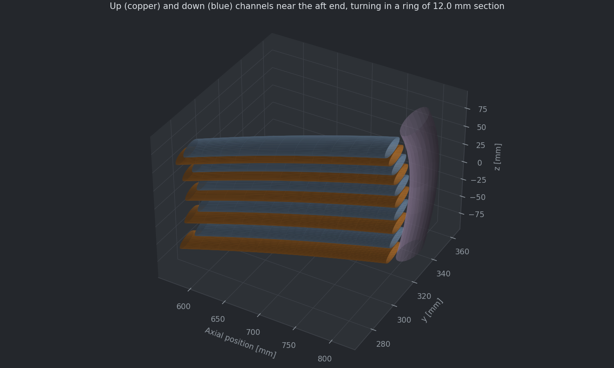

*Up and down channels near the aft end, turning in a ring of 12.0 mm section.*

### The example engines

Each example borrows the architecture of the engine it is named after, not its published dimensions or flows, and its `_comment` says where it departs. All five, and the shipped engine, are solved and drawn by [buildCoolingShowcase.py](../../featureShowcase/buildCoolingShowcase.py) from the GUI's own views.

| Engine | Chamber circuit | Extension | Result |
|---|---|---|---|
| NOVA single pass (A) | 60 channels to $\varepsilon$ 3 | C103 shell beyond | The shell exceeds its limit: Bartz at 6.9 MPa puts a columbium shell over it at any area ratio |
| Methalox booster, 500 kN, 10 MPa, $\varepsilon$ 25 | A, 120 channels splitting to 240 at $\varepsilon$ 2, 0.79 MPa | D, two passes to $\varepsilon$ 12, 115 to 543 K, 6.98 MPa, returned; turbine exhaust film over C103 | Shell 1340 K, 333 K inside its limit; 321.8 s |
| F-1-like, 6.77 MN, 7 MPa, $\varepsilon$ 16 | C, 90 down and 90 up Inconel 718 channels to $\varepsilon$ 10, 30 percent bypass, 560 K coking ceiling, carbon layer; 1.48 MPa | Turbine exhaust film over C103 | Metal 724 K with the coking ceiling binding; shell 1240 K; 306.4 s |
| Vulcain 2-like, 1.2 MN, 11.5 MPa, $\varepsilon$ 58 | A, 180 channels to $\varepsilon$ 4, 5.96 MPa | D, one pass coflow to $\varepsilon$ 12, dumped as a film; turbine exhaust film below it; C103 | Shell 865 K, 808 K inside its limit; 429.3 s |
| SSME-like, 1.86 MN, 20.6 MPa, $\varepsilon$ 69 | A, 390 rectangular NARloy-Z channels to $\varepsilon$ 5, 4.5 MPa | D, one pass counterflow from $\varepsilon$ 68 in 873 channels, 50 to 263 K, 0.54 MPa, returned | Both circuits in parallel from one discharge |

Specific impulses are the engine's after friction at its design back pressure, on the total flow including dumped coolant and turbine exhaust, with the films' thrust kept apart from the core.

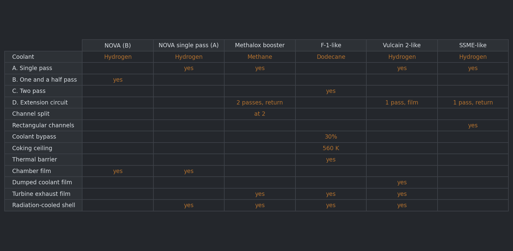

*Which cooling features each engine uses.*

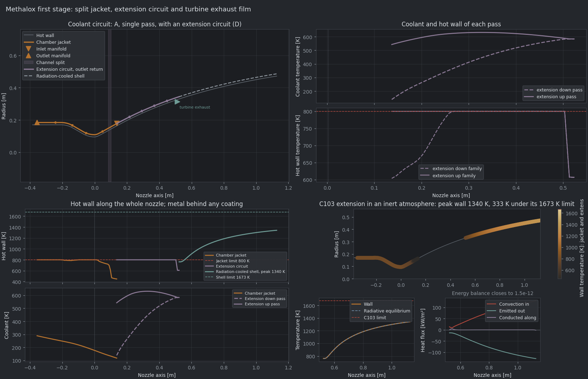

*Methalox first stage. The two-pass extension circuit acts as a counterflow heat exchanger between its passes: the down pass warms from 115 to 585 K toward the far end, and the up pass hands heat back through the rib, peaking at 630 K and leaving at 543 K.*

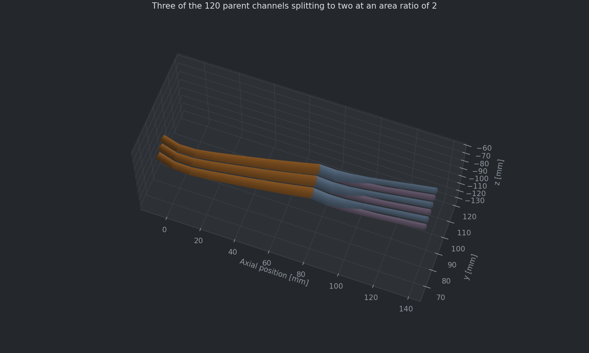

*Three of the 120 parent channels splitting to two at an area ratio of 2.*

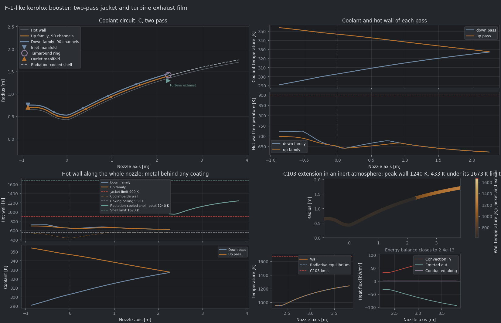

*F-1-like booster: the two families stay at or under 724 K of metal while the coolant-side wall sits at the 560 K coking ceiling; the turbine exhaust film holds the shell beyond an area ratio of ten to 1240 K.*

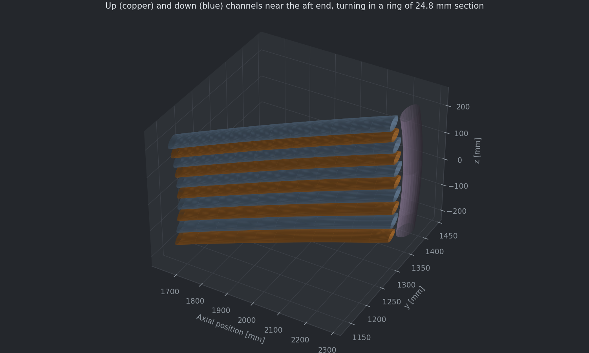

*The F-1-like jacket's alternating families and turnaround ring near the aft end.*

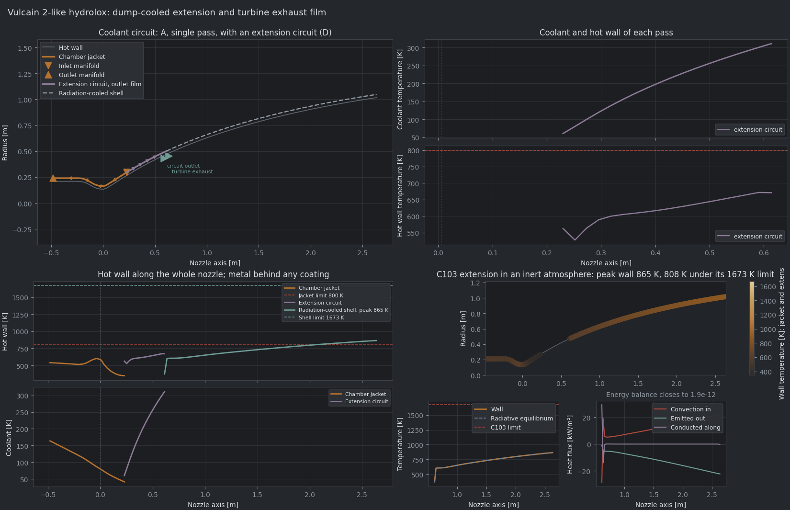

*Vulcain 2-like engine: the extension circuit dumps its hydrogen at 311 K through a slot at an area ratio of 12, and the turbine exhaust enters below it at 13.*

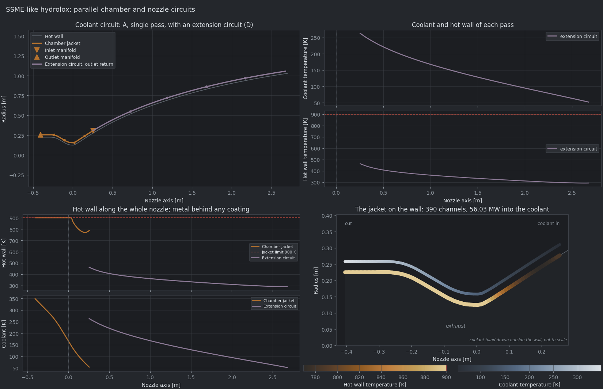

*SSME-like engine: the chamber circuit holds its NARloy-Z wall at the 900 K limit through the throat for 4.5 MPa; the nozzle circuit, fed at the exit, holds the bell under 470 K.*

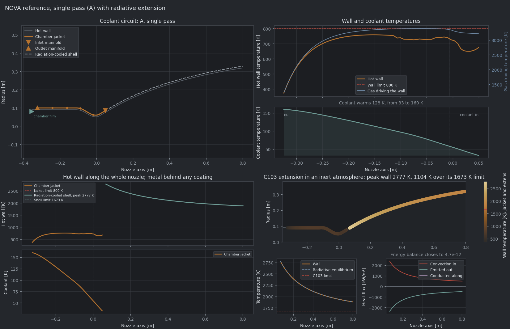

*The single-pass reference, the engine the shipped one replaces, with its C103 extension over its limit.*

### Defects found in Phase 7

**The coolant-side roughness correlation stepped at the onset of roughness.** `dippreySaberskyNusselt` switched to smooth-wall Gnielinski below a roughness Reynolds number of 5, on the understanding that the two met there. They do not: the Dipprey-Sabersky expression does not reduce to the smooth-tube result as the roughness vanishes, so the switch stepped by 25 percent at Pr 0.7, 69 percent at 2.5 and 228 percent at 25. On the F-1-like jacket the wall temperature jumped from 801.6 K to 1043.6 K across a radius change of 0.1 micrometers at the aft end, and the channel-size search oscillated across the step until it failed. The value is held between smooth-wall Gnielinski and Gnielinski on the wall's own friction factor,

$$
Nu = \max\left( Nu_{G}(f_s),\ \min\left( Nu_{DS},\ Nu_{G}(f_r) \right) \right)
$$

where $Nu_{G}(f)$ is Gnielinski's form on a friction factor, $f_s$ the smooth-wall and $f_r$ the rough-wall factor, and $Nu_{DS}$ the Dipprey-Sabersky expression. The upper bound is Dipprey and Sabersky's own finding that roughness buys less heat transfer than the friction it costs. The result is continuous, exact for a smooth wall, and unchanged wherever the expression already sat inside both bounds, which covers hydrogen on a printed wall above a roughness Reynolds number of about 15. Seven regression cases that jacket the whole bell on hydrogen move, by up to 24 K of wall temperature at the aft stations and 0.05 K at the outlet; every other case is bit-identical, and the methalox, Vulcain 2-like and SSME-like engines reproduce their earlier results exactly.

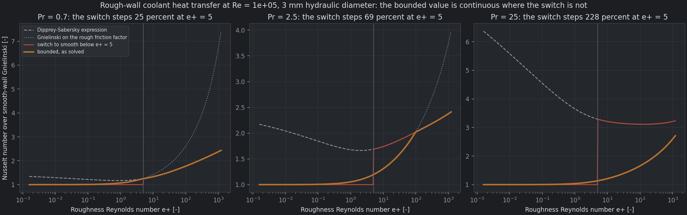

*Rough-wall Nusselt number over smooth-wall Gnielinski against the roughness Reynolds number, at Prandtl numbers of 0.7, 2.5 and 25: the expression alone, the switch at e+ = 5, the full-credit bound, and the bounded value the solver returns.*

**A coated wall's margin was read off the coating.** The sizing report, the GUI's jacket, wall-map, pass and extension views, the Analyze rows and the extension circuit report compared a barrier coating's gas-side surface with the limit, which applies to the metal behind it. On the F-1-like jacket that printed 2830 K against a 900 K limit while the metal sat at 724 K. Each reads the metal and reports the coating surface beside it.

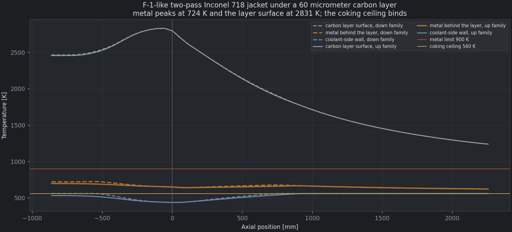

*The F-1-like jacket under its carbon layer: the metal behind the layer against the 900 K limit, the layer's own surface, and the coolant-side wall against the 560 K coking ceiling, for both families.*

**The rest.** The Analyze peak hot wall of a multi-pass jacket read the up family only. The contour figure labelled the throat with the resampled wall's minimum, 0.6 percent high. A chamber too narrow for its converging arcs failed inside the spline instead of being refused by name. The GUI drew the extension circuit in the jacket's color, the passive shell in the limit lines' red, a two-pass extension circuit as one pass, and adjacent slot labels over each other.

---

## Where the numbers stand

Stated in four categories, because they are not the same kind of claim.

**Checked against an independent solve.** The rib conductance between two passes runs 2 to 40 percent above a two-dimensional finite-difference conduction solve of the web between two circular channels.

**Verified against identities, with no external reference.** The coflow march reproduces a reflected counterflow march to 6.6e-15. Through a split, mass and enthalpy are continuous, the summed hot-wall sector areas equal $2\pi r\, ds_m$, and the union area matches a numerical polygon area to 1e-6. With the rib conductance off, two passes are two independent marches; the rib heat balances to 0.05 percent and the coolants' heat matches the wall's to 0.2 percent; the turnaround's loss is charged once and keeps the enthalpy. A one-pass extension circuit reproduces the standalone march bit for bit. With no film the extension drive is the recovery temperature exactly, and a perfect turbine reproduces CEA's frozen expansion. The flow accounting holds its arithmetic identities.

**Compared against published data, and off.** The F-1's gas generator reads 1252 K at equilibrium against its published 1063 K, with 35 percent of its mass as graphite. A real fuel-rich generator does not reach equilibrium, so every hydrocarbon turbine exhaust temperature here, and the film it lays, is overstated.

**Not validated.** No measurement of a multi-pass jacket, of the heat transfer through a split channel, or of a film over a radiation-cooled extension is available to this tool. Every film slot on the example engines runs at 0.06 to 0.15 of the core velocity, far outside the 0.9 to 1.15 band SP-8124's entrainment closure was written for; each run reports Hatch-Papell beside it, and the two disagree by 500 K on the methalox extension. The F-1-like example's carbon layer, 60 micrometers at 0.2 W/m-K, is an assumed value, and the jacket depends on it: with no layer the coolant runs out of pressure holding the coolant-side wall at its coking ceiling, a 20 micrometer layer closes it for 2.6 MPa with the metal at 894 K, and the 60 micrometer layer for 1.48 MPa at 724 K. Every circuit inherits the gas-side and coolant-side status recorded in `gasSideHeatTransfer.py` and `regenThermal.py`; on a hydrocarbon coolant the roughness correlation is extrapolated to Prandtl numbers four times past its fitted range, and there it sits on its full-credit bound.

---

## Open work and the path forward

In the order the value justifies the effort.

**The gas generator's equilibrium.** A frozen or kinetically limited generator model would close the 189 K gap at the F-1 point and every hydrocarbon exhaust film with it. It is the largest known error in a number the examples report.

**A soot model for kerosene.** The F-1-like jacket closes only under an assumed carbon layer; with none, the coking ceiling asks for channels too small for the flow. A deposit correlation that grows the layer from the wall temperature and the mixture ratio would replace the assumption with a prediction, and is what any hydrocarbon jacket at a low wall limit needs.

**Film data at rocket conditions.** The DLR supersonic hydrogen film measurements would put a number on the closures over an extension, where they now disagree by hundreds of kelvin. Velocity ratios near the SP-8124 band would need slots sized for them.

**Multi-pass circuits on shaped channels.** B and C take circular channels only, and a split is refused inside them. The F-1's flattened tubes, its doubling from 178 to 356 tubes at an area ratio of 3, and the J-2's bundle cannot be drawn as they were.

**The dump-cooled objective.** The extension circuit is sized at the flow it is given. Pavli's inverted objective, the least flow that holds the wall, would make dump cooling a design output rather than a sweep.

**Wadel's bifurcated designs.** A comparison of trends against them is possible and has not been made.

**The cycle.** The gas generator is specified, not balanced against the pumps; a power balance would tie the exhaust flow to the engine rather than to the configuration.

---

## Reproducing

From the NOVA root with `C:\Users\seanb\miniconda3\python.exe`:

```bash
python -m pytest                                              # the suite, 2125 tests
python tests/regressionHarness.py --compare                   # the 21 regression cases
python validation/coolingCircuits/phase0Verification.py       # one script per phase, 0 to 5
python featureShowcase/buildCoolingShowcase.py                # the six engines, about 35 minutes
python validation/coolingCircuits/phase7Verification.py       # after the showcase has cached keroloxF1
python featureShowcase/buildGuiScreenshots.py                 # the GUI views, on a visible desktop
```

Every number quoted in this report is printed by one of those scripts or by the run of the engine it describes.

## Author's Information

Sean Bowman - Last Updated [11/05/2026]
