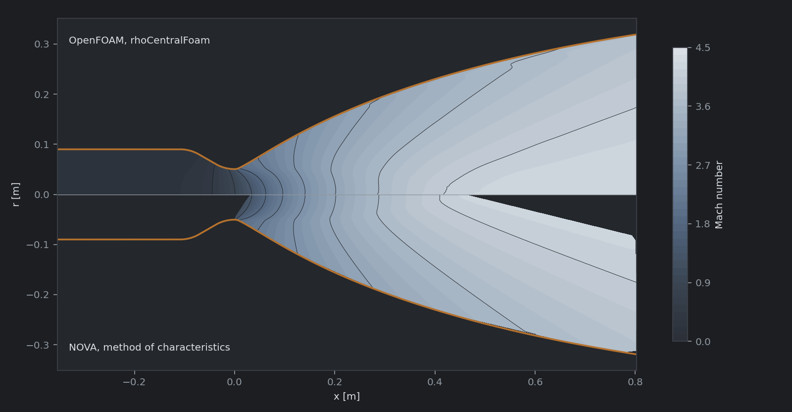
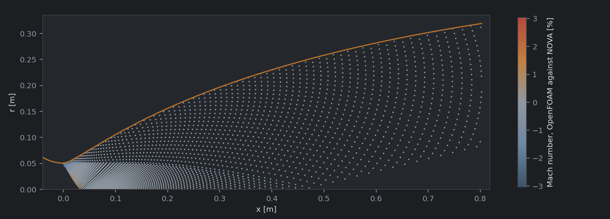
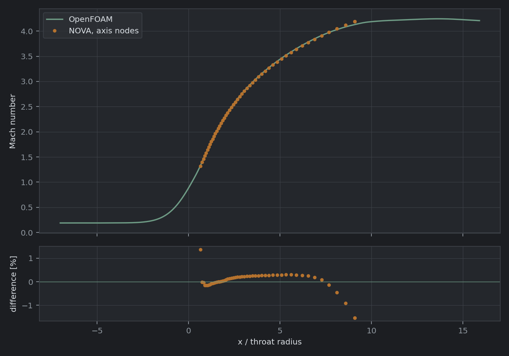
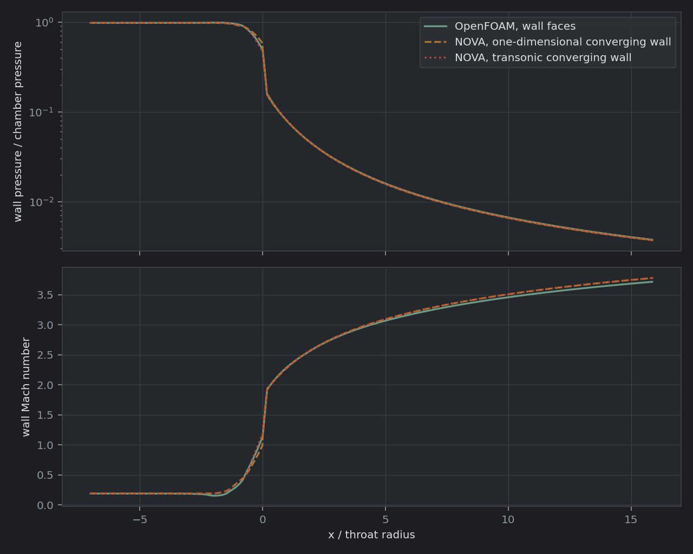
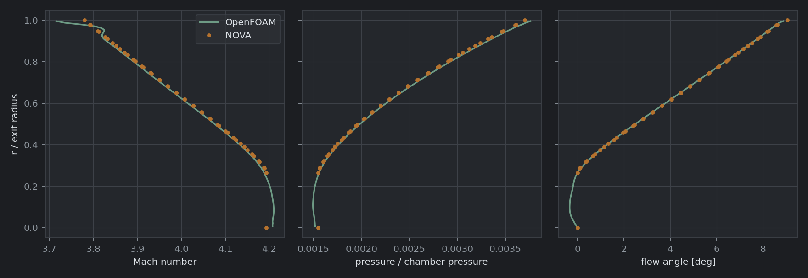
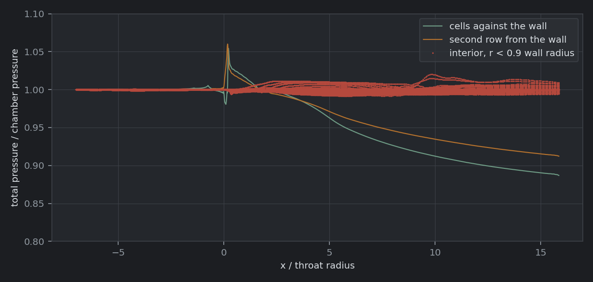
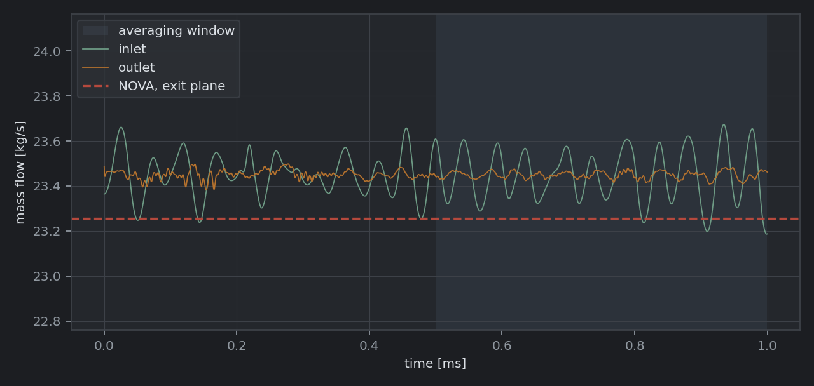
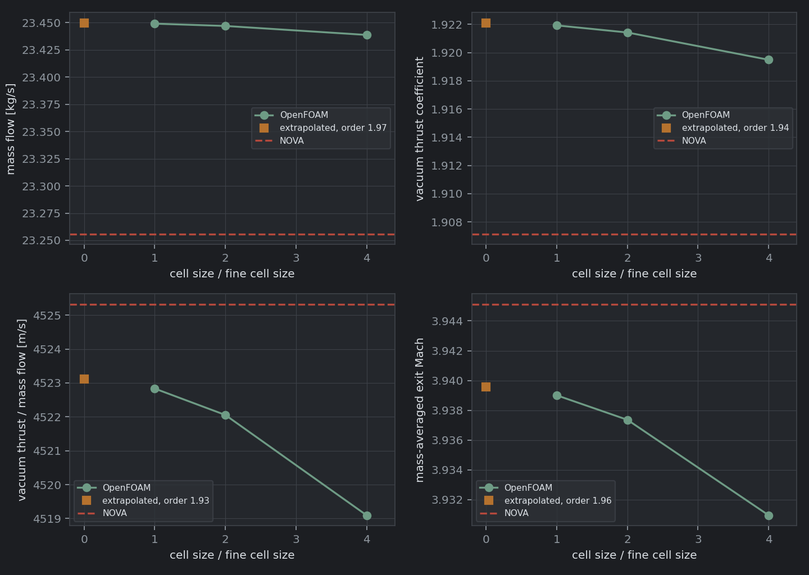

# NOVA Nozzle in OpenFOAM

An axisymmetric Euler solution of NOVA's shipped nozzle in OpenFOAM, run as a cross-check of the flow NOVA's method of characteristics computes inside the nozzle. The plume outside the exit plane is a separate case, described in [plume.md](plume.md).

## Contents

- [Summary](#summary)
- [What the case solves](#what-the-case-solves)
- [Running it](#running-it)
- [What is compared](#what-is-compared)
- [Acceptance criteria](#acceptance-criteria)
- [Results](#results)
- [Findings](#findings)
- [NOVA defects this comparison found](#nova-defects-this-comparison-found)
- [Validation status](#validation-status)
- [References](#references)
- [Files](#files)

## Summary

OpenFOAM and NOVA agree on the expansion to 0.05 percent and on the mass flow to 0.83 percent. Extrapolated to zero cell size, OpenFOAM's throat passes 0.83 percent more mass than NOVA's exit plane carries, and its vacuum thrust coefficient is 0.78 percent higher; per unit mass flow the two agree to 0.05 percent. The mass difference has two parts of about equal size. Sauer's starting line, which NOVA's characteristics start from, carries 0.43 percent less mass than the finite-volume throat; NOVA's characteristic march then loses another 0.39 percent to its first-order discretization at 50 characteristics. OpenFOAM's discharge coefficient sits 0.01 percent above Kliegel and Levine's, the coefficient NOVA sizes its throat with, so the throat passes the mass NOVA designs it for.

| Quantity | OpenFOAM, extrapolated | NOVA | NOVA against OpenFOAM |
| --- | --- | --- | --- |
| Discharge coefficient | 0.9947 | 0.9865 at the exit plane | -0.83 % |
| Vacuum thrust coefficient | 1.9221 | 1.9072 | -0.78 % |
| Thrust per unit mass flow [m/s] | 4523.1 | 4525.3 | +0.05 % |
| Mass-averaged exit Mach | 3.9396 | 3.9451 | +0.14 % |

Nine of the ten criteria pass. The one that fails, the field Mach number's 95th percentile at 2.62 percent against a 2.0 percent limit, is set by the expansion around the throat's exit arc at the wall, where 42 percent of NOVA's characteristic nodes lie. There the finite-volume fan sits three quarters of a cell downstream of NOVA's on every grid, so the difference closes with the grid; beyond one throat radius past the throat the 95th percentile is 0.43 percent.

## What the case solves

The problem NOVA's method of characteristics solves, with nothing added: the Euler equations for a calorically perfect gas, inside NOVA's wall, from NOVA's stagnation state. A difference between the two solutions is then a difference of method, because the physics is identical.

| Item | Setting |
| --- | --- |
| Nozzle | `src/NOVA/assets/NOVANozzle.json`: 100 kN LOX/LH2, Pc = 6.895 MPa, area ratio 40, truncated ideal contour at a length fraction of 0.8, Rao throat (entrant arc 1.5, exit arc 0.382 throat radii) sized by Kliegel and Levine's discharge coefficient to a 50.474 mm radius, Sauer transonic start, 50 characteristics |
| Gas | NOVA's chamber values: gamma = 1.147542, R = 656.596 J/kg K (molecular weight 12.663 kg/kmol), T0 = 3398.37 K |
| Wall | NOVA's contour resampled to 2000 points, injector face to exit plane; slip |
| Inlet | Injector face; total pressure Pc and total temperature T0 (`totalPressure`, `totalTemperature`), velocity zero gradient |
| Outlet | Exit plane; zero gradient on every field (the outflow is supersonic everywhere) |
| Mesh | 5 degree wedge, one row of blocks from axis to wall, split where the wall radius changes by 30 percent; cells 1.5 times as long as they are tall, sized from the local radius; 30, 60 and 120 cells across the radius (5340, 21660 and 86400 cells) |
| Solver | `rhoCentralFoam` (OpenFOAM v2606, ESI): Kurganov-Tadmor central fluxes, van Leer limited reconstruction, explicit Euler in time |
| Initial field | Coarse grid: the quasi one-dimensional isentropic flow. Medium and fine: the next coarser grid's solution, mapped |
| Run | Coarse 6 ms, medium 3 ms, fine 1 ms of physical time; fields averaged over the second half of each run |

Four details of the setup matter to the numbers.

**The wedge carries the exact flow area.** A wedge built from flat faces has a cross-section of r^2 sin(a) / 2 against the sector's r^2 a / 2, which at 5 degrees is 0.13 percent less flow area at every station. The wall points sit sqrt(a / sin a) = 1.000635 times the contour radius out, which gives the flat-faced wedge the sector's area exactly, so the throat area, mass flow and thrust need no correction. The comparison maps mesh coordinates back to contour radius.

**The Courant number limit is set high on purpose.** `rhoCentralFoam` sums the wave speed over every face of a cell, the wedge faces included, although they carry no flux. On the prisms along the axis the wedge faces make up about nine tenths of the sum, so they set the time step. The case runs at `maxCo 1.0`, where the in-plane Courant number at the throat, which decides the scheme's stability, is about 0.2. At `maxCo 2.5` it is about 0.45 and the run is unstable: on the coarse grid the standard deviation of the inlet mass flow grows from 0.46 to 1.3 percent between 1.5 and 4 ms, where at 0.4 and 1.0 it decays alike, from 0.9 to 0.3 percent over the first 1.5 ms.

**The chamber rings, so the fields are time-averaged.** The chamber's radial acoustic modes carry almost no energy into the nozzle, and an inviscid solution has nothing else to damp them. They ring for as long as the run lasts: the first radial mode, near 11 kHz (1.84 c / pi D for a 0.18 m chamber), on the coarse grid, and the second, near 20 kHz, on the medium, at 0.2 to 0.5 percent of the inlet mass flow and a fifth to a seventh of that at the exit. The mean flow is steady; an instant of it is not. A `fieldAverage` function object averages p, T and U over the second half of each run, and every comparison reads the averages.

**The cells against the wall lose total pressure.** The slip wall takes the wall pressure equal to the pressure in the cell beside it, which on a curved wall ignores the pressure gradient that turns the flow. Dadone and Grossman showed this zeroth-order treatment generates spurious entropy at the wall [3]. Here it takes the total pressure in the row of cells against the wall from 1.0 at the end of the throat arc to between 0.89 and 0.93 of the chamber's at the exit on every grid, while the interior holds it to within about a percent. The cell aspect is fixed, so the entropy each wall cell accumulates along the wall does not shrink with the grid; the layer it occupies does. The wall values this case returns are therefore the least trustworthy part of it. Its integrated quantities still converge at an observed order of 1.9 to 2.0, so the layer's share of them is small. See [Findings](#findings).

## Running it

The case is written by the Python NOVA is installed in and run under OpenFOAM v2606 from openfoam.com, here in WSL2 Ubuntu 24.04 with the environment loaded by `source /usr/lib/openfoam/openfoam2606/etc/bashrc`. The comparison scripts need Python 3 with NumPy and Matplotlib on the OpenFOAM side. Cases run from the Linux file system rather than from `/mnt/c`, which is much slower for the many small files OpenFOAM writes.

1. Write the three cases. The first call solves NOVA twice, once with each converging-wall model (about three minutes each), and writes `reference/novaNozzle.json` and `reference/style.json`; later calls reuse them until `--refresh` is passed.

   ```bash
   python validation/openFoam/makeNozzleCase.py --resolution coarse
   python validation/openFoam/makeNozzleCase.py --resolution medium
   python validation/openFoam/makeNozzleCase.py --resolution fine
   ```

2. Copy them into the Linux file system and run the coarse grid, then each finer grid from the one before it. Each `Allrun` meshes, initializes or maps, runs on four processors, reconstructs the last write and runs the comparison, which it logs to `log.python3.compare`. On an otherwise idle four-core machine the coarse grid takes about 10 minutes, the medium about 30 and the fine about 2 hours.

   ```bash
   cp -r /mnt/c/.../NOVA/validation/openFoam/cases/novaNozzle2D-* ~/foam/
   cd ~/foam/novaNozzle2D-coarse && ./Allrun
   cd ~/foam/novaNozzle2D-medium && ./Allrun ../novaNozzle2D-coarse
   cd ~/foam/novaNozzle2D-fine && ./Allrun ../novaNozzle2D-medium
   ```

3. Run the grid study across the three:

   ```bash
   cd ~/foam
   python3 novaNozzle2D-fine/scripts/gridConvergence.py novaNozzle2D-coarse novaNozzle2D-medium novaNozzle2D-fine
   ```

Each case's `comparison/` folder holds `comparison.json` and the figures. Open `case.foam` in ParaView for the fields; `pMean`, `TMean` and `UMean` are the averaged ones.

## What is compared

| Quantity | OpenFOAM | NOVA |
| --- | --- | --- |
| Mass flow | Outlet face values integrated over equal radial divisions of the exit radius; equal to the solver's own outlet flux | `exitMassFlux`: NOVA's exit plane, trapezoidal rule on mass flux times radius |
| Vacuum thrust coefficient | Integral of rho u_x^2 + p over the exit plane, over Pc At | `thrustCoef`, the trapezoidal rule on momentum flux times radius plus NOVA's pressure term, with the design exit pressure over the plane's area added back, which turns the pressure term from the design back pressure to vacuum |
| Thrust per unit mass flow | The two integrals above | The two figures above |
| Mass-averaged exit Mach | Outlet faces, weighted by mass flux | NOVA's exit stations, weighted by mass flux under the same trapezoidal rule |
| Exit profiles | Outlet face values | `exitPlaneRadius`, `exitPlaneMach`, `exitPlanePressure`, `exitPlaneFlowAngle` |
| Centerline Mach | Line sample on the axis | Every node of the characteristic mesh on the axis |
| Wall state | Wall face values | `nozzleNearWall*`: the characteristic wall in the diverging section; ahead of the throat both converging-wall models, one-dimensional (shipped) and transonic |
| Field | Cell values, interpolated linearly to each node | Mach number and flow angle at every node of the characteristic mesh inside the nozzle |
| Discharge coefficient | Mass flow over the one-dimensional choked flow through the geometric throat at the chamber gamma, 23.574 kg/s | Exit-plane mass flow over the same; and the closed forms of Hall and of Kliegel and Levine [1, 2] |

NOVA's exit plane is also integrated a second way, as an exact integral of its piecewise-linear profile (the "NOVA profile" column of the comparison). The trapezoidal rule on an integrand times radius is exact only where that product is linear in radius; the two integrals differ by 0.01 percent on mass flow and thrust and by 0.03 percent or less on every exit quantity, so NOVA's quadrature contributes nothing measurable to the differences below.

## Acceptance criteria

Every limit is a relative difference of OpenFOAM against NOVA's reported value unless stated, and every limit was fixed before the first converged run, in `compareWithNova.py`. The two steadiness criteria were first written against the last instant and the last two writes. The chamber's radial modes made an instantaneous value a measure of the oscillation's phase rather than of convergence, so they are judged on means over the averaging window; the limits are unchanged.

| Criterion | Limit | Basis |
| --- | --- | --- |
| Vacuum thrust coefficient | 1.0 % | The level at which a contour designer would act |
| Mass flow | 1.0 % | As above |
| Thrust per unit mass flow | 0.5 % | Independent of the throat's discharge coefficient; two isentropic solutions should agree closely on it |
| Mass-averaged exit Mach | 1.0 % | The exit state the plume and the thrust both start from |
| Centerline Mach, worst node | 2.0 % | The axis is where the characteristic mesh is sparsest and the finite-volume solution least accurate |
| Diverging wall pressure, worst point from one throat radius past the throat | 5.0 % | Wall pressure falls two decades over the section, so a small shift in position shows as a large local difference |
| Field Mach, 95th percentile over every node | 2.0 % | Allows a few nodes in the transonic start and the steep throat expansion |
| Mass imbalance, inlet against outlet, window means | 0.1 % | Steady state |
| Drift of the outlet mass flow and thrust, second half of the window against the first | 0.05 % | Steady state |
| Vacuum thrust coefficient, medium grid against fine | 0.2 % | Grid convergence |

## Results

Every number for each grid is in `results/<grid>/comparison.json`, with the table `compareWithNova.py` prints in `comparison.txt` beside it. The grid study is in `results/gridConvergence.json`. The figures are the fine grid's.

### Exit plane and throat

The extrapolated value, observed order and grid convergence index come from the three grids at a refinement ratio of 2 [4]. "NOVA, profile" integrates NOVA's exit plane as an exact piecewise-linear profile; see [What is compared](#what-is-compared).

| Quantity | Coarse | Medium | Fine | Extrapolated | Order | GCI | NOVA, reported | NOVA, profile |
| --- | --- | --- | --- | --- | --- | --- | --- | --- |
| Mass flow [kg/s] | 23.439 | 23.447 | 23.449 | 23.450 | 1.97 | 0.004 % | 23.256 | 23.253 |
| Discharge coefficient | 0.9943 | 0.9946 | 0.9947 | 0.9947 | | | 0.9865 | 0.9864 |
| Vacuum thrust coefficient | 1.9195 | 1.9214 | 1.9219 | 1.9221 | 1.94 | 0.012 % | 1.9072 | 1.9070 |
| Thrust per unit mass flow [m/s] | 4519.1 | 4522.1 | 4522.8 | 4523.1 | 1.93 | 0.008 % | 4525.3 | 4525.4 |
| Mass-averaged exit Mach | 3.9309 | 3.9374 | 3.9390 | 3.9396 | 1.96 | 0.018 % | 3.9451 | 3.9452 |

The closed forms for the inviscid discharge coefficient [1, 2], at the entrant arc (R = 1.5): Kliegel and Levine 0.9946, Hall 0.9938. At the exit arc (R = 0.382): Kliegel and Levine 0.9740. NOVA sizes its throat by Kliegel and Levine's value at the entrant arc and the throat's ratio of specific heats, 1.1502, for a design mass flow of 23.466 kg/s.

### Criteria, fine grid

| Criterion | Value | Limit | Result | Where it is largest |
| --- | --- | --- | --- | --- |
| Vacuum thrust coefficient | 0.77 % | 1.0 % | pass | |
| Mass flow | 0.83 % | 1.0 % | pass | |
| Thrust per unit mass flow | -0.05 % | 0.5 % | pass | |
| Mass-averaged exit Mach | -0.16 % | 1.0 % | pass | |
| Centerline Mach, worst node | 1.53 % | 2.0 % | pass | The kernel's last axis node, at 9.08 throat radii |
| Diverging wall pressure, worst point | 1.61 % | 5.0 % | pass | The exit plane, in OpenFOAM's wall cells |
| Field Mach, 95th percentile | 2.62 % | 2.0 % | fail | The exit arc's expansion at the wall; 0.43 % beyond one throat radius |
| Mass imbalance, window means | 0.005 % | 0.1 % | pass | |
| Drift over the window | 0.004 % | 0.05 % | pass | |
| Vacuum thrust coefficient, medium against fine | -0.026 % | 0.2 % | pass | |

### Figures

Mach number, OpenFOAM above the axis and NOVA below. NOVA's net does not reach the uniform core near the axis past 0.46 m, and has nothing upstream of its start line.



The Mach number difference at every node of NOVA's net. The largest differences lie along the throat's exit arc.



The centerline, against NOVA's axis nodes.



The wall, against NOVA's near-wall state under both converging-wall models.



The exit plane. NOVA's sampled stations stop at 0.29 of the exit radius; inside 0.265 of it NOVA closes the plane with the uniform design core.



OpenFOAM's total pressure along the nozzle in the row of cells against the wall, the row behind it, and the interior.



Mass flow through the inlet and the outlet over the fine run, with the averaging window shaded.



The exit-plane quantities on the three grids, their extrapolation and NOVA's values.



## Findings

**The throat passes the mass NOVA sizes it for.** OpenFOAM's discharge coefficient converges to 0.9947, against 0.9946 from Kliegel and Levine's series at the entrant arc's curvature and 0.9938 from Hall's [1, 2]. NOVA makes its geometric throat larger than the one-dimensional choked area by Kliegel and Levine's coefficient, evaluated at the throat's ratio of specific heats, for a design mass flow of 23.466 kg/s. The finite-volume solution passes 23.450 kg/s, 0.07 percent less. The case solves at the chamber's ratio of specific heats, 1.1475, at which the one-dimensional choked flow is 0.08 percent lower than at the throat's 1.1502, so the throat itself delivers its design mass flow to 0.01 percent.

**NOVA's exit plane carries 0.83 percent less mass than the throat passes.** As fractions of the one-dimensional choked flow at the chamber gamma, OpenFOAM's throat passes 0.9947, Sauer's starting line 0.9904 and NOVA's exit plane 0.9865. The first step, 0.43 percent, is Sauer's transonic solution: its closed form, 1 - (gamma + 1) / (96 R^2) = 0.9901 at the entrant arc, is the leading term of the series whose next terms give Kliegel and Levine's 0.9946. The second step, 0.39 percent, is NOVA's characteristic march, which is first order and halves its loss with each doubling of the characteristic count: 0.89 percent at 25 characteristics, 0.42 at 50 and 0.19 at 100 (`tests/testContourMassFlow.py`). Every figure NOVA reports per unit of throat area carries both steps: its vacuum thrust coefficient is 0.78 percent below OpenFOAM's extrapolated value.

**The supersonic expansion agrees.** Thrust per unit mass flow is independent of the throat's coefficient, and OpenFOAM's is 0.05 percent below NOVA's, on the fine grid and extrapolated alike. At NOVA's exit stations inside 97 percent of the exit radius, Mach number agrees to 0.15 percent on average and 0.39 percent at worst, and flow angle to 0.014 degrees on average and 0.05 at worst. The three stations nearest the wall differ by 0.3 to 1.7 percent, in the cells the wall error below reaches. Beyond one throat radius past the throat, the Mach number at NOVA's characteristic nodes differs by 0.17 percent on average, with a 95th percentile of 0.43 percent, and the flow angle by 0.07 degrees on average. The centerline differs by 0.25 percent on average, and by 0.30 percent at most away from the kernel's last three axis nodes.

**The design core agrees.** A truncated ideal contour is cut from an ideal nozzle, whose flow inside the left-running characteristic from the kernel's last axis point is uniform and axial at the design Mach number, here 4.1935. That characteristic crosses the exit plane at 0.265 of the exit radius (1.67 throat radii), and NOVA closes the plane inside it with the design state. Across the same radius OpenFOAM's Mach number runs from 4.189 to 4.211 with flow angles of at most 0.33 degrees on the fine grid, 0.28 percent from the design value on average; the range narrows with each grid (4.196 to 4.259 on the coarse, 4.193 to 4.223 on the medium).

**The kernel's end carries the largest centerline difference.** NOVA's axis reaches the design Mach number at the kernel's last axis point, 9.08 throat radii past the throat, with a break in slope. The finite-volume solution rounds the break: it reaches 4.1935 at 10.2 throat radii, overshoots to 4.244 at 13.6 and leaves the nozzle at 4.208. The kernel's last node is the worst on the centerline, at -1.53 percent. The axis is also where the finite-volume solution is least accurate: the total pressure in the cells nearest it rises to 1.02 times the chamber's near 10 throat radii on the fine grid, 1.06 on the medium and 1.14 on the coarse.

**The transonic start agrees, apart from its first axis node.** Within one throat radius of the throat and inside 0.75 of the wall radius, NOVA's nodes differ from OpenFOAM's field by 0.54 to 0.58 percent at the 95th percentile on the fine grid, against 0.7 to 0.8 on the medium and 1.3 to 1.4 on the coarse. NOVA's first axis node, at 0.65 throat radii, has Mach 1.317 against OpenFOAM's 1.345, 1.339 and 1.335 on the three grids; the difference closes at about first order toward roughly 1 percent.

**The field criterion fails in the exit arc's expansion.** The 0.382 exit arc turns the wall flow from Mach 1.3 to 2.0 within 0.3 throat radii of the throat. NOVA packs 2691 of its 6384 nodes into that region, within a tenth of the wall radius of the wall and one throat radius of the throat. There OpenFOAM's Mach number is below NOVA's by 1.85 percent on average on the fine grid, 2.11 on the medium and 2.87 on the coarse, and the near-throat 95th percentile falls from 7.5 to 3.9 to 2.7 percent. Along the wall the finite-volume fan sits 0.042, 0.018 and 0.0096 throat radii downstream of NOVA's on the three grids: about three quarters of a cell length each time. The difference is the finite-volume solution's resolution of the fan, and the whole-field percentile fails on it because so many nodes lie there.

**On the converging wall the transonic model is closer.** Against OpenFOAM's wall pressure ahead of the throat, NOVA's transonic near-wall model differs by 3.1 to 3.5 percent at the 95th percentile and the shipped one-dimensional model by 6.4 to 6.5 percent, on all three grids. Neither captures the flow slowing into the concave fillet where the barrel meets the cone. There, 1.8 throat radii ahead of the throat, OpenFOAM's wall Mach number is 0.159 against the one-dimensional 0.202, 21 percent lower.

**OpenFOAM's wall values are not trustworthy to a few percent.** The row of cells against the wall loses total pressure steadily along the bell, to 0.89 of the chamber's at the exit on the fine grid (0.91 coarse, 0.93 medium), while the interior holds it to within about a percent. From 4 throat radii to the exit, its wall pressure sits 1.2 to 1.6 percent above NOVA's characteristic wall on the fine grid, and 1.3 to 1.5 percent above on average on every grid; from 1 to 2 throat radii, where the exit arc meets the contour, it agrees to 0.5 percent. The diverging-wall criterion passes, with its worst point at the exit plane, but it tests the case's wall treatment as much as NOVA.

## NOVA defects this comparison found

The comparison was first run against a version of NOVA that failed five of the ten criteria. It exposed five defects, each corrected in NOVA and recorded in `docs/NozzleContourValidation.md`; the results above are against the corrected solver.

- **The kernel discarded most of its starting line.** On the 0.382 exit arc the throat arc's characteristics reach only the outer eighth of the starting line's radius, and the characteristic that opened the inner kernel carried nothing from the rest of it. NOVA passed 2.1 percent less mass than OpenFOAM, its vacuum thrust coefficient was 2.4 percent low, and its first axis node sat at Mach 1.204 against OpenFOAM's 1.321. `contourKernel.startLineCharacteristic` solves that characteristic from the line by a characteristic net reflected from the axis.
- **The exit plane's core was extrapolated.** The sampler closed the plane below its last station by extending the last two stations' slope to the axis, which put the core 2.5 percent above the design Mach number. The plane closes with the uniform design core.
- **Thrust and mass flow were integrated by different rules,** which put NOVA's thrust per unit mass flow 0.47 percent below its own profile's. Both take the trapezoidal rule on the integrand times radius.
- **The throat was sized by an unsourced factor of the wrong sign,** which shrank it by 0.07 percent where a curved sonic line needs it larger. It is sized by Kliegel and Levine's discharge coefficient.
- **One exit station lay outside the wall,** at 6.421 throat radii against 6.325. The sampler drops stations beyond the wall's radius.

## Validation status

**This is a cross-check, not a validation.** NOVA's method of characteristics and OpenFOAM's finite-volume solution are two unvalidated solutions of the same inviscid problem. Where they agree, the agreement shows NOVA's characteristic net, its transonic start and its exit-plane integration are consistent with an independent discretization of the same equations; it does not show either matches a real nozzle, which is viscous, reacting, and has a boundary layer that changes the effective wall.

**The discharge coefficient has a closed-form reference.** Kliegel and Levine's transonic series [1, 2] gives the inviscid discharge coefficient of an axisymmetric throat from its wall curvature alone. It is derived for a symmetric throat, and this one is not, so it is an approximate reference here. The finite-volume coefficient, extrapolated, sits 0.01 percent above it at the entrant arc's curvature. NOVA sizes its throat with the same coefficient, so its design mass flow carries that reference's support. Its exit plane's mass flow, 0.83 percent lower, is the least-supported figure in the comparison, and both parts of that deficit are identified above.

What would close the gap: measured wall pressures and mass flow from a contoured nozzle with a known throat geometry, such as the cold-flow nozzles of Back, Massier and Gier, run through both NOVA and this case; and a curvature-corrected wall boundary condition in the case [3], which would make its wall values usable.

## References

[1] Kliegel, J. R., and Levine, J. N.: *Transonic Flow in Small Throat Radius of Curvature Nozzles*. AIAA Journal, vol. 7, no. 7, 1969, pp. 1375-1378.

[2] Cao, P., Wang, C., Li, C., and Ding, H.: *The Theoretical Analysis and Waviness Profile Measurement for the Discharge Coefficient of Sonic Nozzles*. FLOMEKO 2019, Lisbon. Equations 2 and 3 give Hall's series as Kliegel and Levine corrected it and Kliegel and Levine's recast in 1/(R + 1). <https://imeko.org/publications/tc9-2019/IMEKO-TC9-2019-028.pdf>

[3] Dadone, A., and Grossman, B.: *Surface Boundary Conditions for the Numerical Solution of the Euler Equations*. AIAA Journal, vol. 32, no. 2, 1994. As summarized by Wang, Z. J., and Sun, Y.: *A Curvature-Based Wall Boundary Condition for the Euler Equations on Unstructured Grids*, AIAA 2002-0966, <https://cfd.ku.edu/papers/aiaa-2002--0966.pdf>: zeroth-order pressure extrapolation to a curved wall generates significant spurious entropy.

[4] Roache, P. J.: *Perspective: A Method for Uniform Reporting of Grid Refinement Studies*. Journal of Fluids Engineering, vol. 116, no. 3, 1994, pp. 405-413.

## Files

| File | Purpose |
| --- | --- |
| `makeNozzleCase.py` | Solves NOVA, writes `reference/` and a case folder for one grid |
| `initializeFromQuasi1D.py` | Writes the quasi one-dimensional flow into the initial fields; copied into each case |
| `compareWithNova.py` | Compares a converged case with NOVA and judges the criteria; copied into each case |
| `gridConvergence.py` | Richardson extrapolation and grid convergence index across the three grids; copied into each case |
| `reference/novaNozzle.json` | NOVA's solution: gas, wall, near-wall state under both converging-wall models, characteristic mesh, exit plane, performance |
| `reference/style.json` | NOVA's dark figure palette, so the figures match the rest of the documentation |
| `results/` | The comparison of each grid, the fine grid's figures and the grid study |
| `cases/` | Generated cases and NOVA's scratch runs; not tracked |
| `plume.md`, `makePlumeCase.py`, `setPlumeInflow.py`, `comparePlume.py`, `plumeGridConvergence.py`, `reference/novaPlume.json`, `results/plume/` | The plume case; see [plume.md](plume.md) |
