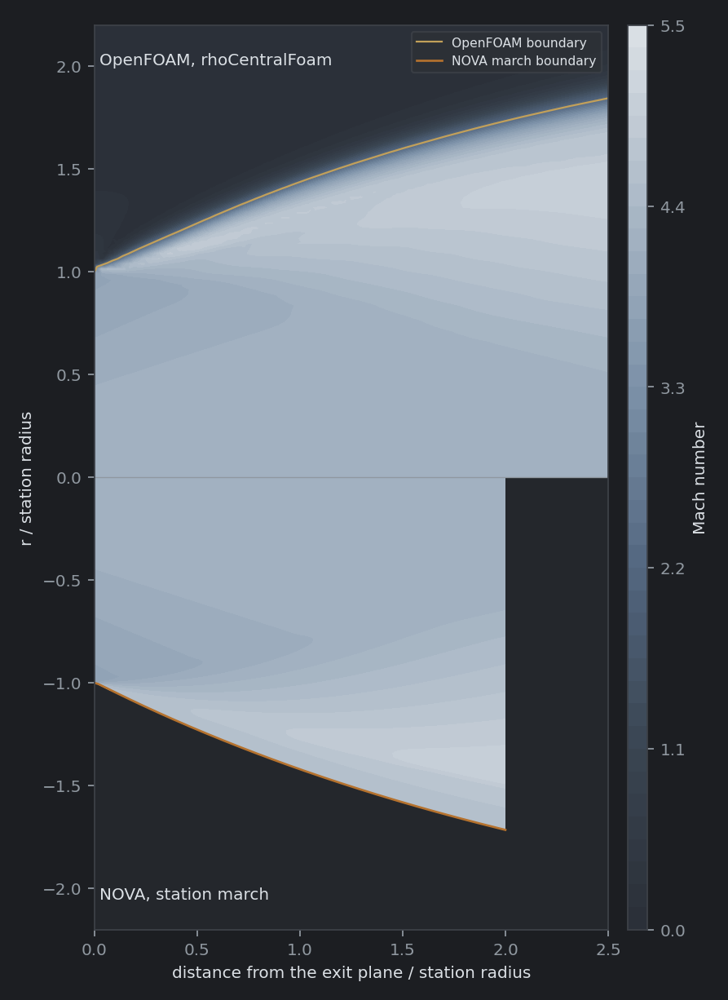
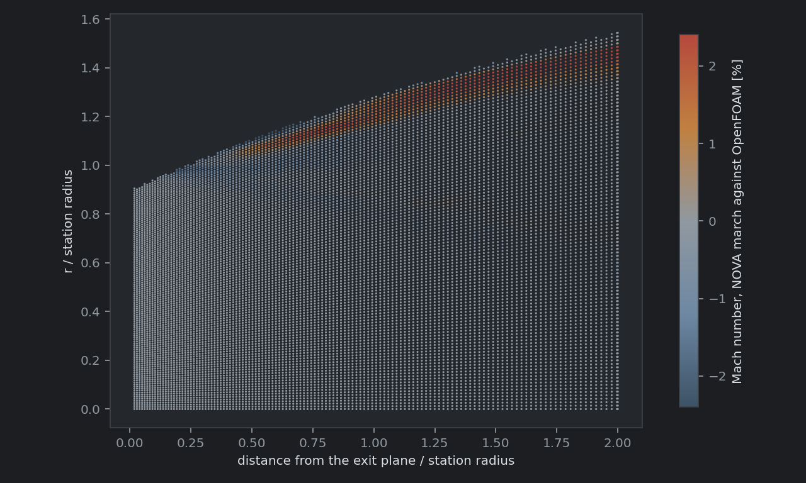
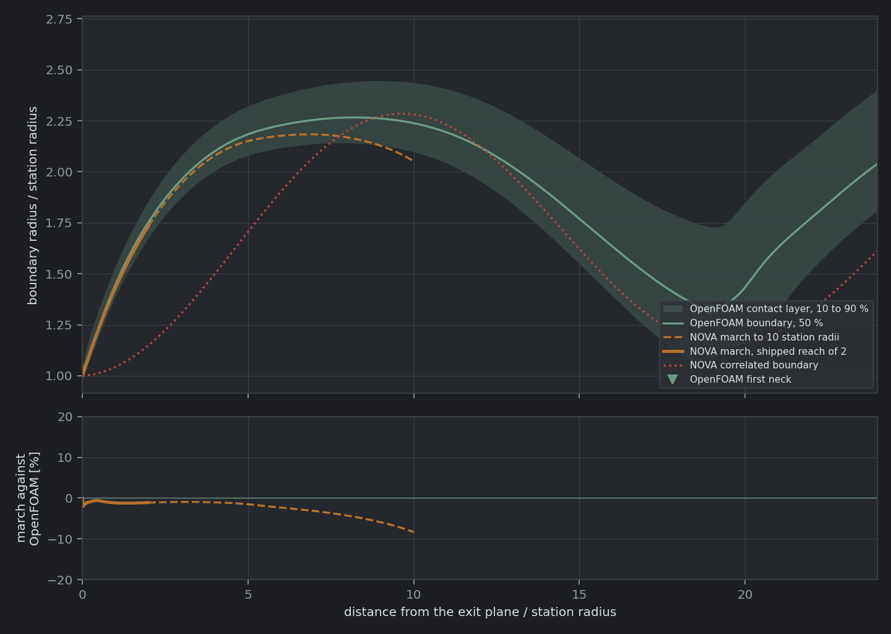
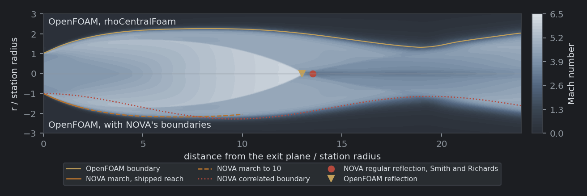
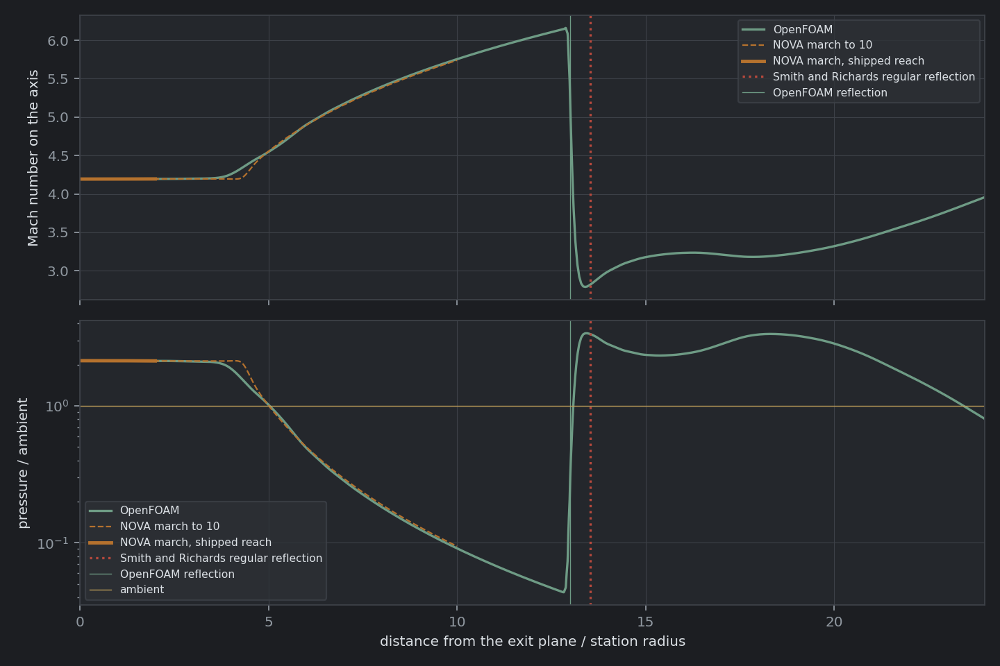
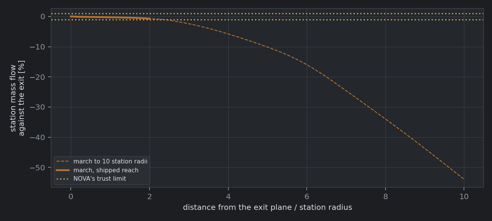
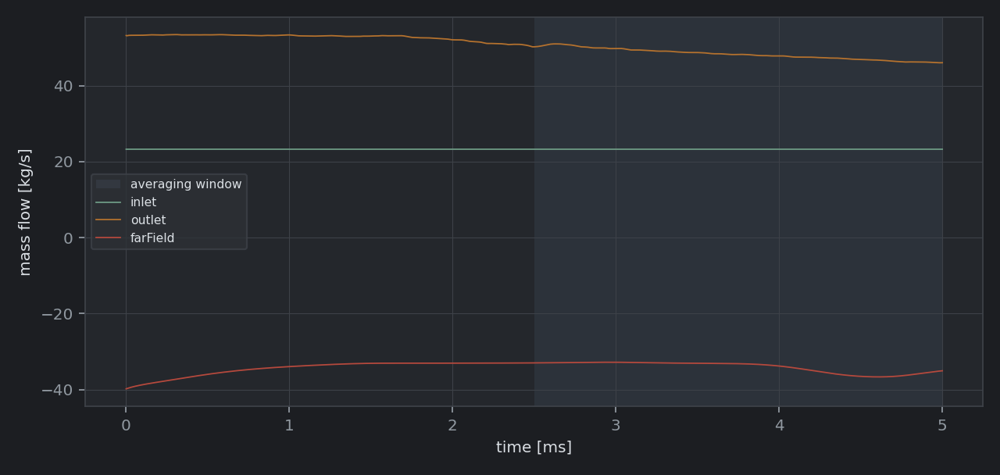
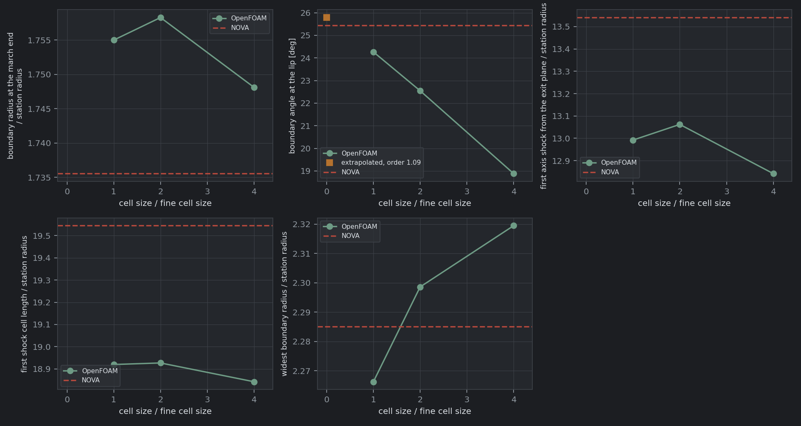

# NOVA Plume in OpenFOAM

An axisymmetric Euler solution of the exhaust plume of NOVA's shipped nozzle in OpenFOAM, run as a cross-check of NOVA's two plume outputs: the station march that solves the boundary and interior for two lip radii past the exit plane, and the correlations that place the shock cell length, the widest boundary and the first shock on the axis. The nozzle's interior is a separate case, described in [README.md](README.md).

## Contents

- [Summary](#summary)
- [What the case solves](#what-the-case-solves)
- [Running it](#running-it)
- [What is compared](#what-is-compared)
- [Acceptance criteria](#acceptance-criteria)
- [Results](#results)
- [Findings](#findings)
- [NOVA defects this comparison found](#nova-defects-this-comparison-found)
- [Validation status](#validation-status)
- [References](#references)
- [Files](#files)

## Summary

Within its shipped reach of two station radii, NOVA's station march agrees with the Euler solution. On the fine grid the march's boundary sits 1.1 percent of radius inside OpenFOAM's on average. The worst station, 2.1 percent, is the first, one fine cell from the lip. The field Mach number agrees to 1.0 percent at the 95th percentile, and the boundary angle at the lip to 0.35 degree once the grid error is extrapolated out. Two of those three miss their criteria on the fine grid itself (2.08 percent against 2.0, and 1.17 degrees against 1.0), by margins that shrink by a factor of 1.8 to 2.5 with each halving of the cell size. Marched on to 10 station radii, the march follows OpenFOAM's axis to within 0.51 percent past the arrival of the lip's expansion, and its boundary to 2.3 percent at 6 station radii, while its own mass flow falls 17 percent.

The correlations hold everywhere but the boundary's first neck. The first shock cell is 18.92 station radii long against Prandtl's 19.55 (+3.3 percent) and Pack's 18.26 (-3.5 percent). The correlated boundary's widest radius, 2.29 station radii, is 0.8 percent wider than OpenFOAM's; its first neck is 13.0 percent narrower. The jet's barrel shock reflects from the axis at 12.99 station radii with no Mach disk on any grid. NOVA judges this jet below the Mach disk onset for its exit Mach number and places a regular reflection at 13.54 station radii, 4.2 percent downstream. The steadiness criteria fail on the open ambient, which settles over tens of milliseconds and trades mass through the far field; the jet itself is steady, its shock reflection varying by 0.09 station radii over the averaging window.

The case found eight defects in NOVA's plume, corrected before the results here were taken; see [NOVA defects this comparison found](#nova-defects-this-comparison-found). The largest started the march 1.7 percent of the lip radius inside the wall, with 4.7 percent of the nozzle's mass flow left out. Starting from the full exit plane, with the corrected kernel behind it, lengthens the plume's structure by 3.2 to 4.1 percent in meters and 1.1 to 2.0 percent in station radii; see [Sensitivity to the starting station](#sensitivity-to-the-starting-station). OpenFOAM and NOVA are both unvalidated for this flow, so the agreement is a cross-check, not a validation; see [Validation status](#validation-status).

## What the case solves

The problem NOVA's station march solves, from the station it starts on: the Euler equations for a calorically perfect gas at NOVA's chamber ratio of specific heats, from the exit station NOVA hands its march, into a still ambient at the shipped pressure. The march is isentropic and carries no shock; the case captures the shocks. A difference between the two within the march's reach is a difference of method, because the starting data and the physics are identical.

| Item | Setting |
| --- | --- |
| Nozzle and plume | `src/NOVA/assets/NOVANozzle.json`: the nozzle of [README.md](README.md), with `plumeAmbientPressure` 5000 Pa and `plumeFieldReach` 2 lip radii |
| Gas | NOVA's chamber values, as in the nozzle case: gamma = 1.147542, R = 656.596 J/kg K, T0 = 3398.37 K, P0 = 6.895 MPa |
| Inflow | NOVA's march exit station, which is the nozzle's exit plane: 121 points from the axis to the 0.31922 m lip radius; Mach 4.1935 on the axis to 3.7802 at the lip, flow angle 0 to 9.05 degrees. Each inlet face takes the station's Mach number and angle at its radius, with p and T from the isentropic relations; every field fixed, since the flow is supersonic |
| Base | The exit plane outside the station radius; slip wall |
| Ambient | 5000 Pa and 216.65 K, the exhaust gas at rest |
| Far field and outlet | 8 station radii out (2.554 m) and 30 downstream (9.577 m). Pressure `waveTransmissive`, relaxing toward 5000 Pa over the domain's radius and length; velocity `pressureInletOutletVelocity` at the far field and `inletOutlet` at the outlet; temperature `inletOutlet` at the ambient's |
| Mesh | 5 degree wedge, six blocks in three radial bands. Square cells of one Nth of the station radius out to 4 station radii downstream and 3 out, growing to 4 times that size at the outlet and 6 times at the far field. N = 10, 20 and 40 (7680, 30720 and 123072 cells) |
| Solver | `rhoCentralFoam` (OpenFOAM v2606, ESI): Kurganov-Tadmor central fluxes, Minmod limited reconstruction, explicit Euler in time, `maxCo 1.0` |
| Initial field | Coarse grid: the ambient, with a column of the station's flow at ambient pressure inside the station radius along the whole domain. Medium and fine: the next coarser grid's solution, mapped |
| Run | Coarse 60 ms, medium 10 ms, fine 5 ms of physical time; fields averaged over the second half of each run |

Six details of the setup matter to the numbers.

**The case starts from NOVA's station, which is the nozzle's exit plane.** NOVA's march starts from the contour's exit-plane profile, wall to axis, the profile the nozzle case compares against at its outlet. The station carries 23.252 kg/s against the 23.256 kg/s NOVA reports for its nozzle, 0.015 percent less, and the case's inflow carries the station's mass flow to 0.005 percent. Both methods start from the same data.

**The ambient's temperature does not change the jet.** A steady inviscid jet meets its ambient at a contact surface across which only the pressure must match, so the ambient's temperature and composition only mark where the jet ends. It is the standard atmosphere's 216.65 K, near the altitude where pressure is 5 kPa, in the exhaust gas. What it does set is the ambient's sound speed, 408 m/s, which sets how slowly the ambient settles.

**The open boundaries pass waves rather than hold a pressure.** With the far field held at the ambient's total pressure, which reflects every wave back into the domain, the mass through it swung from 630 kg/s outward to 90 kg/s inward between 4.7 and 7.6 ms of the first sizing run, thirty times the jet's own flow. That is the still ambient, 5 m across and cold, ringing in its first radial acoustic mode, whose period for a cylinder of this radius with a pressure-release wall is about 16 ms. `waveTransmissive` lets outgoing waves leave at the local wave speed and relaxes the pressure toward the ambient's over the domain's own size. The start-up still disturbs the ambient: on the coarse grid its pressure beyond 5 station radii reads 11.6 percent high at 4 ms and 10.9 percent low, 4450 Pa, at 8 ms; it stays within 2 percent of 5000 Pa from 24 ms on and reads 5012 Pa at 60 ms. The coarse grid runs 60 ms for that reason, and each finer grid starts from the settled solution of the one before it.

**The limiter is Minmod, not van Leer.** Where the barrel shock meets the axis, van Leer's limiter, which the nozzle case uses, drives the axis cells past the gas's limiting velocity of 5893 m/s (to 6640 m/s in the run that failed) and the temperature negative, at a Courant number of 1.0 and of 0.5 alike. Minmod, the most dissipative of the TVD limiters, runs through. It smears the shocks and the contact surface over more cells; the grid study measures what that costs.

**The coarse grid starts from a column of exit flow at ambient pressure.** Started from rest, the jet's head takes about 10 ms to cross the domain, because the expanded jet is much lighter than the cold ambient it pushes aside. A column of the station's flow inside the station radius puts the jet's core in place from the first step. At the station's own pressure, two to five times the ambient's, the column expands radially as a blast; at ambient pressure, moving axially at the station's speed and temperature, it carries no radial pressure difference. With van Leer's limiter the run failed from rest, from a column at the station's pressure and from one at ambient pressure alike, so the start-up sets how long the run takes rather than whether it survives.

**The jet boundary is a total temperature contour.** Total temperature is conserved along streamlines of an inviscid adiabatic flow, so it is the chamber's 3398 K inside the jet and the ambient's 216.65 K outside. The case smears the contact surface between them over a few cells. The boundary is taken where total temperature is halfway between the two, and the radii where it is 10 and 90 percent of the way give the width of the smeared layer.

## Running it

The case is written and run the way the nozzle case is; see [README.md](README.md#running-it) for the environment.

1. Write the three cases. The first call solves NOVA with its plume (about two minutes), marches it a second time to 10 lip radii, and writes `reference/novaPlume.json`; later calls reuse it until `--refresh` is passed.

   ```bash
   python validation/openFoam/makePlumeCase.py --resolution coarse --writes 15
   python validation/openFoam/makePlumeCase.py --resolution medium --writes 10
   python validation/openFoam/makePlumeCase.py --resolution fine --writes 10
   ```

2. Copy them into the Linux file system and run the coarse grid, then each finer grid from the one before it. Each `Allrun` meshes, writes the inflow (and on the coarse grid the starting column), runs on four processors, reconstructs the last write and runs the comparison, which it logs to `log.python3.compare`. On four processors the coarse grid's 60 ms take 8 minutes, the medium grid's 10 ms 15 minutes and the fine grid's 5 ms 87 minutes.

   ```bash
   cp -r /mnt/c/.../NOVA/validation/openFoam/cases/novaPlume2D-* ~/foam/
   cd ~/foam/novaPlume2D-coarse && ./Allrun
   cd ~/foam/novaPlume2D-medium && ./Allrun ../novaPlume2D-coarse
   cd ~/foam/novaPlume2D-fine && ./Allrun ../novaPlume2D-medium
   ```

3. Run the grid study across the three; `--output` names the folder for its JSON and figure:

   ```bash
   cd ~/foam
   python3 novaPlume2D-fine/scripts/plumeGridConvergence.py novaPlume2D-coarse novaPlume2D-medium novaPlume2D-fine --output plumeGridStudy
   ```

Each case's `comparison/` folder holds `comparison.json` and the figures.

## What is compared

| Quantity | OpenFOAM | NOVA |
| --- | --- | --- |
| Jet boundary | The 50 percent total temperature contour, column by column, from the averaged fields | `PlumeField.boundaryX`, `boundaryR`: the march's free boundary, one point per station |
| Boundary angle at the lip | Straight-line fit to the boundary over the first half station radius | The same fit to the march's boundary; and the Prandtl-Meyer turn from the lip Mach number to the boundary Mach number, added to the lip's wall angle |
| Interior field | Cell values interpolated linearly to each march node inside 0.9 of the march's boundary radius | Mach number, pressure and flow angle at every node of the march's 132 stations of 121 points |
| Axis | Line sample on the axis | The march's axis nodes |
| First shock on the axis | The steepest fall in axis Mach number ahead of the first subsonic stretch, or ahead of the first minimum when the reflection is regular | `PlumeStructure.axisShockX`. Above the Mach disk onset, Pe / Pa against the exit Mach number from Smith and Richards' simulations [7], a Mach disk at Lewis and Carlson's x / De = 0.69 Me sqrt(gamma Pe / Pa) [8]; below it, a regular reflection at Smith and Richards' x / Re = sqrt(Me^2 - 1) Pe / Pa [7] |
| Mach disk diameter | Twice the radius of the subsonic region a tenth of a station radius behind the disk; zero for a regular reflection | `machDiskDiameter`: Smith and Richards' D / De = 0.6 sqrt(Pe / Pa - onset), zero below the onset [7] |
| First shock cell | Exit plane to the boundary's first neck | `shockCellLength`: Prandtl, 1.306 Dj sqrt(Mj^2 - 1), with Tam and Tanna's fully expanded diameter [3, 4]; and `cellLengthPack`, Pack's coefficient of 1.22 |
| Widest boundary | The boundary's first maximum | The correlated boundary's maximum: a sinusoid of the cell length about the fully expanded jet's radius, decaying over four cells |

NOVA evaluates its correlations at the chamber ratio of specific heats, 1.1475, the gas its march and this case run in, from the one-dimensional exit state at the nozzle's area ratio of 40 in that gas: Mach 3.954 and 17699 Pa, a ratio of 3.54 to the ambient. `makePlumeCase.py` re-evaluates each correlated scalar with NOVA's own functions (`plume.fullyExpandedDiameter`, `shockCellLength`, `machReflectionOnset`, `supersonicMachDiskLocation`, `regularReflectionLocation`, `gasDynamics.machFromPressureRatio`, `prandtlMeyerAngle`) as a check on the reported values, and the two agree.

## Acceptance criteria

Every limit is a relative difference of NOVA against OpenFOAM unless stated, and every limit was fixed in `comparePlume.py` and `plumeGridConvergence.py` before the first run. Three sizing runs on the coarse grid then settled the boundary conditions, the start-up and the limiter described above; none of them changed a limit or a measurement.

| Criterion | Limit | Basis |
| --- | --- | --- |
| Boundary radius, worst march station | 2.0 % | The boundary is what the march exists to produce; 2 percent of radius is 4 percent of area |
| Field Mach, 95th percentile over march nodes inside 0.9 of its boundary | 2.0 % | As for the nozzle |
| Boundary angle over the first half station radius | 1.0 degree | The lip's expansion fan, which sets everything downstream |
| Where the first shock meets the axis | 10 % | Mach disk location coefficients span 5 percent across sources; the same limit holds a regular reflection |
| Mach disk diameter | 25 % | Less certain than the location; a disk both solutions leave out passes |
| First shock cell length | 10 % | Prandtl's and Pack's coefficients differ by 7 percent |
| Mass imbalance, inflow against outflow, window means | 0.2 % | Steady state; the open boundaries exchange mass with the ambient, which the nozzle's walls do not |
| Drift of the outlet mass flow, second half of the window against the first | 0.1 % | Steady state |
| Boundary radius at the end of the march, medium grid against fine | 0.5 % | Grid convergence |
| First shock on the axis, medium grid against fine | 2.0 % | Grid convergence |

## Results

Lengths are in station radii, measured from the exit plane; the station radius is the lip radius, 0.31922 m. The figures are the fine grid's. Each grid's full comparison is in `results/plume/<grid>/comparison.txt` and `comparison.json`, and the grid study in `results/plume/plumeGridConvergence.json`.

### Criteria

On the fine grid:

| Criterion | NOVA against OpenFOAM | Limit | Result |
| --- | --- | --- | --- |
| Boundary radius, worst march station | 2.08 % | 2.0 % | Fail |
| Field Mach, 95th percentile | 1.01 % | 2.0 % | Pass |
| Boundary angle over the first half station radius | 1.17 degrees | 1.0 degree | Fail |
| Where the first shock meets the axis | +4.2 % (a regular reflection in both) | 10 % | Pass |
| Mach disk diameter | None in either | 25 % | Pass |
| First shock cell length | +3.3 % | 10 % | Pass |
| Mass imbalance | -39.3 % | 0.2 % | Fail |
| Drift of the outlet mass flow | -4.8 % | 0.1 % | Fail |
| Boundary radius at the end of the march, medium grid against fine | 0.19 % | 0.5 % | Pass |
| First shock on the axis, medium grid against fine | 0.54 % | 2.0 % | Pass |

### Grid convergence

| Quantity | Coarse | Medium | Fine | Observed order | Extrapolated | GCI | NOVA |
| --- | --- | --- | --- | --- | --- | --- | --- |
| Boundary radius at the end of the march | 1.7481 | 1.7583 | 1.7550 | oscillatory | | 0.08 % | 1.7355 |
| Boundary angle at the lip [deg] | 18.88 | 22.55 | 24.27 | 1.09 | 25.79 | 7.8 % | 25.44 |
| Reflection on the axis | 12.84 | 13.06 | 12.99 | oscillatory | | 0.23 % | 13.54 (regular reflection) |
| Mach disk diameter | none | none | none | | | | none |
| First shock cell length | 18.84 | 18.93 | 18.92 | oscillatory | | 0.02 % | 19.55 (Prandtl); 18.26 (Pack) |
| Widest boundary radius | 2.320 | 2.299 | 2.266 | -0.63 | | 0.60 % | 2.285 |

An oscillatory sequence, or one whose change grows with refinement, has no observed order; it gets no extrapolation, and its index is taken at a formal second order. The boundary where the march ends, the reflection and the first cell's length settle to 0.19, 0.54 and 0.04 percent between the medium and fine grids. The widest boundary radius narrows by more with each refinement, so its grids are outside the asymptotic range, and its fine value carries an error of order its last change, 1.4 percent. The first neck's radius narrows from 1.443 to 1.380 to 1.322 station radii, by about the same amount each time, so it has not converged either.

The near field converges toward the march:

| Grid | Cells | Boundary, mean / worst station | Field Mach, p95 | Field pressure, p95 | Field flow angle, p95 | Lip angle | Contact layer at the end of the march |
| --- | --- | --- | --- | --- | --- | --- | --- |
| Coarse | 7680 | 1.5 / 6.7 % | 4.2 % | 31 % | 3.35 deg | 18.88 deg | 0.45 |
| Medium | 30720 | 1.2 / 3.8 % | 1.9 % | 17 % | 1.64 deg | 22.55 deg | 0.28 |
| Fine | 123072 | 1.1 / 2.1 % | 1.0 % | 7.6 % | 0.73 deg | 24.27 deg | 0.18 |

The worst-station boundary difference falls by a factor of 1.8 per halving, at an observed order of 0.76, and extrapolates to -0.4 percent, which is zero within the extrapolation's own uncertainty. The mean holds near 1 percent: the 50 percent contour at the end of the march has converged to 0.19 percent, and the march's boundary sits 1.1 percent inside it.





### Near field

The worst boundary difference, 2.08 percent, is at the march's first station, 0.018 station radii from the lip and inside the first fine cell, where OpenFOAM's contact layer is still forming; it falls to 1.6 percent by 0.06 station radii, and past 0.1 station radii the worst is 1.24 percent. The largest field differences lie in a band 0.2 to 0.35 station radii inside the boundary, from about 0.4 station radii downstream: the barrel shock forming. Both solutions carry a Mach peak and a compression there. At the end of the march OpenFOAM's pressure rises from 0.43 to 0.66 of ambient between 1.39 and 1.54 station radii, while the march's rises from 0.34 to 0.56 between 1.48 and 1.52, with its Mach number dropping from 5.09 to 4.84. The Minmod scheme spreads the compression over about six cells and starts it inward of the march's steeper one, so along the band's inner edge the two Mach numbers differ by up to 4.4 percent and the pressures by up to 38 percent. Away from the band the two agree to a few tenths of a percent.

The lip angle measures the first half station radius of the fan. OpenFOAM's rises from 18.9 to 24.3 degrees with refinement and extrapolates to 25.79 degrees, against the march's 25.44; the grid convergence index of 7.8 percent (2.0 degrees) bounds that agreement. The march's own first segment leaves at 17.9 degrees. The Prandtl-Meyer turn from the lip Mach number of 3.780 to the boundary Mach number of 4.559 is 19.0 degrees, which with the lip's wall angle of 9.0 degrees puts the boundary's slope at the lip itself at 28.0 degrees; the boundary bends back toward the axis within the first cells.



### Structure

On the axis the march and OpenFOAM agree to 0.01 percent within 2 station radii and to 0.07 percent within 3. The lip's expansion reaches the axis there, and the two solutions take it differently: OpenFOAM's axis Mach number starts to rise at 2.8 station radii and is 1 percent up by 3.9, while the march holds the station's Mach number to 4.2 and is 1 percent up by 4.4. The difference peaks at 2.9 percent at 4.3 station radii; by 5.2 both have risen 10 percent, and from there to the end of the march at 10 station radii they agree to 0.51 percent. The Mach number on the axis rises to 6.16 at 12.9 station radii and falls to 2.79 across the reflected shock, with no subsonic cell on any grid.

The boundary widens to 2.27 station radii at 8.2 and narrows to its first neck, 1.32 station radii, at 18.9. NOVA's correlated boundary, a decaying sinusoid about the fully expanded jet's radius of 1.68 station radii, peaks at 2.29 station radii at 9.6 and narrows to 1.15 at 19.4.





| Structure | OpenFOAM, fine grid | NOVA | NOVA against OpenFOAM |
| --- | --- | --- | --- |
| First shock on the axis | 12.99 (regular reflection) | 13.54 (regular reflection) | +4.2 % |
| Mach disk diameter | none | none | |
| First shock cell length | 18.92 | 19.55 (Prandtl); 18.26 (Pack) | +3.3 %; -3.5 % |
| Widest boundary radius | 2.266 | 2.285 | +0.8 % |
| First neck radius | 1.322 | 1.150 | -13.0 % |
| Boundary angle at the lip [deg] | 24.27 (25.79 extrapolated) | 25.44 (march fit); 28.02 (Prandtl-Meyer, at the lip itself) | |

### Sensitivity to the starting station

The same three grids were run from the station NOVA's march used before its correction (commit `0ab642f`): the rows of the characteristic mesh that cross the exit plane, ending at 0.31270 m, 0.9826 of the lip radius, and carrying 21.76 kg/s from the uncorrected kernel. On the fine grid:

| Quantity | Cut station, 0.31270 m | Full exit plane, 0.31922 m | Difference in meters | Difference in station radii |
| --- | --- | --- | --- | --- |
| Reflection on the axis [m] | 4.0001 | 4.1474 | +3.7 % | +1.6 % |
| First shock cell length [m] | 5.8527 | 6.0396 | +3.2 % | +1.1 % |
| Widest boundary radius [m] | 0.69491 | 0.72343 | +4.1 % | +2.0 % |
| Boundary at the end of the march [station radii] | 1.7337 | 1.7550 | | +1.2 % |

The station radius grows 2.1 percent, and that much of each change in meters is the jet's scale. The rest, 1.1 to 2.0 percent in station radii, belongs to the starting profile: the full exit plane carries 6.9 percent more mass than the cut station, of which its area accounts for 4.2 percent, and the corrected kernel lowers the core's Mach number from 4.2033 to 4.1935. The comparison changes the station's edge and the kernel at once, so it measures their combined effect and does not separate them. The fine-grid criteria that compare the march with OpenFOAM moved by less than their grid uncertainty: the worst boundary station from 2.04 to 2.08 percent and the field Mach number's 95th percentile from 0.99 to 1.01 percent.

### Steadiness

The inflow carries 23.2511 kg/s against the march station's 23.2523, a difference of 0.005 percent, and holds it to machine precision. The jet's structure is steady; the ambient is not. On the fine grid 34.1 kg/s enters through the far field and 48.2 kg/s leaves through the outlet, so the domain gains 9.1 kg/s, 39 percent of the jet's flow. That is 0.36 percent of the domain's 6.3 kg of gas over the 2.5 ms window, about 18 Pa of ambient pressure. To meet the 0.2 percent criterion the ambient's pressure would have to change by less than 0.7 percent per second, which an ambient with a 16 ms acoustic period, disturbed by the start-up, does not reach in tens of milliseconds. The criterion suits the nozzle's closed walls more than an open ambient.

The flow in through the far field is entrainment. An inviscid jet entrains nothing, but the smeared contact layer drags ambient gas along with the jet, and the far field replaces it; on the coarse grid the ambient beyond 5 station radii moves at about 18 m/s. It is 31 kg/s on the coarse grid, 67 on the medium and 34 on the fine, following the ambient's settling more than the grid. The boundary pressure averages 1.4 percent from ambient on the fine grid, 6.7 percent on the coarse.







## Findings

**The march matches the Euler solution within its reach.** Inside two station radii every difference between the march and OpenFOAM falls with refinement: the worst boundary station from 6.7 to 2.1 percent, the field Mach number's 95th percentile from 4.2 to 1.0 percent, and the lip angle's difference from 6.6 to 1.2 degrees, with the extrapolated angle 0.35 degree from the march's. The two criteria that fail on the fine grid fail by less than the grid's own error.

**The march's boundary holds past its reach.** Past two station radii its mass flow drifts (-6.4 percent at 4 station radii, -17 at 6, -35 at 8), as NOVA's trust limit says, yet its boundary stays within 1.0 percent at 4 station radii and 2.3 percent at 6, and its axis within 0.51 percent to 10 once the expansion has arrived. The drift belongs to the interior field near the boundary; the boundary's position and the axis hold much longer. A trust limit set on the boundary alone could reach about 6 station radii.

**The first shock reflects from the axis without a resolved disk, where NOVA places it.** At an exit Mach number of 3.95 the exit pressure ratio, 3.54, is under half the 7.31 at which Smith and Richards' simulations form a Mach disk [7], so NOVA reports a regular reflection, at 13.54 station radii by their equation 8, against OpenFOAM's 12.99. Their simulations are uniform, parallel jets at gamma = 5/3, where this exit is non-uniform, 9 degrees divergent at the lip, and at gamma = 1.1475; the 4.2 percent is one point of agreement, not a check of the relation at this gamma. Inviscid theory does not allow a converging conical shock to reflect regularly from the axis [6], so a disk is expected in principle; the case resolves none, which puts any disk below the grid's resolution at the reflection, about 0.05 station radii axially and 0.025 radially. A regular reflection here, in OpenFOAM's sense and in Smith and Richards', is a disk too small to resolve.

**The shock cell correlations bracket the case.** Prandtl's first-term coefficient puts the first cell 3.3 percent long and Pack's 40-term coefficient 3.5 percent short, at the chamber gas and with Tam and Tanna's fully expanded diameter. NOVA reports Prandtl's and lists Pack's beside it; the spread between them, 7 percent, is a fair measure of the correlation's uncertainty here.

**The correlated boundary gets the width and misses the neck.** The sinusoid about the fully expanded jet's radius puts the widest radius 0.8 percent from OpenFOAM's, 1.4 station radii downstream of it, and the first neck 13.0 percent narrow, 0.5 station radii downstream. The neck's comparison carries the grid's error: OpenFOAM's neck narrows by about 4 percent with each halving of the cell size. The sinusoid does not reproduce the lip turn, which the real boundary makes within a fraction of a cell; near the lip the march's boundary is the better output.

## NOVA defects this comparison found

The comparison was first run against a version of NOVA whose march started short of the wall. It exposed eight defects in NOVA's plume, each corrected in NOVA; the results above are against the corrected solver, and [Sensitivity to the starting station](#sensitivity-to-the-starting-station) compares the two starting stations.

- **The march started short of the wall.** `plume.plumeExitLine` read the exit plane from the rows of the characteristic mesh that cross it, and the outermost row crosses at 0.9826 of the lip radius. The station carried 3.5 percent less area than the exit plane and 21.76 kg/s against the 22.83 kg/s NOVA then reported for its nozzle, 4.7 percent less. The march starts from the contour's exit-plane profile, wall to axis, which `PlumeContour` carries when the plume is driven from a `Nozzle`; the crossings remain the fallback for a contour without a profile.
- **The correlations used a different gas from the march.** `plume.solvePlumeStructure` took CEA's exit ratio of specific heats, 1.257, while the march ran at the chamber's 1.1475; the reported shock cell was 14 percent longer and the lip turn 2.8 degrees larger than the chamber gas gives. The correlations take the contour's chamber gas.
- **The fully expanded jet took the thermochemistry's exit Mach number.** That Mach number belongs to a different area ratio in the contour's gas, and shrank the shipped nozzle's fully expanded jet from 1.074 m to 0.852 m when the plume was driven from a `Nozzle`. The jet's diameter takes the exit Mach number the area ratio gives in the contour's gas.
- **An amplitude cap set the correlated boundary's width.** The boundary was a sinusoid about the lip radius anchored to the lip turn angle, which needs an amplitude of 1.7 lip radii on this nozzle; NOVA held it at 0.95 of the lip radius to keep it off the axis, so the cap set the widest radius 13 percent narrow and carried the first neck to a fifth of the lip radius. The boundary oscillates about the fully expanded jet's radius, as Tam's shock-cell model has it; the floor that remains binds only for a strongly overexpanded jet.
- **The Mach disk was judged as behind a sonic exit.** NOVA decided a disk formed from the nozzle pressure ratio, 1379 against the sonic onset of 3.5, and placed it by Ashkenas and Sherman's sonic-nozzle fit [1] at 7.92 station radii, where NOVA's own march, run to 10 station radii, passes with the axis Mach number at 5.36 and rising, in agreement with OpenFOAM. The diameter fit [2] gave 9.22 station radii, twice the jet's widest diameter. Behind a supersonic exit the switch is the exit pressure ratio against an onset that rises with exit Mach number [7], and the disk's position scales on the exit diameter and state [8]; NOVA judges and places the first axis shock that way.
- **The exit Mach number and pressure came from the thermochemistry.** `PlumeStructure.exitMach` and `exitPressure` were CEA's equilibrium exit values, Mach 4.223 and 13993 Pa, where the contour's gas at the same area ratio gives Mach 3.954 and 17699 Pa. They set the jet type, the separation warning and the Mach disk switch. They are the one-dimensional state at the area ratio in the contour's gas, and `PlumeContour` carries nothing from the thermochemistry.
- **The throat was read off the resampled wall.** The shipped wall has 100 points from the injector face to the exit, and its smallest radius sits 0.6 percent outside the throat, which read the area ratio as 39.5 against 40 and widened the fully expanded jet by 0.6 percent. The structure takes the throat radius from the contour's scaling factor.
- **`PlumeField.lipTurnAngle` was never set.** It was declared with a default of 0.0, and `examples/novaNozzle.py` printed a lip turn of 0.00 degrees. It carries the Prandtl-Meyer turn from the station's lip Mach number to the boundary's, 0.3317 rad (19.0 degrees) on the shipped nozzle.

## Validation status

The case is a cross-check between two unvalidated tools, not a validation. Neither OpenFOAM's `rhoCentralFoam` with this mesh, limiter and boundaries nor NOVA's march has been compared here with a measured underexpanded jet or an exact solution of one. Their agreement within the march's reach shows that the two methods, from the same starting data and under the same physics, produce the same near field; it does not show that either matches a real jet. Both solve the Euler equations, so neither carries the turbulent mixing layer that thickens a real plume's boundary. The correlations are the opposite case: each is a fit to measurements or simulations, which NOVA applies outside the conditions they were fitted to. The Mach disk onset and the regular reflection's position come from simulations at gamma = 5/3, and Lewis and Carlson's disk position from nozzles up to exit Mach 2.9.

Sanity checks in place of a validation:

- Mass: the inflow carries the march station's mass flow to 0.005 percent, and the station carries the nozzle's to 0.015 percent.
- Limiting case: on the axis, upstream of where the lip's expansion arrives, both solutions hold the station's Mach 4.1935 to 0.01 percent.
- Grid convergence: three grids at a refinement ratio of 2, with both grid criteria met and the near-field differences falling toward zero with refinement.
- Steadiness of the jet: the shock reflection's position varies by 0.09 station radii over the averaging window. The ambient fails the steadiness criteria, for the reasons in [Steadiness](#steadiness).

Closing the gap needs a measured supersonic underexpanded jet run through the same setup. The axisymmetric free jets of Love et al. [5] give jet boundaries and shock positions for supersonic nozzles at known exit Mach numbers and pressure ratios; agreement there, with this mesh, limiter and boundary treatment, would make the case a validation of the march's near field and a measured reference for the Mach disk.

## References

[1] Ashkenas, H., and Sherman, F. S.: *The Structure and Utilization of Supersonic Free Jets in Low Density Wind Tunnels*. Rarefied Gas Dynamics, 4th Symposium, vol. 2, Academic Press, 1966, pp. 84-105. x / D* = 0.67 sqrt(P0 / Pa), fitted to sonic orifices and nozzles; see `docs/references_plumeStructure_2026-09-04.md`.

[2] *Mach-Disk Formation and Shock-Structure Transitions in Underexpanded Coflowing Jets*. arXiv:2608.18923, <https://arxiv.org/html/2608.18923>. D_MD / De = 1.78 log10(NPR) - 0.98, fitted to coflowing jets.

[3] Powell, A.: *On Prandtl's Formulas for Supersonic Jet Cell Length*. International Journal of Aeroacoustics, vol. 9, no. 1-2, 2010, p. 207. Prandtl's 1904 first-term coefficient 1.306 and Pack's 40-term 1.22, for an almost perfectly expanded jet.

[4] Schindler, Castner and Zaman: *A Study of Highly Underexpanded Supersonic Jets in Subsonic Crossflow*. NASA/TM-20210024918, 2022, equation 6: Tam and Tanna's fully expanded jet diameter.

[5] Love, E. S., Grigsby, C. E., Lee, L. P., and Woodling, M. J.: *Experimental and Theoretical Studies of Axisymmetric Free Jets*. NASA TR R-6, 1959. <https://ntrs.nasa.gov/citations/19980228067>

[6] Courant, R., and Friedrichs, K. O.: *Supersonic Flow and Shock Waves*. Interscience, 1948. A conical shock with converging flow behind it cannot reflect regularly from the axis; as cited by Hew, J. K. J., Ogawa, H., and Boswell, R. W.: *Centreline Shock Reflection Phenomena for Supersonic Internal Flows in the Non-Rankine-Hugoniot Zone*, arXiv:2209.13453, 2022.

[7] Smith, M. D., and Richards, C.: *The Influence of Mach Number and Overpressure on the Structure of Supersonic Gas Jets*. Monthly Notices of the Royal Astronomical Society, vol. 526, no. 3, 2023, pp. 3407-3420. <https://doi.org/10.1093/mnras/stad2879>. Axisymmetric Euler simulations of uniform jets at gamma = 5/3: the Mach disk forms above Pe / Pa = 3.5 at Mach 2 and 7.4 at Mach 4 (equations 3 and 4), and at Mach 4.96, 5.52 and 7.20 for ratios of 12, 16 and 24; the first axis shock of a regular reflection at x / Re = sqrt(M^2 - 1) Pe / Pa (equation 8); the disk's radius (equation 6) and position (equation 9).

[8] Lewis, C. H., and Carlson, D. J.: *Normal Shock Location in Underexpanded Gas and Gas-Particle Jets*. AIAA Journal, vol. 2, no. 4, 1964, pp. 776-777. x / De = 0.69 Me sqrt(gamma Pe / Pa), from nozzles up to exit Mach 2.9; in jet radii it is equation 9 of [7].

## Files

| File | Purpose |
| --- | --- |
| `makePlumeCase.py` | Solves NOVA with its plume, writes `reference/novaPlume.json` and a case folder for one grid |
| `setPlumeInflow.py` | Writes NOVA's exit station into the inflow, and the starting column on the coarse grid; copied into each case |
| `comparePlume.py` | Compares a converged case with NOVA's march and correlations and judges the criteria; copied into each case |
| `plumeGridConvergence.py` | Richardson extrapolation and grid convergence index across the three grids; copied into each case with `gridConvergence.py`, whose estimate it uses |
| `compareWithNova.py` | The nozzle case's comparison, whose readers and figure style the plume comparison imports; copied into each case |
| `reference/novaPlume.json` | NOVA's plume: gas, exit station, the march at the shipped reach (every node) and at 10 lip radii (boundary, axis and mass flow), the correlated structure as reported and re-evaluated from NOVA's functions |
| `results/plume/` | The comparison of each grid, the fine grid's figures and the grid study |
